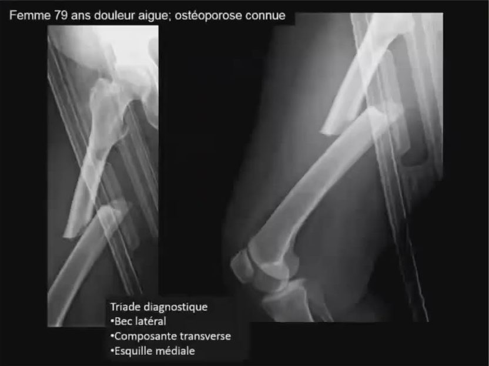
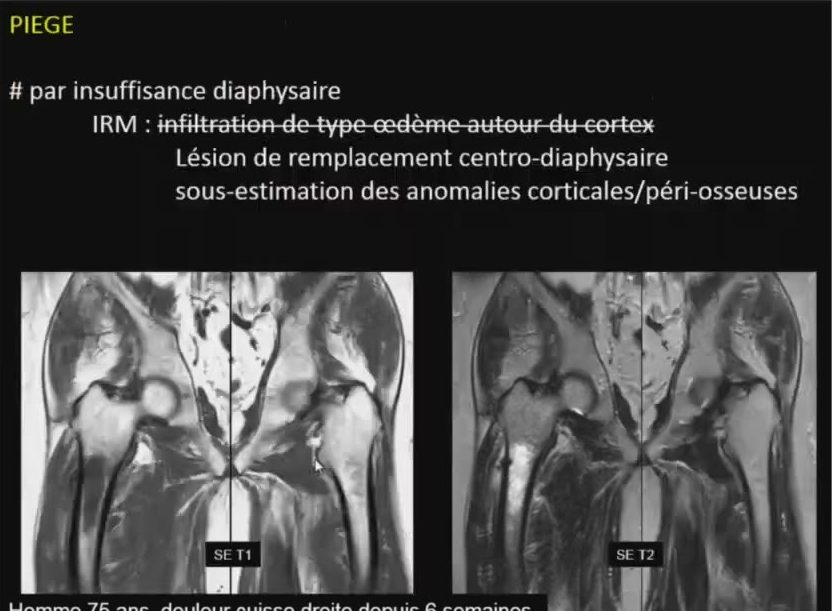
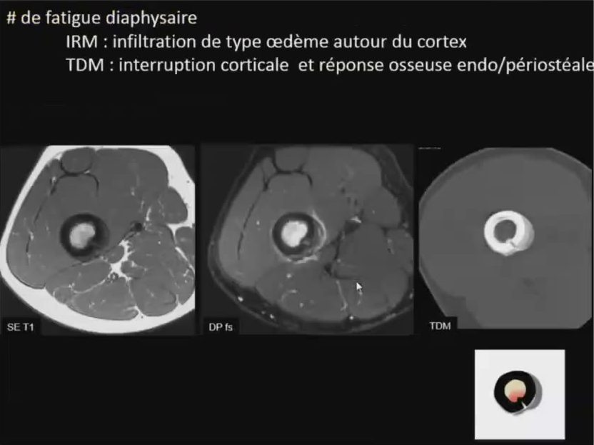

# Les fractures du tiers proximal de la diaphyse fémorale

> [!abstract] L'essentiel
> **Tiers proximal du fémur = contraintes maximales** : y traquer fatigue, insuffisance et fracture atypique, souvent mieux vues au **scanner** qu'en IRM.

> [!success] À retenir
> 1. Fracture atypique (bisphosphonates, mais **15-20 %** sans) : **triade bec cortical latéral + composante transverse + esquille médiale** ; toujours examiner le **fémur controlatéral**.
> 2. Piège IRM : la fracture par insuffisance mime une **lésion de remplacement centro-diaphysaire** (métastase, myélome) → scanner pour l'interruption corticale et le cal.
> 3. Fracture de fatigue : œdème **autour du cortex** en IRM, trait souvent **longitudinal** ; bulles de gaz dans le trait = micromobilité, pas infection.

## Images clés
 [▶ 8:29](https://www.youtube.com/watch?v=cYaYEnn7yac&t=509s)
 [▶ 5:55](https://www.youtube.com/watch?v=cYaYEnn7yac&t=355s)
 [▶ 4:25](https://www.youtube.com/watch?v=cYaYEnn7yac&t=265s)

## Points clés
- Territoire le plus latéral par rapport au vecteur du poids du corps : le bras de levier majore les contraintes, auxquelles s'ajoutent les contraintes dynamiques des muscles longs, parfois bi-articulaires.
- Persistance de moelle hématopoïétique : le diagnostic différentiel inclut toute la pathologie de la moelle rouge (infections, tumeurs).
- Les contraintes reçues par le réseau trabéculaire de l'extrémité proximale se transmettent à la corticale diaphysaire.
- Fracture de fatigue du sportif : radiographie normale au début, douleur souvent projetée à la cuisse, voire au genou ; le trait est fréquemment longitudinal.
- Fracture par insuffisance (résistance osseuse diminuée, contraintes normales) : il n'y a pas d'histoire clinique orientante. Terrain cité : sujets âgés, diabétiques, insuffisants rénaux chroniques dialysés, corticothérapie.
- Fracture atypique associée aux bisphosphonates : épaississement cortical préexistant (« bec »), trait transverse et saillie proximale. Elle siège presque toujours sur la face latérale de la diaphyse (le versant médial évoque plutôt l'ostéomalacie), rarement en distalité.
- Environ 15 à 20 % de ces patients n'ont jamais reçu de bisphosphonates.
- Les fractures atypiques sont souvent multiples, pluri-étagées, transverses, partielles et non déplacées. Elles évoluent peu, sont peu symptomatiques et consolident difficilement. Aux États-Unis, on pratique souvent un enclouage préventif.

## Sémiologie et technique d'imagerie
- IRM : hyposignal T1 médullaire, hypersignal T2 ou DP FS de part et d'autre de la corticale. Une anomalie des parties molles adjacentes indique un processus cortical plutôt que médullaire.
- Rechercher l'interruption corticale sur les séquences DP FS, STIR ou Dixon « eau ».
- Scanner préférable : remaniement focal linéaire et cal endosté et périosté, souvent déjà présents et invisibles en IRM. Il faut l'analyser en fenêtres adaptées, avec reconstructions MIP et comparaison controlatérale, car la corticale est physiologiquement irrégulière dans ce territoire.
- De petites bulles de gaz dans le trait traduisent une micromobilité et non une infection.
- Sur une fracture atypique opérée, relire le cliché postopératoire à la recherche de l'épaississement cortical préexistant.

## Pièges et diagnostics différentiels
- La fracture par insuffisance donne une large plage hypoT1/hyperT2 avec une anomalie corticale très discrète. Cet aspect oriente à tort vers un remplacement médullaire (métastase, myélome).
- Une zone graisseuse en « bouchon » à la jonction métaphyso-diaphysaire (« gouttière » de la cavité médullaire) donne des anomalies IRM de signification incertaine.
- Fracture atypique chronique : il y a très peu d'œdème en IRM, la fracture est donc difficile à reconnaître.
- Ne pas confondre avec un ostéome ostéoïde.

> [!WARNING] À ne pas manquer
> Une fracture par insuffisance méconnue évolue en quelques semaines vers une fracture transverse déplacée. Devant une fracture atypique, il faut toujours examiner le fémur controlatéral.

> [!TIP] Pour le compte rendu
> Préciser le siège (face latérale ou médiale), la nature du trait (longitudinal, transverse, partiel), la présence d'un cal et d'un épaississement cortical en « bec », et l'état du côté controlatéral. Évoquer explicitement une fracture atypique en cas de traitement par bisphosphonates.

## Liens
- Congrès : [[SIMS 2019 - Index]]
- Voir aussi : [[Œdème médullaire de la tête fémorale - quand contrôler]], [[Ostéome ostéoïde de la hanche]]
