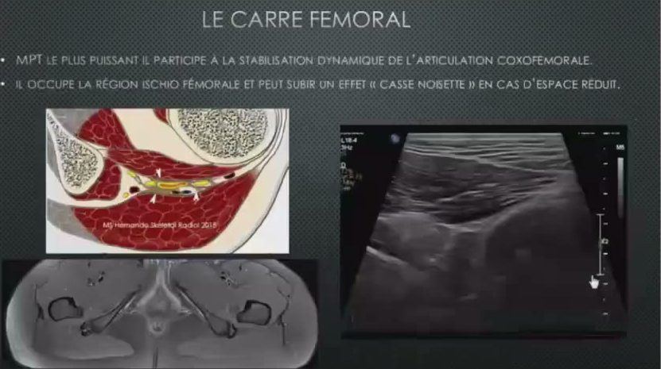
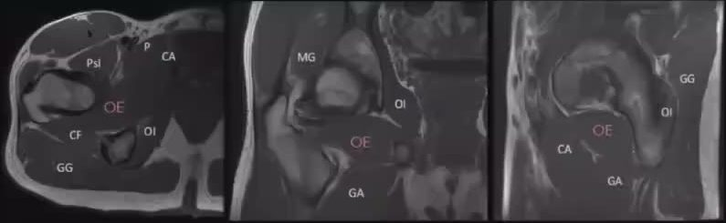
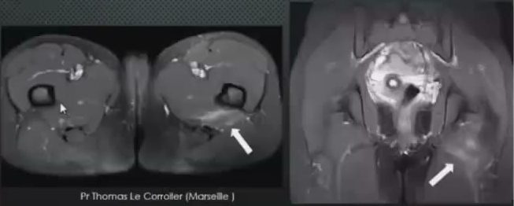

# Les lésions traumatiques rares des muscles pelvitrochantériens

> [!abstract] L'essentiel
> **Fessalgie ou « pubalgie » du jeune athlète après contraction excentrique : penser aux pelvitrochantériens et faire une IRM axiale T2 FS** : pronostic excellent.

> [!success] À retenir
> 1. Clinique **non spécifique** (douleur aux rotations) et écho souvent négative → **IRM précoce, coupes axiales T2 FS** : œdème/hématome, lésion partielle surtout du **tendon distal**.
> 2. **Carré fémoral** le plus touché (danse, gymnastique, **espace ischiofémoral réduit**) ; obturateur interne chez footballeur/escrimeur ; obturateur externe chez footballeur.
> 3. Reprise en **≈ 2 semaines** sous traitement conservateur, sans récidive ; chercher un **hématome au contact du nerf sciatique** si irradiation.

## Images clés
 [▶ 2:55](https://www.youtube.com/watch?v=wll5EQc9n-Q&t=175s)
 [▶ 3:14](https://www.youtube.com/watch?v=wll5EQc9n-Q&t=194s)
 [▶ 8:27](https://www.youtube.com/watch?v=wll5EQc9n-Q&t=507s)

## Points clés
- **6 muscles** (courts rotateurs latéraux) : 2 à insertion intrapelvienne (piriforme, obturateur interne) et 4 extrapelviens (jumeaux supérieur et inférieur, carré fémoral, obturateur externe). Rapports intimes avec le nerf sciatique (pince piriforme/obturateur interne, enroulement sur le carré fémoral), nombreuses variations et adhérences.
- **Piriforme** : biarticulaire (sacro-iliaque et coxofémorale), synchronise sacrum et ilium à la marche/course.
- **Complexe jumeaux–obturateur interne** (« triceps coxae ») : insertion commune ; l'obturateur interne se réfléchit à la sortie du petit bassin ; rôle dans la contre-nutation lors de l'accouchement.
- **Carré fémoral** : le plus puissant, stabilisateur dynamique ; peut être pincé dans un espace ischiofémoral réduit.
- **Obturateur externe** : le plus profond, ligne de force parallèle au col, coaptateur actif ; bourse supérieure pouvant communiquer avec l'articulation.
- **Terrain** : quasi exclusivement jeunes athlètes de haut niveau en période intense/compétition ; lésion souvent isolée.
- **Clinique peu spécifique** : de la douleur inguinale de type pubalgie à la fessalgie irradiant au genou ; majorée par les rotations passives et actives → diagnostic d'exclusion (adducteurs, glutéaux, ischio-jambiers, hanche, fracture de stress).
- **Mécanisme** : contraction excentrique contre résistance, mouvement de faible amplitude mais de forte énergie (grand battement en danse, sports multidirectionnels, crochet au rugby).
- **Répartition** : carré fémoral le plus fréquent (prépondérance féminine, gymnastique, danse, favorisé par un espace ischiofémoral réduit) ; complexe gemello-obturateur interne chez le footballeur et l'escrimeur (atteinte quasi exclusive de l'obturateur interne, pas de lésion décrite des jumeaux) ; piriforme (rugbyman) ; obturateur externe (footballeur, enthèse sur la branche ischiopubienne).
- **Pronostic** : récupération rapide sans séquelle ni récidive sous traitement conservateur ; reprise après environ **2 semaines**, soit la moitié du délai d'une lésion des ischio-jambiers.

## Sémiologie et technique d'imagerie
- **Échographie** de première intention pour les grands groupes musculaires ; classiquement négative pour ces muscles profonds, mais les sondes matricielles à forte pénétration permettent désormais de visualiser espace ischiofémoral, carré fémoral, obturateurs, piriforme et nerf sciatique.
- **IRM** : coupes **axiales T2 FS** les plus informatives ; œdème musculaire, hématome, désorganisation des fibres ; lésion généralement partielle, prédominant au **tendon distal**.
- Une IRM tardive (10–15 jours) peut manquer la lésion.

## Pièges et diagnostics différentiels
- Pubalgie, lésions des adducteurs/ischio-jambiers/glutéaux, pathologie coxofémorale, fracture de stress.
- Lésion du carré fémoral possible même avec un espace ischiofémoral normal (danseuse).
- Hématome au contact du nerf sciatique pouvant expliquer une fessalgie irradiée.

> [!WARNING] À ne pas manquer
> Échographie négative chez un athlète avec fessalgie ou douleur inguinale atypique post-effort : demander une IRM précoce, axiale T2 FS, centrée sur les pelvitrochantériens.

> [!TIP] Pour le compte rendu
> Nommer le muscle, la topographie (tendon distal, jonction myotendineuse, enthèse), le caractère partiel, l'hématome, le rapport au nerf sciatique et la mesure de l'espace ischiofémoral.

## Liens
- Congrès : [[SIMS 2019 - Index]]
- Voir aussi : [[Le conflit ischiofémoral en 2019]], [[Les syndromes de la traversée pelvifémorale]], [[Surutilisation et fractures de stress de la ceinture pelvienne]]
