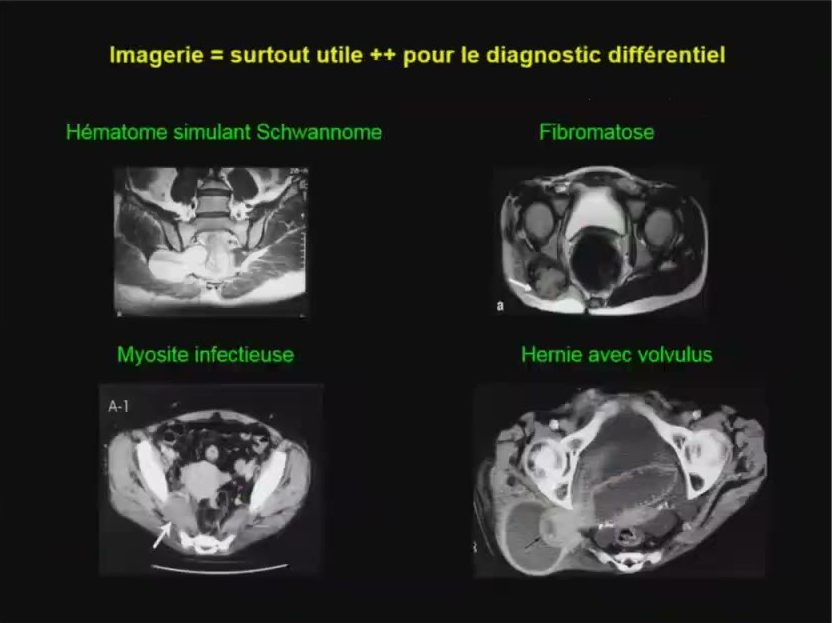
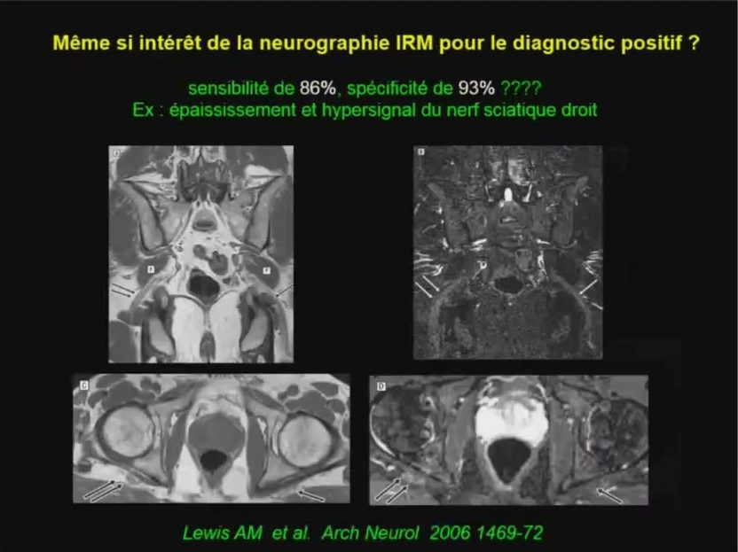
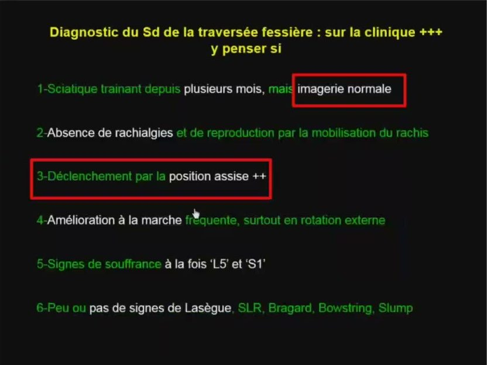

# Les syndromes de la traversée pelvifémorale

> [!abstract] L'essentiel
> **Sciatique ou pygalgie traînante à imagerie normale, déclenchée par la position assise : penser traversée pelvifémorale** ; diagnostic clinique, l'imagerie sert au différentiel.

> [!success] À retenir
> 1. Mécanisme = **traction** sur un nerf sciatique fixé par des **adhérences fibreuses** (souvent 2 sites : rachis + fesse), invisibles en IRM.
> 2. Y penser si : **imagerie normale**, pas de rachialgie, **position assise ++** (conduite > 30 min → improbable), soulagement à la marche en rotation externe, Lasègue pauvre.
> 3. IRM : éliminer schwannome, fibromatose, hématome, myosite, hernie ; neurographie IRM (Se **86 %**, Sp **93 %**) peu contributive ; neurolyse endoscopique ≈ **80 %** de bons résultats.

## Images clés
 [▶ 5:02](https://www.youtube.com/watch?v=x646HNnFoBU&t=302s)
 [▶ 5:25](https://www.youtube.com/watch?v=x646HNnFoBU&t=325s)
 [▶ 6:02](https://www.youtube.com/watch?v=x646HNnFoBU&t=362s)

## Points clés
- Analogue fessier du syndrome du défilé thoracobrachial ; pathologie des nerfs et parfois des vaisseaux, liée à des **adhérences** et pas seulement au piriforme (terme « syndrome du piriforme » trop restrictif).
- Principale cause de douleur fessière (pygalgie) et/ou de sciatique **à imagerie normale**.
- **Notion de glissement** : le tronc du nerf sciatique se déplace d'environ **3 cm** à la fesse. La pathogénie relève davantage de la **traction** que de la compression ; les manœuvres reproduisant la douleur sont des manœuvres de mise en tension.
- La traction suppose **au moins deux points d'adhérence** (« double crush ») : souvent rachis + fesse, voire un troisième site plus bas (carré fémoral) → syndrome « de Gulliver ».
- **Endoscopie fessière** (équipes coréenne et espagnole) : adhérences petites, multiples, fibreuses ou **fibrovasculaires** (ne pas sectionner sans réfléchir) ; disparition des vaisseaux épineuraux sous adhérence, réapparition après libération, corrélée au résultat clinique. Variantes de passage du nerf à travers le piriforme : rôle mineur.
- Adhérences pouvant apparaître très progressivement, 10 à 20 ans après un traumatisme (rugby, accident de la route) ; une 2e adhérence sous-jacente explique des échecs de chirurgie du piriforme.
- **Diagnostic clinique** : imagerie normale (signe important) + interrogatoire (9 fois sur 10) — **tolérance de la position assise** : impossibilité de rester assis/conduire 1/4 h → zone obturateur interne ; patient conduisant > 30 min → syndrome très improbable. Critères cliniques sur 12 points (Fabrice Michel). Marche dans le couloir : douleur, main sur la fesse, marche en rotation externe.
- **Traitement** : faciliter le glissement nerveux — techniques rachidiennes (inspirées de McKenzie), étirements musculaires (insuffisants seuls), infiltrations et toxine botulique ; en échec, libération endoscopique (≈ **80 % de bons résultats** selon les équipes publiées).

## Sémiologie et technique d'imagerie
- Imagerie normale dans plus des trois quarts des cas des séries chirurgicales ; sensibilité de 86 % et spécificité de 93 % rapportées pour la neurographie IRM (Lewis, Arch Neurol 2006) mais peu contributive en pratique quotidienne.
- Utilité principale : **diagnostics différentiels** (schwannome, fibromatose, autres) et éventuellement guider la hauteur d'intervention ; coupes adaptées au piriforme et au trajet du nerf sciatique.
- L'échographie dynamique pourrait à l'avenir évaluer le glissement.

## Pièges et diagnostics différentiels
- Adhérences physiologiques ou acquises du nerf sciatique au carré fémoral, notamment chez la femme.
- Lésion rachidienne associée (double crush).

> [!WARNING] À ne pas manquer
> Une IRM normale n'élimine pas le diagnostic : ne jamais dire au patient « il n'y a rien » devant une pygalgie avec irradiation sciatique mal comprise.

> [!TIP] Pour le compte rendu
> Éliminer une cause organique (tumeur nerveuse, masse, conflit ischiofémoral), décrire piriforme et trajet du nerf sciatique, et mentionner que l'imagerie normale est compatible avec un syndrome de la traversée pelvifémorale.

## Liens
- Congrès : [[SIMS 2019 - Index]]
- Voir aussi : [[La chirurgie des syndromes de la traversée pelvifémorale du nerf ischiatique]], [[Le conflit ischiofémoral en 2019]], [[Les lésions traumatiques rares des muscles pelvitrochantériens]]
