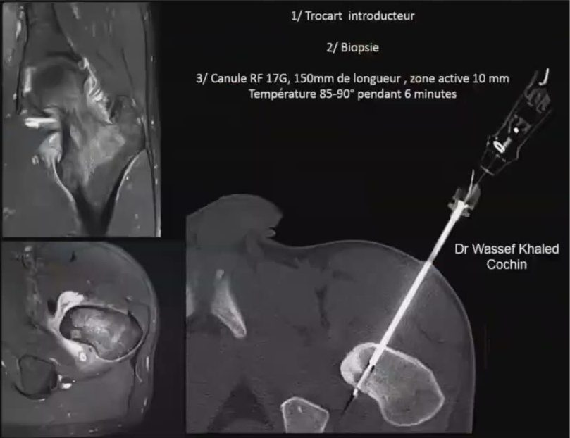
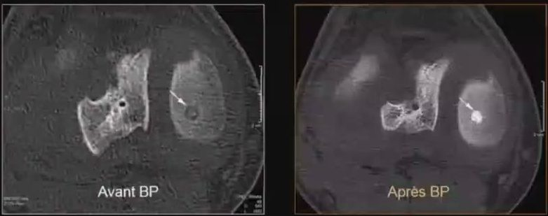

# Ostéome ostéoïde : traitement

> [!abstract] L'essentiel
> **Ablathermie percutanée (RF, laser, cryo) = référence, > 90 % de succès à 24 mois** ; les bisphosphonates IV deviennent une alternative crédible.

> [!success] À retenir
> 1. RF : canule 17G, zone active 10 mm, **85-90 °C pendant 6 min** ; cryo possible en abord **tangentiel** sous sédation.
> 2. Récidive précoce = **échec technique** ; tardive si **nidus > 12 mm**, **âge < 16-18 ans**, localisation difficile.
> 3. Protéger les nerfs (**> 42 °C / < −10 °C** toxiques) : distance **8-10 mm**, hydro/dissection gazeuse, monitoring.
> 4. Acide zolédronique (~**3 perfusions**) : **83 %** de réponse précoce, **74 %** à long terme ; signe d'efficacité = **minéralisation complète du nidus**.

## Images clés
 [▶ 3:24](https://www.youtube.com/watch?v=HkOTr0If6FI&t=204s)
 [▶ 11:04](https://www.youtube.com/watch?v=HkOTr0If6FI&t=664s)

## Points clés
- Techniques percutanées guidées par l'imagerie :
  - résection percutanée ;
  - injection d'éthanol ;
  - ablathermies (5 méthodes) : radiofréquence, photocoagulation laser, micro-ondes, ultrasons focalisés, cryothérapie.
- Les gestes se font en asepsie chirurgicale, avec anesthésiste (anesthésie générale, sédation consciente ou bloc locorégional).
- Historique : forage-résection osseux percutané (FREOP), premier patient en 1987, par un binôme lyonnais chirurgien-radiologue.
- **Radiofréquence** (pionnier : Rosenthal, 1992 et 1995) : nécrose de coagulation visée entre 60 °C (seuil de nécrose) et 100 °C. Au-delà, la carbonisation réduit la diffusion thermique.
- **Laser** (pionnier : Gangi, 1997) : fibre optique dans un trocart. L'énergie déposée et sa diffusion sont bien codifiées et adaptées à la taille du nidus.
- **Cryothérapie** (< −20 °C) : la sonde peut être tangentielle sans pénétrer le nidus ni franchir l'os. Elle évite la douleur violente de la ponction du nidus et se fait sous sédation consciente.
- Succès : plus de 90 % à 24 mois.
  - Récidives précoces : échec technique (malposition, énergie insuffisante).
  - Récidives tardives : taille du nidus (> 12 mm), jeune âge (< 16-18 ans), localisation.
- **Traitement médical** : les ostéoblastes tumoraux sécrètent des prostaglandines (d'où l'efficacité de l'aspirine et des AINS). La croissance est autolimitée (≤ 15 mm) et des guérisons spontanées sont décrites.
- **Acide zolédronique** : 23 patients (avec l'équipe bordelaise), lésions surtout rachidiennes, 1 à 3 perfusions mensuelles à dose standard. Réponse précoce de 83 % (19/23) et 74 % à long terme (17/23), EVA en baisse surtout après la 2e ou 3e perfusion. Étude terminée en 2014, suivi de plus de 2 ans (jusqu'à 5 ans).
- Un PHRC compare 3 perfusions d'acide zolédronique à la destruction percutanée.

## Sémiologie et technique d'imagerie
- Contrôle post-ablation : disparition du rehaussement du nidus (T1 gadolinium FS), rehaussement périphérique à la zone d'ablation.
- Après acide zolédronique : minéralisation complète du nidus, régression de l'œdème péri-lésionnel.
- Les localisations du nidus sont stéréotypées et il faut les connaître : fémur proximal, arrière-fond acétabulaire, corps vertébral.

## Pièges et diagnostics différentiels
- Complications de l'ablation : hématome, tendinite, fracture, brûlure cutanée, lésion nerveuse.
- Le nerf ne tolère ni plus de 42 °C ni moins de −10 °C.

> [!WARNING] À ne pas manquer
> Rester à 8-10 mm d'un nerf, sinon l'éloigner par dissection gazeuse ou surveiller la température ou les potentiels évoqués. Une récidive dans les 2 ans impose de revoir la technique (positionnement, énergie).

> [!TIP] Pour le compte rendu
> Indiquer la taille et la localisation du nidus et sa distance aux structures nobles (nerf, peau), puis proposer la voie (ablathermie percutanée ou option médicale) en RCP. Suivi clinique et imagerie à 24 mois.

## Liens
- Congrès : [[SIMS 2019 - Index]]
- Voir aussi : [[Ostéome ostéoïde de la hanche]]
