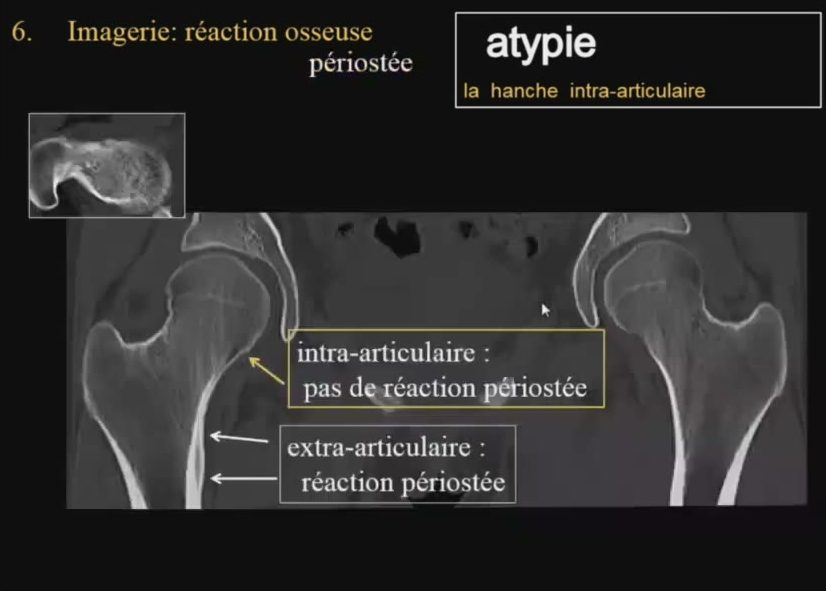
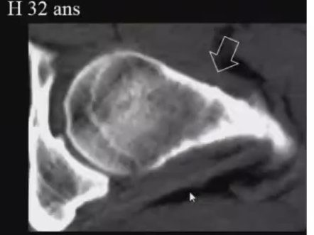
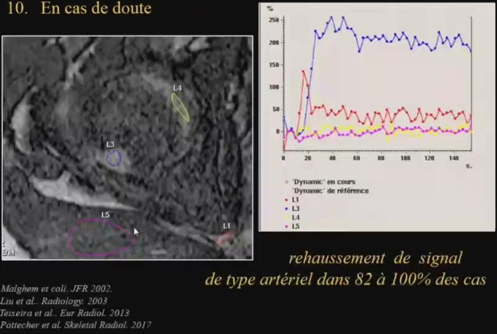

# Ostéome ostéoïde de la hanche

> [!abstract] L'essentiel
> **Ostéome ostéoïde intra-articulaire de hanche : synovite sans réaction périostée, le grand piège** : chercher le nidus au scanner, trancher par l'IRM de perfusion dynamique.

> [!success] À retenir
> 1. **Col intra-capsulaire = pas de réaction périostée** ; seuls signes : **synovite**, œdème, boiterie, flessum → mime un **rhumatisme inflammatoire**.
> 2. Nidus parfois minuscule (**3-4 mm**) ou **totalement ossifié** : scanner en coupes fines (TDM > IRM pour nidus et hyperostose).
> 3. **IRM dynamique** : rehaussement **artériel précoce dans 82-100 %** des cas (< 6 s après l'artère), lent et progressif dans l'abcès de Brodie ; récidive **2-27 %** après ablation percutanée.

## Images clés
 [▶ 4:47](https://www.youtube.com/watch?v=Pyo_VZ19egQ&t=287s)
 [▶ 2:52](https://www.youtube.com/watch?v=Pyo_VZ19egQ&t=172s)
 [▶ 8:15](https://www.youtube.com/watch?v=Pyo_VZ19egQ&t=495s)

## Points clés
- Prédominance masculine, pic vers 20 ans. Il n'est pas exceptionnel après 40 ans : 6 % des cas dans une série de 2015 citée.
- Environ un quart des ostéomes ostéoïdes siègent au fémur proximal, souvent en territoire **intra-synovial**.
- Atypies cliniques :
  - forme indolore (tuméfaction tibiale chez un enfant, hippocratisme digital d'un seul doigt) ;
  - à la hanche, symptômes fonctionnels isolés : boiterie, flessum, raideur.
- Le nidus est parfois totalement ossifié et minuscule (3-4 mm). Un cas réséqué sous arthroscopie avait été pris pour la bosse d'un conflit fémoro-acétabulaire.
- La localisation intra-articulaire explique la **synovite** et l'**absence de réaction périostée** sur le col intra-capsulaire, alors que l'hyperostose est marquée en extra-articulaire.
- Signes indirects : troubles de croissance, inégalité de longueur, ostéoporose, chondrolyse, ostéophytes. L'ensemble peut mimer un rhumatisme inflammatoire chronique.
- Récidives in situ : environ 20 % après curetage, 2 à 27 % après ablation percutanée ; souvent par destruction insuffisante, mais aussi à distance (dissémination de fragments lors d'une résection arthroscopique), voire dans une ossification hétérotopique postopératoire.
- Guérison spontanée possible : environ la moitié des patients bien soulagés par AINS guérissent en environ 2 ans.

## Sémiologie et technique d'imagerie
- Scanner : nidus (lacune à calcification incomplète, moins dense que la corticale) et hyperostose.
- IRM : œdème médullaire et des parties molles, synovite. Le nidus est mal vu en T1 et mieux vu sur les séquences sensibles aux liquides. L'œdème est parfois absent (sous AINS ?).
- Scintigraphie ± SPECT : non spécifique, utile pour localiser une lésion inconnue. La TEP-FDG est généralement négative.
- Échographie : synovite, nidus exceptionnellement visible.
- **IRM de perfusion dynamique** (acquisitions toutes les 3 s) : rehaussement de type artériel très précoce (82 à 100 % des cas), en général moins de 6 s après une artère de référence. Ce rehaussement n'est pas spécifique (tumeurs bénignes et malignes) mais sert au diagnostic différentiel.

## Pièges et diagnostics différentiels
- Arthrite inflammatoire chronique : piège majeur, car seule la synovite est visible (nidus méconnu sur une coupe sur cent).
- Fracture de stress : clinique différente, pas de nidus.
- Abcès de Brodie : lacune irrégulière avec séquestre en hyposignal sur toutes les séquences, micro-abcès adjacents. Son rehaussement est lent et progressif.

> [!WARNING] À ne pas manquer
> Devant une boiterie, un flessum ou une synovite inexpliquée de hanche chez un sujet jeune, rechercher activement un nidus intra-articulaire. L'absence de réaction périostée sur le col ne l'élimine pas.

> [!TIP] Pour le compte rendu
> Préciser la localisation (intra ou extra-articulaire), la taille et la minéralisation du nidus, la synovite et le retentissement articulaire. En cas de doute, proposer une IRM de perfusion dynamique.

## Liens
- Congrès : [[SIMS 2019 - Index]]
- Voir aussi : [[Ostéome ostéoïde - traitement]], [[La boiterie chez l'enfant et l'adolescent]]
