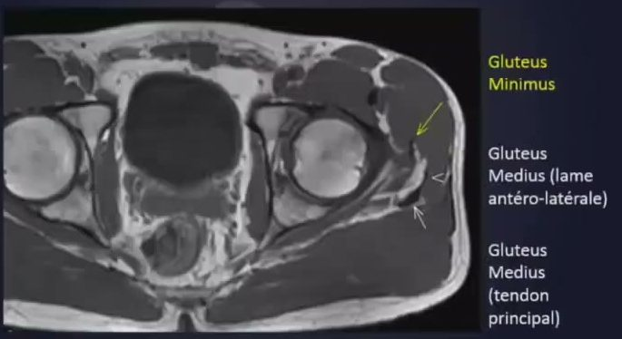
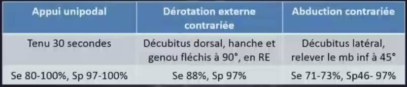

# Pathogénie et clinique des tendinopathies glutéales

> [!abstract] L'essentiel
> **Seule la rupture du tendon principal du moyen glutéal a un enjeu fonctionnel (Trendelenburg)** : nommer précisément la structure lésée, pas « syndrome du grand trochanter ».

> [!success] À retenir
> 1. Distinguer **lame antérolatérale** (fine, antérieure, surtout douloureuse) et **tendon principal** du moyen glutéal (épais, postéro-supérieur, rupture = déficit d'abduction → chirurgien).
> 2. « **Bursite** » = seulement **≈ 20 %** des douleurs péritrochantériennes : ne l'écrire que si l'imagerie la montre ; terme à préférer : **tendinobursopathie glutéale**.
> 3. Manœuvres : **appui unipodal 30 s** (Se 80-100 %, Sp 97-100 %) et **dérotation externe contrariée** (Se 88 %, Sp 97 %) ; abduction contrariée moins spécifique.

## Images clés
 [▶ 1:57](https://www.youtube.com/watch?v=BJ3QKeTuD2U&t=117s)
 [▶ 5:17](https://www.youtube.com/watch?v=BJ3QKeTuD2U&t=317s)

## Points clés
- **Anatomie** : le petit glutéal naît de la face externe de l'ilium et se termine sur la facette antérieure du grand trochanter (avec un tendon réfléchi doublant la capsule). Le moyen glutéal se termine par un **tendon principal** épais sur la facette supérieure (postéro-supérieure) et par une **lame antérolatérale** fine, insérée en avant.
- L'atteinte de la lame antérolatérale a **peu de conséquences fonctionnelles** (surtout douloureuse) ; l'atteinte du tendon principal est fonctionnellement grave.
- Bourses : sous le petit glutéal, sous le moyen glutéal et bourse superficielle (entre TFL en avant et grand glutéal en arrière).
- Fonction : le petit glutéal est fléchisseur et rotateur interne, abducteur dans les premiers degrés ; le moyen glutéal stabilise le bassin en appui monopodal à la marche ; le TFL et le tractus iliotibial prennent le relais.
- **Terminologie** : abandonner « syndrome douloureux du grand trochanter » (fourre-tout incluant causes articulaires, rachidiennes, vasculaires) et « bursite » (≈ 20 % seulement des douleurs péritrochantériennes). Préférer **tendinobursopathie glutéale**, précisée selon l'imagerie (bursite, fissuration de la lame antérieure du moyen glutéal, tendinopathie…).
- **Clinique classique** : femme > 40 ans, douleur latérale de hanche à la marche, aux escaliers, au relever de la position assise, en décubitus latéral ; non spécifique de la structure lésée.
- **Rupture du tendon principal du moyen glutéal** : douleur vive, souvent post-traumatique (sujet jeune sportif ou sujet âgé avec tendinopathie préexistante, contraction excentrique pour éviter une chute), puis déficit d'abduction et **boiterie de Trendelenburg** (bascule du bassin, inclinaison de l'épaule du côté atteint).
- **Manœuvres** : appui monopodal tenu 30 s (bascule du bassin et reproduction de la douleur habituelle ; non interprétable si non tenu 30 s ; Se 80-100 %, Sp 97-100 %), **dérotation externe contrariée** (Se 88 %, Sp 97 %), abduction contrariée en décubitus latéral (moins performante : Se 71-73 %, Sp 46-97 %).
- **Pathogénie** : excès de traction et de compression → altération du collagène. Sur-utilisation (marche inhabituelle, escaliers, step) ou sous-utilisation (adduction → compression accrue, compensation par TFL) → cercle vicieux douleur/sous-utilisation.
- **Facteurs** : prédominance féminine (hormonaux, bassin large, chaussage évoqués mais non prouvés), coxa vara, offset trochantérien élevé, bassin oblique, pathologie des membres inférieurs ; inégalité de longueur non reconnue ; médicaments (corticoïdes, fluoroquinolones, statines).

## Sémiologie et technique d'imagerie
- Coupe axiale T1 : lame antérolatérale fine en avant, tendon principal épais en arrière.
- L'imagerie de qualité est indispensable pour individualiser la lésion précise, dont dépend le traitement.

## Pièges et diagnostics différentiels
- Douleur latérale de hanche d'origine articulaire, rachidienne ou vasculaire.
- Ne pas conclure à une « bursite » sans preuve en imagerie.

> [!WARNING] À ne pas manquer
> Douleur brutale + déficit d'abduction + boiterie de Trendelenburg = rupture du tendon principal du moyen glutéal, à adresser rapidement au chirurgien.

> [!TIP] Pour le compte rendu
> Nommer précisément la structure atteinte (lame antérolatérale vs tendon principal du moyen glutéal, petit glutéal, bourse) plutôt que « syndrome du grand trochanter ».

## Liens
- Congrès : [[SIMS 2019 - Index]]
- Voir aussi : [[Imagerie des tendinopathies glutéales - classique et inhabituel]], [[Prise en charge médicale des tendinopathies du moyen et petit glutéal]], [[Prise en charge chirurgicale des tendinopathies du petit et du moyen glutéal]]
