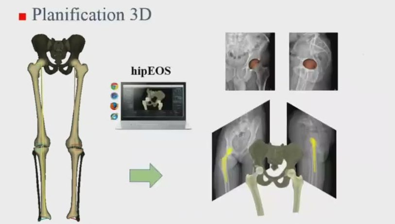
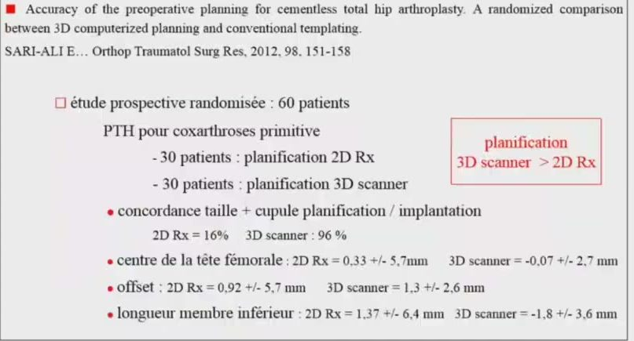
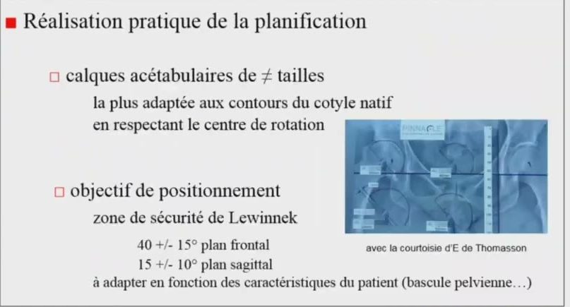

# Planification préopératoire

> [!abstract] L'essentiel
> **La planification de PTH n'est fiable que sur un bassin de face debout standardisé ; la 3D (scanner, EOS) prédit mieux taille et position que les calques 2D** : EOS > scanner > radiographie.

> [!success] À retenir
> 1. Bassin de planification : debout, **pieds en rotation interne 15-20°**, centré **2 cm sous la symphyse**, crêtes iliaques + fémur proximal sur toute la longueur de la tige ; agrandissement ≈ **1,15**, variable chez l'obèse.
> 2. Concordance taille planifiée/implantée : **16 % en 2D vs 96 % au scanner 3D** (essai randomisé, 60 PTH) ; scanner ≈ **4 mSv**, en décubitus.
> 3. Cupule dans la zone de **Lewinnek** (**40 ± 15°** frontal, **15 ± 10°** sagittal), à adapter à la bascule pelvienne ; EOS 3D = debout, faible dose, sans agrandissement.

## Images clés
 [▶ 9:42](https://www.youtube.com/watch?v=OJIkaLwQqFM&t=582s)
 [▶ 8:08](https://www.youtube.com/watch?v=OJIkaLwQqFM&t=488s)
 [▶ 4:34](https://www.youtube.com/watch?v=OJIkaLwQqFM&t=274s)

## Points clés
- PTH : survie de 80 à 85 % à 20 ans ; bon positionnement et taille adaptée des implants = objectif prioritaire pour éviter les complications.
- Planification préconisée dès les années 80 (Maurice Müller), après l'ère Charnley (années 70).
- **Planification 2D** : superposition de calques acétabulaires et fémoraux (manuels puis numérisés) sur le cliché préopératoire.
- **Qualité radiographique** : patient debout en charge, fesses contre la plaque, bras le long du corps, **pieds en rotation interne de 15-20°** (corrige l'antéversion fémorale, déroule le col) ; cliché incluant les crêtes iliaques et le fémur proximal sur toute la longueur de la tige, centré sous la symphyse ; mêmes critères au suivi.
- **Agrandissement** ≈ 1,15 (calques fabricants), mais variable selon la morphologie (moindre chez le sujet maigre, plus important chez l'obèse) → imprécision sur taille et offset ; limites aussi chez le patient raide ou en flessum.
- **Repères** : ligne passant par le bas des « U » radiologiques (horizontale de référence) ; **centre de rotation** = centre de la tête fémorale (cercles concentriques) ; en cas de destruction acétabulaire, se fier à la hanche controlatérale.
- Objectifs : offset, longueur du membre, centre de rotation ; ajustables par hauteur de coupe, longueur de col, angle cervicodiaphysaire, diamètre et hauteur de tête.
- Limites de la 2D démontrées surtout pour les **tiges non cimentées**.
- **Planification scanner** : patient en décubitus, propositions de taille et de positionnement modifiables par le chirurgien ; supérieure à la 2D sur pratiquement tous les paramètres.
- **Planification EOS** (imagerie biplanaire basse dose, travaux de Georges Charpak, Nobel 1992) : debout en charge, faible dose, corps entier, deux faisceaux orthogonaux simultanés sans agrandissement ; modélisation 3D du bassin et des fémurs à partir de points anatomiques et d'une base statistique, puis intégration virtuelle des implants avec calcul permanent de l'offset et de la longueur.
- **Résultats de l'équipe** : étude rétrospective de 31 patients (2017) — meilleure prédiction de la taille de tige (à ± 1 taille) en 3D EOS, amélioration non significative pour la cupule ; étude prospective de 33 patients — mêmes résultats sur la taille et amélioration des paramètres de positionnement.

## Sémiologie et technique d'imagerie
- Bassin de face debout standardisé, reproductible au suivi.
- Hiérarchie proposée : **EOS > scanner > radiographie 2D** ; couplage futur avec la navigation peropératoire.

## Pièges et diagnostics différentiels
- Rotation externe ou flessum antalgique faussant offset et taille.
- Agrandissement non maîtrisé chez l'obèse.

> [!WARNING] À ne pas manquer
> Un bassin de face de planification mal positionné (rotation, cadrage insuffisant du fémur) rend la planification 2D peu fiable.

> [!TIP] Pour le compte rendu
> Pour un bilan pré-PTH, préciser la qualité du positionnement (rotation des pieds, cadrage), la présence d'un marqueur de calibration si disponible, et l'état de la hanche controlatérale.

## Liens
- Congrès : [[SIMS 2019 - Index]]
- Voir aussi : [[Analyse du positionnement des pièces prothétiques et complications]], [[Imagerie du conflit psoas-prothèse]]
