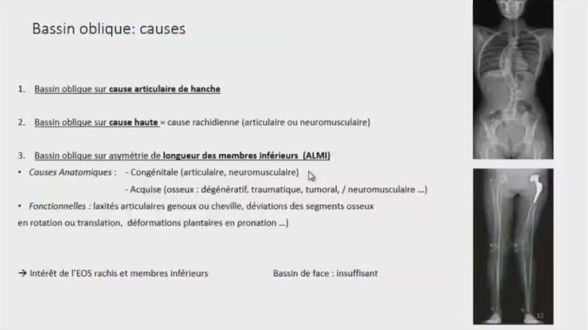
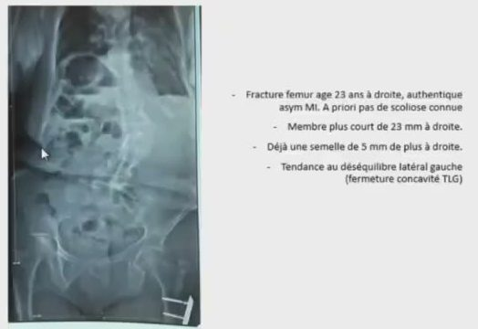

# Prise en charge médicale des déséquilibres pelviens

> [!abstract] L'essentiel
> **Bassin oblique : toujours préciser la cause, haute (rachis), articulaire (hanche) ou basse (inégalité de longueur)** ; un bassin de face seul est **insuffisant**, l'EOS tranche.

> [!success] À retenir
> 1. **EOS rachis + membres inférieurs** : distinguer inégalité **anatomique** (mesure segmentaire) et **fonctionnelle**, et une fausse inégalité de scoliose primitive.
> 2. Compensation : quasi systématique **> 2 cm**, toujours chez l'enfant, avis chirurgical **> 6 cm** ; progressive (≈ **50 %** de la perte), puis réévaluer.
> 3. Conflit fémoro-acétabulaire : **tilt pelvien antérieur dynamique** → rééducation en rétroversion (abdominaux, ischio-jambiers, fessiers).

## Images clés
 [▶ 7:15](https://www.youtube.com/watch?v=LnkaKo3j0oo&t=435s)
 [▶ 8:28](https://www.youtube.com/watch?v=LnkaKo3j0oo&t=508s)

## Points clés
- Le pelvis est un carrefour de transmission des contraintes. Pour un coût énergétique minimal à la marche, le centre de gravité doit se projeter entre le centre des têtes fémorales et le milieu du plateau sacré.
- La grande variabilité inter-individuelle empêche tout algorithme rigide : on raisonne au cas par cas.
- Démarche standardisée :
  1. contexte : plainte algo-fonctionnelle, asymétrie signalée ou découverte fortuite ;
  2. plan : frontal ou sagittal ;
  3. cause : articulaire pelvienne, sus-pelvienne (rachis, scoliose) ou sous-pelvienne (inégalité de longueur, anatomique ou fonctionnelle) ;
  4. caractère statique et/ou dynamique ;
  5. objectifs individualisés et réévalués, ou abstention.
- **Conflit fémoro-acétabulaire** : à l'antéflexion du tronc, ces patients fléchissent davantage la hanche que le rachis lombaire (tilt pelvien antérieur dynamique). La rééducation vise la proprioception et le contrôle neuromoteur du bassin, l'assouplissement des fléchisseurs de hanche et le recrutement des muscles rétroverseurs (abdominaux, ischio-jambiers, fessiers) pour diminuer le conflit antérieur.
- Cas d'une scoliose thoraco-lombaire droite (gibbosité) : le bassin oblique relève d'une cause haute avec **fausse inégalité de longueur**. On propose une rééducation lombaire et, si besoin, un appareillage du tronc plutôt que des semelles.
- Cas d'une femme de 71 ans, lombalgique, aux antécédents de fracture du fémur droit à 23 ans (accident de la voie publique) : inégalité vraie de 23 mm et scoliose secondairement structuralisée. La cause est basse ; une correction au-delà de 5 mm a été mal tolérée.

## Sémiologie et technique d'imagerie
- Le clinicien mesure mal l'antéversion pelvienne : les paramètres pelviens radiologiques (pente sacrée, version pelvienne, bascule acétabulaire) sont précieux.
- L'EOS mesure les segments de membre et distingue l'inégalité anatomique de l'inégalité fonctionnelle.
- **Un simple bassin de face est désormais insuffisant.**

## Pièges et diagnostics différentiels
- Une « jambe plus courte » ou un « bassin oblique » mentionné sans analyse n'a pas de valeur. Distinguer une fausse inégalité (scoliose primitive) d'une vraie inégalité.
- Faut-il compenser ou non ? Le débat reste ouvert, y compris chez le sportif asymptomatique (exemple d'un footballeur célèbre).

> [!WARNING] À ne pas manquer
> Compensation d'une inégalité de longueur :
> - quasi systématique au-delà de **2 cm** ;
> - rapide si le déséquilibre s'installe vite ;
> - toujours chez l'enfant (retentissement rachidien en croissance) ;
> - avis chirurgical au-delà de **6 cm**.
> Compenser progressivement, en général à 50 % de la perte, et réévaluer.

> [!TIP] Pour le compte rendu
> Préciser si l'obliquité pelvienne est d'origine haute, pelvienne ou basse, quantifier l'inégalité en distinguant les segments (EOS), et décrire une éventuelle scoliose (structurale ou non).

## Liens
- Congrès : [[SIMS 2019 - Index]]
- Voir aussi : [[Relations normales et pathologiques entre colonne vertébrale et bassin]], [[Comment aborder les pathologies de la hanche et de la colonne vertébrale]]
