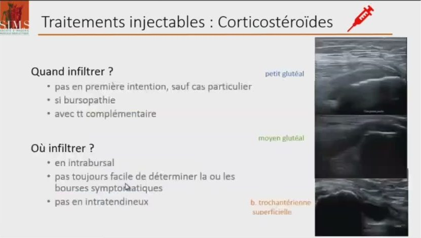
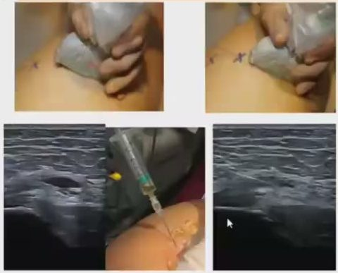
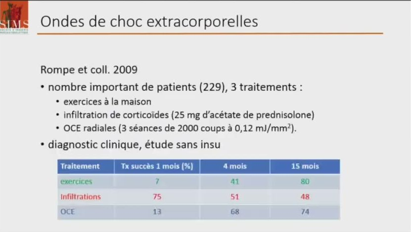

# Prise en charge médicale des tendinopathies du moyen et petit glutéal

> [!abstract] L'essentiel
> **Tendinopathie glutéale = d'abord réduire la compression (pas d'adduction), rééduquer, décharger ; l'infiltration soulage vite mais fait moins bien à long terme.**

> [!success] À retenir
> 1. Corticoïdes (Rompe 2009, **229 patients**) : succès **75 % à 1 mois** mais **48 % à 15 mois** vs **80 %** exercices et **74 %** ondes de choc.
> 2. Infiltrer **en intrabursal, jamais en intratendineux**, pas en première intention (sauf hyperalgie/bursopathie) ; **écho-guidage** supérieur à 6 mois.
> 3. **PRP** : effet plus lent mais plus durable que les corticoïdes ; réponse spectaculaire aux AINS chez le jeune → évoquer une **spondyloarthrite**.

## Images clés
 [▶ 8:45](https://www.youtube.com/watch?v=U-_q0pEdi4c&t=525s)
 [▶ 9:21](https://www.youtube.com/watch?v=U-_q0pEdi4c&t=561s)
 [▶ 6:25](https://www.youtube.com/watch?v=U-_q0pEdi4c&t=385s)

## Points clés
- **Éducation posturale** (travaux australiens, 2015) : éviter l'adduction qui comprime tendons et bourse.
  - Décubitus latéral douloureux des deux côtés (compression directe homolatérale, adduction controlatérale) → coussin entre les genoux, décubitus dorsal si possible.
  - Debout : éviter appui monopodal et piétinement ; jambes légèrement écartées.
  - Assis : éviter jambes croisées ; se relever jambes en abduction plutôt que serrées.
- **Rééducation** : pas de protocole validé ; exercices d'abduction isométriques à faible charge, exercices de faible vélocité en position debout.
- **Analyse statique** : genu valgum, arrière-pied valgus, gonarthrose fémorotibiale médiale, atteinte bilatérale, association fréquente aux lombalgies (équilibre pelvien frontal et sagittal) → **orthèses plantaires** et aides à la marche.
- **Décharge** : deux cannes quelques semaines en phase aiguë ; canne obligatoire en cas de boiterie de Trendelenburg sur rupture complète.
- **Ondes de choc** (focales ou radiales) : littérature peu standardisée. Une étude à 3 bras (Rompe 2009, 229 patients : exercices à domicile, infiltrations, ondes de choc radiales ; succès à 1, 4 et 15 mois : exercices 7/41/80 %, infiltrations 75/51/48 %, ondes de choc 13/68/74 %) : efficacité rapide des infiltrations mais résultats **moins bons à 15 mois** que sans infiltration ; peu de différence ondes de choc vs exercices. Option pour tendinopathies hypertrophiques ou calcifiantes sans bursite.
- **Traitement oral** : rien de spécifique ; une réponse spectaculaire aux AINS chez un sujet jeune doit faire évoquer une **spondyloarthrite**.
- **Infiltrations de corticoïdes** : revue de 8 études — amélioration significative à 3 mois, pas mieux que les ondes de choc à 12 mois. Pas en première intention sauf hyperalgie ou bursopathie ; toujours associer repos ; **intrabursale, pas intratendineuse**.
- **Guidage** : résultats équivalents au repérage clinique à 2 semaines, supériorité des injections écho-guidées à 6 mois (coût plus élevé). 1 à 2 infiltrations sur repérage clinique tolérables, ne pas insister en cas d'échec.
- **PRP** : manque de standardisation ; méta-analyse de 3 essais randomisés : amélioration dès 3 mois persistant à 12 mois, effet plus lent mais plus durable que les corticoïdes.

## Sémiologie et technique d'imagerie
- L'échographie permet de cibler la bourse symptomatique et de réduire le nombre d'injections.

## Pièges et diagnostics différentiels
- Spondyloarthrite à évoquer chez le sujet jeune très répondeur aux AINS.

> [!WARNING] À ne pas manquer
> Ne pas multiplier les infiltrations cortisoniques en phase de recrudescence aiguë : risque de rupture tendineuse ; préférer la décharge.

> [!TIP] Pour le compte rendu
> Indiquer si une bourse est distendue (cible d'infiltration intrabursale) et l'état du tendon (rupture complète = pas d'indication à multiplier les infiltrations).

## Liens
- Congrès : [[SIMS 2019 - Index]]
- Voir aussi : [[Pathogénie et clinique des tendinopathies glutéales]], [[Prise en charge chirurgicale des tendinopathies du petit et du moyen glutéal]], [[Le tractus iliotibial de haut en bas]]
