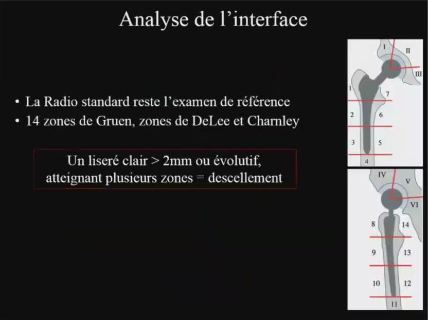
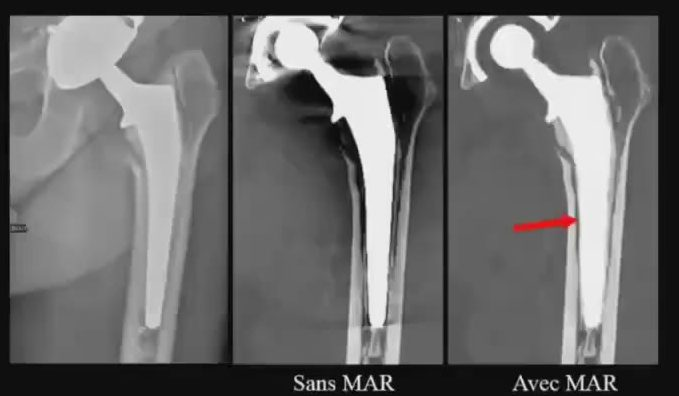
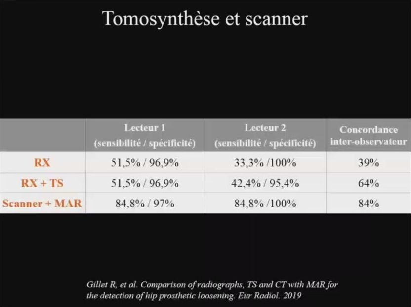

# Prothèse douloureuse - l'interface osseuse

> [!abstract] L'essentiel
> **Descellement = liseré > 2 mm ou évolutif sur plusieurs zones de Gruen** : en cas de doute radiographique, le scanner avec MAR est l'examen le plus performant.

> [!success] À retenir
> 1. Radio de référence : **14 zones de Gruen** (tige) + zones de **DeLee-Charnley** (cupule) ; toujours **comparer aux clichés antérieurs**.
> 2. Détection du descellement (Gillet 2019) : radio sensibilité **33-52 %**, tomosynthèse concordance **64 %**, **scanner + MAR Se 85 %, Sp 97-100 %**, concordance **84 %**.
> 3. **MAR > double énergie** pour les PTH ; **SPECT-CT** : liseré douteux + hyperfixation étendue = argument fort de descellement.

## Images clés
 [▶ 5:20](https://www.youtube.com/watch?v=jbnFDu0Bnlo&t=320s)
 [▶ 10:33](https://www.youtube.com/watch?v=jbnFDu0Bnlo&t=633s)
 [▶ 12:59](https://www.youtube.com/watch?v=jbnFDu0Bnlo&t=779s)

## Points clés
- Fixation **non cimentée** désormais prédominante : fixation primaire mécanique (press-fit) puis **ostéo-intégration** (fixation secondaire biologique) = interface directe os viable–implant, sans réaction inflammatoire ni tissu fibreux, rigide et asymptomatique en charge.
- Facteurs d'ostéo-intégration : biocompatibilité (alliages de titane), design et état de surface (rugosité, revêtement micro/macroporeux, **hydroxyapatite** ostéo-inductrice, macro-relief), qualité de la fixation primaire, répartition des contraintes, capacité ostéogénique (patient ostéoporotique → préférer une fixation cimentée).
- Identifier le type de tige : revêtement **métaphysaire** ou **sur toute la longueur** (davantage de stress shielding) → zones où l'on attend l'ostéo-intégration.
- **Descellement = « maladie des particules »** : débris d'usure (couple de frottement, métal hors zone de frottement, ciment) migrant à l'interface → réaction cellulaire inflammatoire/immunologique (ALVAL), cytokines, ostéoclastes → ostéolyse ; composante mécanique accessoire.
- **Radiographie standard** = référence, clichés de qualité et comparables : **14 zones de Gruen** (face + profil) pour la tige, 3 zones de face pour la cupule (+ zones 4–6 de profil). Un **liseré > 2 mm** ou évolutif, étendu à plusieurs zones (notamment celles où une fixation est attendue) traduit un descellement.
- Limites : liseré pas toujours visible, faible reproductibilité, sous-estimation de l'ostéolyse, signes associés et score radiographique classique peu fiables ; cas ambigu (formation osseuse atypique, varisation débutante, hyperfixation à 1 an) interprété 50/50 par des experts.
- **Score OSS** (ostéo-intégration et stabilité secondaire, équipe française multicentrique) : pondération du liseré en zone proximale et distale ; tend à s'imposer.
- **Tomosynthèse** : extension de la radiographie (face puis tomosynthèse, profil puis tomosynthèse), reconstruction itérative + MAR, dose ≈ 2 radiographies, pas de reconstructions multiplanaires ; reproductibilité très supérieure à la radiographie (travail de Romain Gillet, Eur Radiol 2019) mais inférieure au scanner : sensibilité/spécificité radiographie 51,5 %/96,9 % et 33,3 %/100 % selon le lecteur (concordance 39 %), radiographie + tomosynthèse 51,5 %/96,9 % et 42,4 %/95,4 % (concordance 64 %), scanner + MAR 84,8 %/97 % et 84,8 %/100 % (concordance 84 %).
- **Scanner** : MAR **supérieur à la double énergie** (les artefacts de PTH relèvent surtout de la privation de photons, non du durcissement du faisceau) ; association double énergie + MAR sans intérêt supplémentaire. Sensible aux changements fins entre deux examens ; montre ostéolyse en miroir et infiltration des parties molles (ex. métallose par conflit tige-cupule).
- **SPECT-CT** : liseré douteux + hyperfixation nette et étendue = argument fort de descellement.
- Cas rétrospectif : ostéolyse zones 1–2 actuelle, irrégularités déjà présentes 3 ans plus tôt avec discrète hyperfixation → diagnostic possible plus tôt.

## Sémiologie et technique d'imagerie
- Radiographies de face et profil reproductibles, comparaison avec l'antériorité.
- Tomosynthèse face/profil en complément ; scanner avec MAR en cas de doute ; SPECT-CT pour l'information fonctionnelle.

## Pièges et diagnostics différentiels
- Zone sombre sur scanner sans MAR = artefact ou vrai liseré : vérifier la symétrie de part et d'autre de l'implant.
- Zone 6 difficile à analyser en radiographie.

> [!WARNING] À ne pas manquer
> Toujours comparer aux clichés antérieurs : un liseré discret mais évolutif est un signe précoce de descellement.

> [!TIP] Pour le compte rendu
> Préciser le type de fixation et de revêtement, décrire le liseré par zones de Gruen (épaisseur, extension, évolutivité), l'ostéolyse et l'état des parties molles ; proposer tomosynthèse, scanner MAR ou SPECT-CT si doute.

## Liens
- Congrès : [[SIMS 2019 - Index]]
- Voir aussi : [[IRM des prothèses de hanche]], [[Infection sur prothèse de hanche - prélèvements et germes]], [[Analyse du positionnement des pièces prothétiques et complications]]
