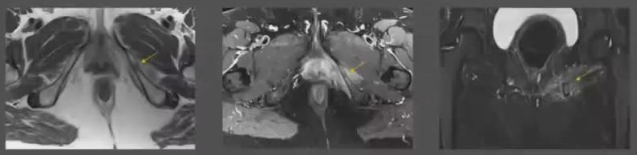
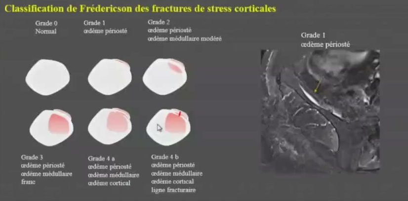

# Surutilisation et fractures de stress de la ceinture pelvienne

> [!abstract] L'essentiel
> **Fracture de fatigue pelvienne : radio souvent normale, IRM d'emblée** ; la fracture du **versant supérieur (en tension) du col fémoral** est l'urgence à ne pas manquer.

> [!success] À retenir
> 1. Radio peu sensible (**Se 15-35 %** au stade précoce) ; **IRM = référence** (œdème STIR, **Se 100 %, Sp 86 %**).
> 2. Grader selon **Fredericson** : œdème périosté → médullaire → cortical → **trait de fracture (grade 4b)** ; chercher d'autres foyers.
> 3. Terrain : **femme > 3×** (apports caloriques, aménorrhée), recrues (**4,7 % H vs 13,9 % F** après 8-14 semaines) ; **60 % col fémoral, 40 % anneau pelvien**.

## Images clés
 [▶ 7:27](https://www.youtube.com/watch?v=mwu5KMN2xVk&t=447s)
 [▶ 8:14](https://www.youtube.com/watch?v=mwu5KMN2xVk&t=494s)

## Points clés
- **Définition** : charge mécanique chronique supérieure à la résistance naturelle de l'os. Environ 0,8 % des blessures du sportif, surtout aux membres inférieurs ; 5 % des lésions du membre inférieur siègent à la ceinture pelvienne.
- **Structure osseuse** : os cortical (ostéons, col fémoral) vs os trabéculaire (sacrum, ailes iliaques).
- **Biomécanique** : zone élastique réversible → zone plastique (microfissures nécessitant réparation) → point de rupture quand les microfissures dépassent les capacités de réparation. Remodelage continu de 2 à 8 mois (résorption ostéoclastique puis apposition) : la charge renforce l'os, la sous-utilisation l'affaiblit.
- **Facteurs** : extrinsèques (fréquence/durée d'entraînement, équipement) ; intrinsèques (anatomie, métabolisme, sexe, démarche) ; rôle des muscles (amortissement, répartition, mais aussi traction).
- Sportifs : ≈ 0,7 fracture de stress pour 1000 h d'entraînement, souvent multiples (gymnastique, athlétisme, course d'endurance). **Femmes > 3 fois plus touchées** : biomécanique, apports caloriques insuffisants, aménorrhée. **Recrues militaires** : après 8 à 14 semaines d'entraînement, fractures de stress chez 4,7 % des hommes et 13,9 % des femmes.
- **Topographie pelvienne** : ≈ 60 % col fémoral, 40 % anneau pelvien (sacrum et anneau inférieur surtout ; aile iliaque, acétabulum).
- **Clinique** : changement de quantité/qualité d'entraînement ou de matériel ; douleur mécanique progressive, de moins en moins soulagée par le repos ; mobilisation et contractions contrariées souvent indolores ; palpation du site par un clinicien expérimenté ; 18 % de symptômes controlatéraux au signal IRM dans une étude.

## Sémiologie et technique d'imagerie
- **Radiographie** : peu sensible au stade précoce (sensibilité 15 à 35 %, spécificité 79 %), meilleure en os cortical (déminéralisation, puis condensation de réparation 2 mois plus tard). **Scanner** plus performant. Os trabéculaire (sacrum) : diagnostic plus difficile.
- **Scintigraphie** : très sensible précocement.
- **IRM = référence** : œdème intra-osseux (hypersignal STIR) et des parties molles adjacentes ; sensibilité 100 %, spécificité 86 %. Exemples : garçon de 15 ans avec anneau pelvien normal en radiographie ; sauteur avec fracture de tête fémorale visible seulement en IRM.
- **Gradation de Fredericson** (décrite au tibia, transposable au bassin) : œdème périosté → œdème intracortical/médullaire → trait de fracture. Au stade chronique, IRM normalisée ; radiographie et scanner montrent les stigmates de réparation.
- Avenir : scanner spectral comme alternative possible.

## Pièges et diagnostics différentiels
- Douleur à mauvaise valeur localisatrice.
- Fractures multiples anciennes réparées découvertes tardivement (anomalie transitionnelle lombosacrée possiblement favorisante).
- **Col fémoral** : fracture du versant **inférieur** (en compression) peu grave, traitée par réduction d'activité ; fracture du versant **supérieur** (en tension) à risque de progression et de déplacement secondaire, traitement plus agressif voire chirurgical.

> [!WARNING] À ne pas manquer
> Une fracture de stress de la corticale supérieure du col fémoral expose au déplacement : la signaler en urgence.

> [!TIP] Pour le compte rendu
> Localiser précisément (versant supérieur ou inférieur du col, sacrum, anneau pelvien), grader (œdème périosté, médullaire, trait), rechercher d'autres foyers et suggérer l'évaluation des facteurs favorisants (femme : nutrition, aménorrhée).

## Liens
- Congrès : [[SIMS 2019 - Index]]
- Voir aussi : [[Les fractures de hanche du sujet âgé]], [[Les lésions traumatiques rares des muscles pelvitrochantériens]], [[Échographie des hernies de l'aine]]
