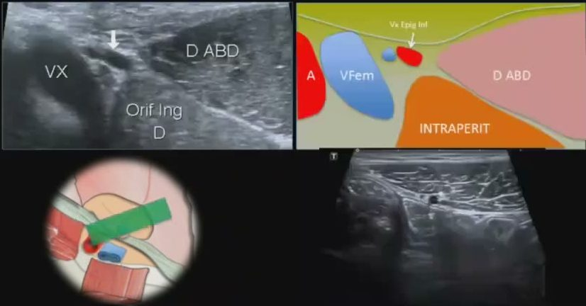
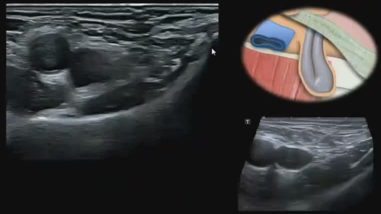
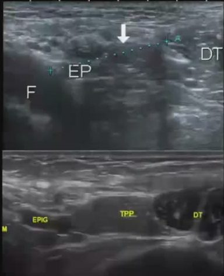

# Échographie des hernies de l'aine

> [!abstract] L'essentiel
> **Douleur inguinale à radiographies normales = échographie dynamique des orifices herniaires en poussée** : situer la hernie par rapport à l'artère épigastrique inférieure et au ligament inguinal.

> [!success] À retenir
> 1. **2 coupes de référence** : orifice fémoral (artère, veine, pectiné) et orifice inguinal (vaisseaux fémoraux, **artère épigastrique inférieure**, droit de l'abdomen), toujours **en poussée**.
> 2. Latérale à l'artère épigastrique = **indirecte** ; médiale = **directe** ; sous le ligament inguinal, médiale à la veine fémorale qu'elle comprime = **fémorale** ; mesurer le **collet**.
> 3. Pubalgie pariétale du sportif : **orifice inguinal > 2 cm** et protrusion du **tissu prépéritonéal** en poussée, sans péritoine = **pas une hernie**.

## Images clés
 [▶ 4:12](https://www.youtube.com/watch?v=o4VSEBU68OM&t=252s)
 [▶ 5:20](https://www.youtube.com/watch?v=o4VSEBU68OM&t=320s)
 [▶ 7:39](https://www.youtube.com/watch?v=o4VSEBU68OM&t=459s)

## Points clés
- **Hernie** : issue d'un contenu abdominal recouvert de péritoine par un orifice naturel.
- **Orifice myopectinéal de Fruchaud** : limité par le tendon conjoint (transverse + oblique interne) en haut, le droit de l'abdomen en dedans, le pectiné/branche pubienne en bas, le psoas en dehors ; divisé par le **ligament inguinal** en orifice inguinal (haut) et fémoral (bas).
- L'**artère épigastrique inférieure** divise l'orifice inguinal : fossette latérale (anneau inguinal profond, cordon spermatique) et fossette médiale (seul le fascia transversalis sépare le contenu péritonéal de l'extérieur → zone de faiblesse).
- **3 hernies** : **indirecte** (latérale à l'artère épigastrique, la plus fréquente, suit le cordon), **directe** (médiale à l'artère, bombement du fascia transversalis), **fémorale/crurale** (sous le ligament inguinal, médiale à la veine fémorale).
- **Indication** : pas d'examen si tuméfaction typique réductible majorée à la toux ; l'échographie sert si la clinique ne suffit pas, et surtout en imagerie ostéo-articulaire devant une **douleur ou gêne inguinale inexpliquée à radiographies normales**.
- **Pubalgie du sportif** (« douleur de l'aine du sportif », conférence de consensus) : 4 origines — adducteurs, symphyse pubienne, ilio-psoas et **origine inguinale pariétale** (lésion du fascia transversalis, du tendon conjoint ou de l'oblique externe, élargissement de l'anneau profond ; insuffisance pariétale douloureuse par proximité de petits nerfs). Ce n'est **pas une hernie** (pas de protrusion péritonéale).

## Sémiologie et technique d'imagerie
- Repères : vaisseaux fémoraux, vaisseaux épigastriques inférieurs, cordon spermatique, pectiné, droit de l'abdomen.
- **Coupe 1 – orifice fémoral** : sonde sur les vaisseaux fémoraux, oblique en dedans et en bas ; de dehors en dedans artère, veine, pectiné, os. Valide la compréhension du Valsalva (dilatation harmonieuse de la veine). Hernie crurale = tissu qui bombe et comprime/déforme la veine.
- **Coupe 2 – orifice inguinal** : sonde oblique en dedans et vers le haut, alignant vaisseaux fémoraux, artère épigastrique inférieure et droit de l'abdomen (ou suivre l'artère depuis le droit). Issue latérale = indirecte ; médiale = directe.
- Confirmer dans un second plan (sagittal) et **mesurer le collet**.
- Contenu digestif (péristaltisme, air) ou uniquement graisseux.
- **Insuffisance pariétale** (sémiologie décrite par l'équipe de Bordeaux) : élargissement de l'orifice inguinal à la poussée avec seuil de **2 cm** sur la coupe de référence, et protrusion du **tissu prépéritonéal** médialement à l'artère épigastrique, en dehors du droit, péritoine retenu en arrière ; disparaît à l'arrêt de la poussée. Continuum discuté avec la hernie directe.

## Pièges et diagnostics différentiels
- **Ganglions** au bord médial de la veine fémorale à ne pas prendre pour une hernie crurale.
- Masse sans péristaltisme et non modifiée par la poussée → masse du cordon ou du creux inguinal : ganglion typique ou investigation complémentaire.
- Signes d'insuffisance pariétale présents chez des sujets asymptomatiques.

> [!WARNING] À ne pas manquer
> Toute « hernie » qui ne bouge pas à la poussée et sans anse digestive identifiable est une masse jusqu'à preuve du contraire.

> [!TIP] Pour le compte rendu
> Préciser le type (indirecte, directe, crurale) par rapport à l'artère épigastrique inférieure et au ligament inguinal, le contenu, le collet, la réductibilité ; décrire séparément un élargissement de l'orifice inguinal (> 2 cm) sans hernie vraie.

## Liens
- Congrès : [[SIMS 2019 - Index]]
- Voir aussi : [[Imagerie du tendon droit fémoral proximal]], [[Surutilisation et fractures de stress de la ceinture pelvienne]]
