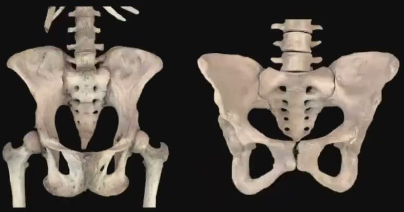
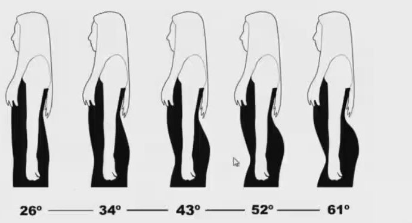
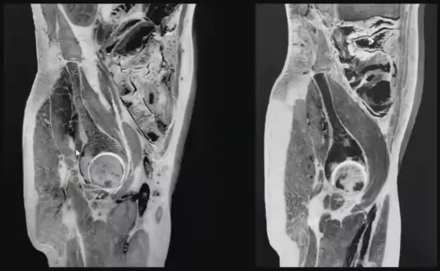

# Évolution vers la bipédie : complexe lombo-pelvi-fémoral

> [!abstract] L'essentiel
> **La bipédie humaine = hyperextension tronc/membre inférieur, extension intra-coxale et lordose lombaire** : clés des conflits antérieurs de hanche (ilio-psoas, ligaments) et des variantes du piriforme.

> [!success] À retenir
> 1. Centre de gravité **en arrière de la hanche** → stabilité antérieure assurée par les **ligaments spiralés** et l'**ilio-psoas**, réfléchi sur le bord antérieur de l'os coxal (frottements, tendinopathie).
> 2. Extension intra-coxale = **grande incisure et épine ischiatiques** → variantes du **piriforme** et compressions nerveuses ; **EIAI** spécifiquement humaine.
> 3. **Lordose lombaire** très variable (≈ **26 à 61°**) : variante morphologique à ne pas surinterpréter ; épaississement cortical **inféro-médial du col** = marqueur de charge bipède.

## Images clés
 [▶ 10:59](https://www.youtube.com/watch?v=Kj-xEwzi-so&t=659s)
 [▶ 14:15](https://www.youtube.com/watch?v=Kj-xEwzi-so&t=855s)
 [▶ 14:48](https://www.youtube.com/watch?v=Kj-xEwzi-so&t=888s)

## Points clés
- Il faut distinguer :
  - la **station érigée**, statique, qui pourrait se contenter de membres courts ;
  - la **bipédie**, dynamique, en « pendule inversé », qui impose des membres postérieurs longs pour une grande enjambée.
- Travaux anciens : études biomécaniques du XIXe siècle et chronophotographie de Marey.
- Positions spécifiquement humaines qui conditionnent les amplitudes de hanche : assise, tailleur, lotus, décubitus dorsal.
- Bipédies non humaines : lézards (marche sur l'eau du basilic), dinosaures bipèdes, oiseaux (autruche, modèle étudié de la bipédie humaine), kangourou, animaux dressés, primates (bipédie occasionnelle et brève).
- Chez ces espèces, il persiste toujours une **angulation entre l'axe du tronc et le membre inférieur**, et le redressement est assuré par les ischio-jambiers, pas par les fessiers.
- Le dernier ancêtre commun avec les grands singes remonte à environ 7 millions d'années, vraisemblablement en Afrique. La quadrupédie est l'état primitif chez les primates.
- Fémur : l'angulation du col varie peu entre espèces. L'épaississement cortical inféro-médial du col, lié à la charge verticale, est propre à l'homme et sert de marqueur sur les australopithèques.

## Sémiologie et technique d'imagerie
- Pelvis humain :
  - ailes iliaques obliques vers l'avant et recourbées en dedans ;
  - bassin « en compression » en forme de cuvette, contre un bassin long « en tension » chez les grands singes ;
  - large surface d'insertion au-dessus et en avant de la hanche, indispensable à l'appui monopodal.
- L'extension intra-coxale (flexion postérieure de l'ischium par rapport à l'ilium) crée la grande incisure ischiatique et l'épine ischiatique. D'où des variations du piriforme et des compressions nerveuses.
- L'épine iliaque antéro-inférieure est une caractéristique humaine.
- Lordose lombaire spécifique de l'homme, avec L5 cunéiforme et grande variabilité.
- Ligaments antérieurs spiralés par l'hyperextension. Le centre de gravité passe légèrement en arrière de la hanche, si bien que les ligaments antérieurs sont essentiels au maintien (travaux de Delmas).
- L'ilio-psoas, recourbé contre le bord antérieur de l'os coxal, subit frottements et remaniements tendineux.

## Pièges et diagnostics différentiels
- Le grand fessier, spécifiquement humain, n'est pas actif en station érigée. Il sert à passer de l'accroupi au debout et à grimper. L'appui monopodal repose sur les muscles latéraux (fessiers).
- « Dilemme obstétrical » : chez l'homme seul, la tête fœtale a quasiment la taille de la filière pelvienne. Cela explique le dimorphisme sexuel du bassin.

> [!WARNING] À ne pas manquer
> L'hyperextension de la hanche humaine fait reposer la stabilité antérieure sur les ligaments et l'ilio-psoas. Ce sont des zones de conflit et de pathologie tendineuse spécifiques.

> [!TIP] Pour le compte rendu
> Exposé de culture anatomique. À retenir pour interpréter les variantes du piriforme, du tendon ilio-psoas et de la morphologie pelvienne, sans les surinterpréter.

## Liens
- Congrès : [[SIMS 2019 - Index]]
- Voir aussi : [[La hanche en mouvement]], [[Relations normales et pathologiques entre colonne vertébrale et bassin]], [[Anatomie et orientation de l'acétabulum]]
