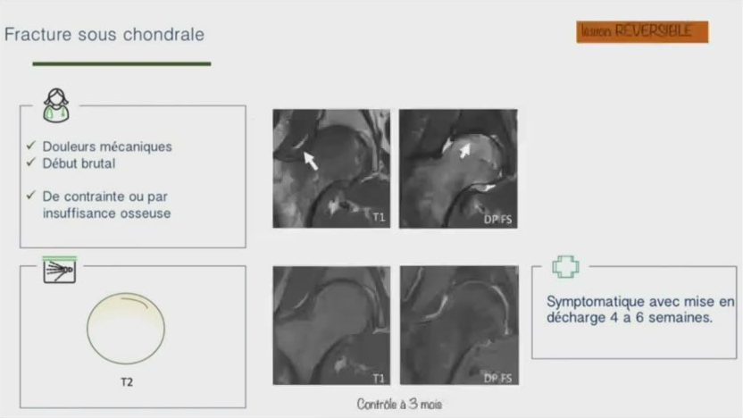
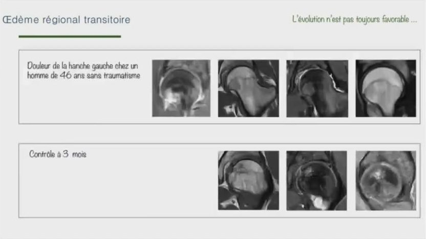
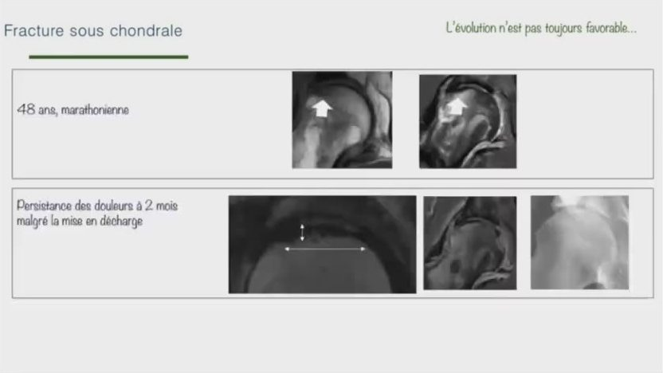

# Œdème médullaire de la tête fémorale : quand contrôler ?

> [!abstract] L'essentiel
> **L'œdème de la tête fémorale n'est pas un diagnostic : c'est la plaque sous-chondrale en sagittal T2 qui sépare réversible et irréversible** ; ne recontrôler que les patients restés douloureux.

> [!success] À retenir
> 1. **OM transitoire** (plaque intacte) : décharge, normalisation en **3 à 6 mois** ; **fracture sous-chondrale** (bande hypo fine parallèle à la surface) : décharge **4 à 6 semaines**.
> 2. **Nécrose mécanique** (femme > 50 ans en surpoids) : plage sous-chondrale sans os sain entre trait et corticale, perte de sphéricité → **irréversible**, coxarthrose.
> 3. Douleur persistante à **2-3 mois** malgré la décharge → **IRM de contrôle** (migration vers fracture puis nécrose) ; gadolinium si doute nécrose vs fracture.

## Images clés
 [▶ 5:41](https://www.youtube.com/watch?v=NNb-6m6ts9k&t=341s)
 [▶ 4:18](https://www.youtube.com/watch?v=NNb-6m6ts9k&t=258s)
 [▶ 5:54](https://www.youtube.com/watch?v=NNb-6m6ts9k&t=354s)

## Points clés
- Substrat anatomique de l'OM : infiltration œdémateuse, congestion vasculaire, hémorragie interstitielle et amincissement trabéculaire.
- Sémiologie de l'OM : hyposignal T1 restant plus élevé que celui du muscle (contrairement à un remplacement médullaire), limites floues, gradient décroissant vers la médullaire. Il est hyperintense en T2, surtout avec saturation de la graisse, et se rehausse de façon homogène après injection.
- Démarche diagnostique :
  1. topographie : un OM à distance de la plaque sous-chondrale doit faire évoquer un autre diagnostic ;
  2. lésion cartilagineuse, extension à l'acétabulum ou épanchement : éliminer d'abord une pathologie articulaire ;
  3. plaque sous-chondrale pathologique dans quatre cas : OM transitoire, fracture sous-chondrale, nécrose mécanique, nécrose systémique.
- **OM transitoire** : douleur mécanique sans traumatisme, limitation de la mobilité ; femme enceinte au 3e trimestre, homme d'âge moyen. Traitement par décharge. Normalisation en 3 à 6 mois.
- **Fracture sous-chondrale** (contrainte excessive ou insuffisance osseuse) : début brutal. Décharge de 4 à 6 semaines en moyenne, normalisation en 3 à 4 mois.
- Facteurs de mauvaise évolution : IMC élevé, longueur du trait de fracture, défect cartilagineux associé.
- **Nécrose focale mécanique** : surtout femme de plus de 50 ans en surpoids. Large plage en hyposignal au contact de la plaque, sans liseré de démarcation, avec perte de sphéricité. Lésion le plus souvent irréversible (en lien avec la taille du fragment), qui évolue vers la coxarthrose.
- Un OM transitoire peut évoluer vers une fracture sous-chondrale (OM qui migre, apparition d'une strie au contrôle à 3 mois), et une fracture vers une nécrose mécanique.

## Sémiologie et technique d'imagerie
- Protocole : coronal T1 et T2 FS pour détecter l'OM, puis **sagittal T2** pour la plaque sous-chondrale (en T1, l'hyposignal de l'œdème masque la plaque).
- Gadolinium non systématique, réservé au doute (nécrose mécanique contre fracture par insuffisance). Dans la fracture, l'os sous-chondral entre le trait et la corticale se rehausse, contrairement à l'ostéonécrose.
- Radiographies systématiques : perte de sphéricité de la tête, et surtout examen de référence pour le suivi.
- OM transitoire : OM au sommet de la tête sans anomalie de la plaque, épanchement possible. Un hypersignal T2 linéaire non liquidien parallèle à la surface articulaire est un signe non spécifique de remaniement.
- Fracture sous-chondrale : fine bande en hyposignal parallèle à la surface articulaire.
- Nécrose mécanique : la bande s'élargit en plage sous-chondrale, sans os sain entre le trait et la corticale.

## Pièges et diagnostics différentiels
- En T1 seul, l'œdème masque la plaque sous-chondrale.
- Un OM à distance de la plaque n'entre pas dans ce cadre.
- L'ostéonécrose systémique est un diagnostic différentiel (cf. fiche dédiée).

> [!WARNING] À ne pas manquer
> En cas de douleur persistante sous décharge, faire une IRM de contrôle pour dépister l'évolution d'un OM transitoire ou d'une fracture sous-chondrale vers une nécrose mécanique irréversible.

> [!TIP] Pour le compte rendu
> Préciser la topographie de l'OM, l'état de la plaque sous-chondrale (intacte, fracture, plage nécrotique), la sphéricité de la tête, l'épanchement et le cartilage.
> - Lésion à potentiel réversible : contrôle IRM à 2-3 mois, seulement si les symptômes persistent.
> - Nécrose mécanique étendue : la surveillance radiographique suffit (apparition d'une coxarthrose).

## Liens
- Congrès : [[SIMS 2019 - Index]]
- Voir aussi : [[L'ostéonécrose de tête fémorale]], [[Les fractures du tiers proximal de la diaphyse fémorale]]
