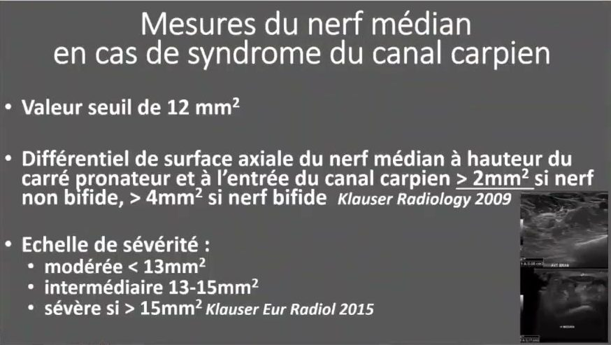
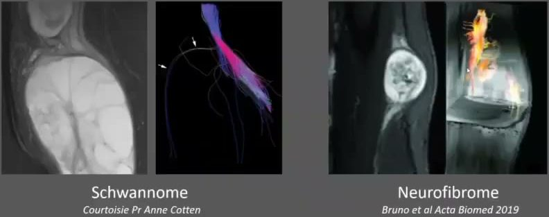
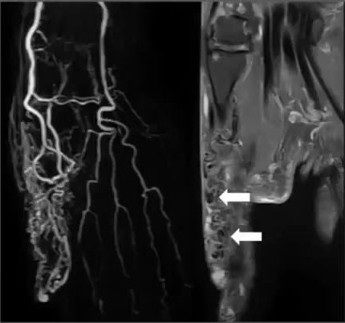

# Actualités en pathologies neurovasculaires de la main et du poignet

> [!abstract] L'essentiel
> **Un nerf chroniquement souffrant devient atrophique, hyperéchogène et sans hypersignal : une surface normale n'élimine pas une neuropathie ancienne** ; penser mobilité nerveuse, TE long et tractographie.

> [!success] À retenir
> 1. Médian au canal carpien : seuil **12 mm²**, différentiel carré pronateur/entrée du canal **> 2 mm²** (> **4 mm²** si nerf bifide) ; sévérité **< 13 / 13–15 / > 15 mm²** — faussé chez le sujet âgé (atrophie).
> 2. Écho dynamique : **translation latérale du médian réduite** en flexion-extension des doigts = argument pour SCC ; IRM nerf en **T2 FS TE > 80 ms**.
> 3. Malformations vasculaires : lire **chaque temps** de l'angio-IRM 4D ; haut débit = **flow-voids + retour veineux précoce** ; bas débit = hypersignal T2 lobulé + **phlébolithes**.

## Images clés
 [▶ 0:02](https://www.youtube.com/watch?v=2zRPvuYhebo&t=2s)
 [▶ 4:17](https://www.youtube.com/watch?v=2zRPvuYhebo&t=257s)
 [▶ 6:46](https://www.youtube.com/watch?v=2zRPvuYhebo&t=406s)

## Points clés
- Surface de section du nerf médian au canal carpien : seuil 12 mm², différentiel carré pronateur/entrée du canal > 2 mm² (> 4 mm² si nerf bifide) [Klauser 2009], sévérité modérée < 13, intermédiaire 13-15, sévère > 15 mm² [Klauser 2015], mais **faussées par l'ancienneté** de la neuropathie (sujets âgés) : la perte axonale chronique conduit à une **atrophie** et non à une hypertrophie ; valable pour tous les nerfs périphériques.
- Le nerf est **mobile** (répartition des contraintes) ; sa diminution de mobilité augmente les contraintes et les troubles vasculaires.
- Échographie dynamique en flexion-extension des doigts : translation latérale du nerf médian en coupe axiale (diminuée dans le syndrome du canal carpien, aide au diagnostic) ; glissement crânio-caudal en coupe longitudinale (plus intuitif, moins reproductible).
- Échostructure : neuropathie = épaississement hypoéchogène avec dédifférenciation fasciculaire (œdème) ; au stade tardif, fibrose → nerf **hyperéchogène** avec rares fascicules résiduels (ex. neuropathie toxique chronique).
- Échographie : localiser la lésion, en préciser le type et l'étendue (perte de substance), cartographier les rapports tumeur-vaisseaux-nerfs en préopératoire.
- Astuce : **marquage cutané** des lésions puis photo sur le téléphone du patient, disponible au bloc (ex. plaie balistique avec perte de substance du nerf médian, planification d'une greffe).
- IRM : hypersignal T2 et rehaussement (rarement utile) au stade aigu ; disparition de l'hypersignal et du rehaussement au stade chronique fibreux.
- Technique IRM nerf : T2 Fat Sat avec **TE long (> 80, voire > 100 ms)** plutôt que densité de protons, pour détecter les hypersignaux discrets et réduire l'artefact d'angle magique.
- **Tractographie** sous-utilisée : distingue schwannome (refoule les fascicules) et neurofibrome (les interrompt) ; intérêt en traumatologie et pour le suivi de la repousse.
- **Corpuscules de Pacini** : mécanorécepteurs hypodermiques de 1 à 2 mm, nodules hypoéchogènes en échographie, hypersignal T2 relatif en IRM ; hyperplasie/hypertrophie décrite dans la maladie de Raynaud, névromes ou neurofibromes exceptionnels, prolifération post-traumatique douloureuse.

## Sémiologie et technique d'imagerie
- Pathologie vasculaire : échographie-Doppler en première intention, puis angioscanner et/ou angio-IRM selon l'équipe.
- Analyser **toutes les phases dynamiques** une à une, comme une artériographie.
- Malformation à haut débit : prise de contraste dès le temps artériel avec **retour veineux précoce**, flow-voids.
- Malformation veineuse (bas débit) : masse lobulée en hypersignal T2 sans flow-void, révélée par des thromboses (augmentation de volume, douleur) ; thrombi ; **phlébolithes** pathognomoniques (radiographie, scanner, séquence ZTE en IRM, échographie) ; rehaussement tardif sans retour veineux précoce.

## Pièges et diagnostics différentiels
- Neuropathie chronique fibreuse : surface normale ou basse, nerf hyperéchogène → faux négatif échographique.
- Anisotropie des nerfs en échographie.

> [!WARNING] À ne pas manquer
> Une surface de section normale du nerf médian n'élimine pas une neuropathie ancienne avec perte axonale.

> [!TIP] Pour le compte rendu
> Décrire surface, échostructure et mobilité du nerf, la topographie précise d'une lésion (avec marquage cutané si chirurgie prévue) ; pour une malformation vasculaire, conclure sur haut ou bas débit selon la cinétique.

## Liens
- Congrès : [[SIMS 2022 - Index]]
- Voir aussi : [[L'échochirurgie du canal carpien]], [[Tumeurs de l'ongle, il n'y a pas que la glomique]]
