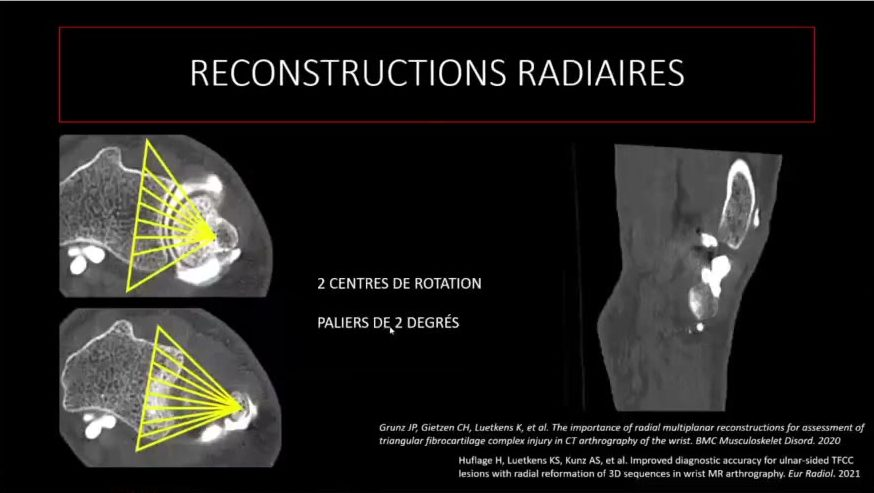
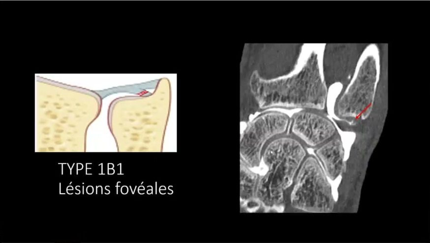
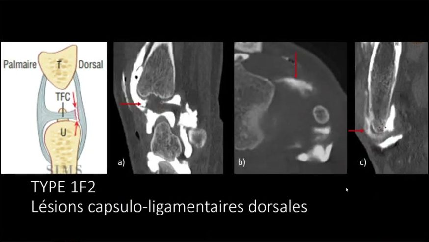

# Actualités en pathologies traumatiques (lésions traumatiques du TFCC)

> [!abstract] L'essentiel
> **Palmer 1B est dépassé : décrire séparément les lésions fovéales, styloïdiennes, palmaires et dorsales du TFCC (classification de Zhan 2020)** : elles cicatrisent et se réparent sous arthroscopie.

> [!success] À retenir
> 1. **Arthroscanner ou arthro-IRM** (≈ **100 %** Se/Sp) avec **reconstructions radiaires** (2 centres de rotation, pas de **2°**) centrées sur fovéa et styloïde.
> 2. Signaler explicitement une **lésion fovéale (1B1)** : invisible en arthroscopie radiocarpienne, elle impose un abord radio-ulnaire distal.
> 3. Chercher les lésions **palmaires (1C, 1F1)** en sagittal et **dorsales (1F2-1F4)** en axial ; préciser la date du traumatisme (bons résultats si opéré **< 15 mois**).

## Images clés
 [▶ 6:52](https://www.youtube.com/watch?v=nFzCV75lh60&t=412s)
 [▶ 7:08](https://www.youtube.com/watch?v=nFzCV75lh60&t=428s)
 [▶ 8:02](https://www.youtube.com/watch?v=nFzCV75lh60&t=482s)

## Points clés
- Lésions fréquentes, cause de douleur chronique du bord ulnaire et d'instabilité radio-ulnaire distale, avec errance diagnostique ; examen clinique peu spécifique (douleur sous la styloïde ulnaire).
- Anatomie : disque articulaire central (amortisseur) ; ligaments radio-ulnaires distaux palmaire et dorsal, principaux stabilisateurs de la RUD, avec fibres proximales/profondes (insertion **fovéale**) et distales/superficielles (insertion **styloïdienne**) ; ligaments ulnocarpiens palmaires (ulno-lunaire, ulno-triquétral), homologue méniscal, ligament collatéral ulnaire (discuté), sous-gaine de l'extenseur ulnaire du carpe.
- Nakamura : torsion des insertions fovéales et styloïdiennes en prono-supination, gênant la cicatrisation sans immobilisation.
- Anatomie arthroscopique (2021) : **continuum** entre disque, ligaments radio-ulnaires distaux, ligaments ulnocarpiens et capsule dorsale formant une arche insérée sur la styloïde ; deux seuls récessus physiologiques : **pré-styloïdien** et **piso-triquétral**.
- Vascularisation de type méniscal, essentiellement fovéale et distale : potentiel de cicatrisation de ces lésions, d'où l'intérêt de les dépister.
- Arthroscopie : voie radio-carpienne dorsale, tests fovéaux de sensibilité imparfaite (faux négatifs des lésions fovéales partielles), suture des lésions distales, réinsertion fovéale par voie radio-ulnaire distale.
- Résultats (méta-analyse 2021) excellents, si pas d'instabilité RUD résiduelle et si le traitement a lieu **moins de 15 mois** après le traumatisme ; complications rares (neurapraxie de la branche dorsale sensitive du nerf ulnaire).
- Palmer (1989) : le type 1B doit être démembré. Estrella (2007) : 18 lésions dorsales sur 35 patients, non décrites par Palmer, 74 % de bons résultats après suture. Classification arthroscopique d'Atzei/EWAS (2009) : lésion fovéale, styloïdienne ou combinée.
- **Classification de Zhan (2020)**, Palmer revisitée en IRM 3T, exhaustive : 1B1 (fovéale isolée partielle ou complète), 1C (désinsertion palmaire ulnocarpienne), 1F1 (désinsertion ulno-triquétrale palmaire), 1F2 (ligament radio-ulnaire distal dorsal et capsule dorsale), 1F3 (désinsertion capsulaire dorsale distale sur le triquetrum), 1F4 (associations dorsales), 1G (languettes du disque luxées dans l'interligne ulnocarpien).

## Sémiologie et technique d'imagerie
- Arthroscanner et arthro-IRM : sensibilité et spécificité proches de 100 % (2013), supérieures à l'IRM conventionnelle, notamment pour les lésions fovéales et distales.
- Arthroscanner : **reconstructions radiaires** (deux centres de rotation, paliers de 2°) centrées sur la fovéa et la styloïde ulnaire ; plan sagittal pour les lésions palmaires (1C, 1F1) ; plan axial pour les désinsertions dorsales.

## Pièges et diagnostics différentiels
- Ne pas prendre les récessus pré-styloïdien et piso-triquétral pour une désinsertion.
- Lésion fovéale partielle méconnue à l'arthroscopie radio-carpienne.

> [!WARNING] À ne pas manquer
> Les lésions fovéales doivent être signalées explicitement : sans abord radio-ulnaire distal, le chirurgien peut ne pas les voir ni les traiter.

> [!TIP] Pour le compte rendu
> Décrire séparément disque, insertions fovéale et styloïdienne, ligaments ulnocarpiens palmaires et versant dorsal ; préciser la date du traumatisme (fenêtre de 15 mois) et les signes d'instabilité RUD.

## Liens
- Congrès : [[SIMS 2022 - Index]]
- Voir aussi : [[Les ligaments du carpe à connaître]], [[Le conflit ulnocarpien et le conflit styloïdo-triquétral]]
