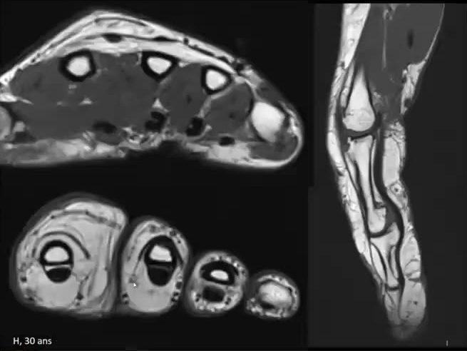
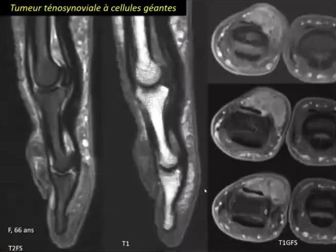
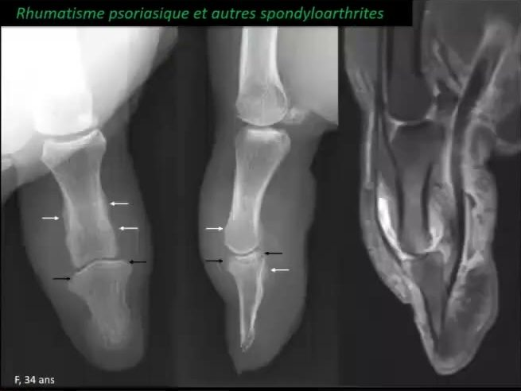

# Algorithme diagnostique à propos du gros doigt

> [!abstract] L'essentiel
> **Gros doigt = diagnostic clinique à classer d'emblée : congénital, tuméfaction localisée (dysharmonieux) ou dactylite globale** ; l'imagerie identifie ensuite les composants atteints.

> [!success] À retenir
> 1. Congénital : penser **spectre PROS (*PIK3CA*)** ; macrodystrophie lipomateuse = hypertrophie graisseuse des **2e-3e rayons**, **fibrolipome du nerf** associé dans **30-50 %**.
> 2. Tuméfaction localisée au contact d'un tendon en **hyposignal T1 et T2** avec encoche osseuse = **tumeur ténosynoviale à cellules géantes**.
> 3. Dactylite : **6 causes** (infection, **rhumatisme psoriasique** = 1re cause, sarcoïdose, crise d'hydroxyapatite, ostéome ostéoïde, drépanocytose) ; éliminer d'abord le **phlegmon/abcès**.

## Images clés
 [▶ 4:20](https://www.youtube.com/watch?v=P09ERySLV7Y&t=260s)
 [▶ 7:07](https://www.youtube.com/watch?v=P09ERySLV7Y&t=427s)
 [▶ 9:38](https://www.youtube.com/watch?v=P09ERySLV7Y&t=578s)

## Points clés
- **Gros doigt congénital** (rare), classé grâce à la génétique :
  - famille du spectre **PROS** (*PIK3CA*, mutations activatrices somatiques/postzygotiques → distribution en mosaïque) : CLOVES, CLAPO, macrodystrophie lipomateuse ; hypercroissance graisseuse et malformations vasculaires ;
  - autres syndromes d'hypercroissance hors PROS : Protée (Proteus), Parkes Weber (atteinte surtout des membres inférieurs) ;
  - prolifération de tissu anormal : neurofibromes (NF1), enchondromes multiples (Ollier), enchondromes + malformations vasculaires (Maffucci).
- **Macrodystrophie lipomateuse** : hypercroissance du mésenchyme (graisse, tissu fibreux) surtout des 2e et 3e rayons, à prédominance palmaire et distale, avec hypertrophie osseuse moindre ; arrêt à la puberté puis **arthrose précoce** IPP/MCP ; fibrolipome du nerf du même territoire dans 30 à 50 % des cas (aspect en « sachet de spaghettis », ex. nerf médian).
- Thérapeutiques ciblées de la voie de signalisation en essai, porteuses d'espoir.
- **Gros doigt dysharmonieux** (tuméfaction localisée, tumeurs osseuses ou des parties molles) : tumeur ténosynoviale à cellules géantes (signal bas T1 et T2, contact des tendons — extenseurs à la main —, encoche osseuse, parfois agressive) ; malformation vasculaire à haut débit ; prolifération ostéochondromateuse paraostéale bizarre (coiffe cartilagineuse sans continuité corticomédullaire) ; kyste anévrismal primitif (niveaux liquides pas toujours présents) ; goutte avec tophus destructeurs.
- **Dactylite** : six étiologies : infection, rhumatismes (surtout psoriasique), sarcoïdose, crise de résorption microcristalline aiguë (hydroxyapatite), ostéome ostéoïde, drépanocytose.
- Rhumatisme psoriasique : première cause de dactylite (survient chez 1 patient sur 2 au cours de la maladie ; pied 2/3, main 1/4 ; récidive 1 fois sur 2), chaude ou froide, souvent inaugurale ; inflammation des parties molles, ténosynovite, enthésite, arthrites, érosions et proliférations osseuses, atteinte d'un seul rayon.
- Sarcoïdose : atteinte conjointe os, tissus mous, peau, ongle ; infiltration granulomateuse médullaire des phalanges, lyse partielle spongieuse et corticale, ténosynovite floride.
- Ostéome ostéoïde phalangien : sujets plus âgés, peu douloureux, nidus souvent non vu en IRM et très minéralisé aux phalanges.
- Drépanocytose : tout-petits, syndrome pied-main par crise vaso-occlusive, apposition périostée.

## Sémiologie et technique d'imagerie
- Radiographies, IRM et/ou échographie pour préciser les composants (graisse, nerf, os, tendon, synoviale).
- Infections : phlegmon sous-cutané non abcédé ou abcès des espaces celluleux (staphylocoque).

## Pièges et diagnostics différentiels
- Kyste anévrismal sans niveau liquide-liquide.
- Ostéome ostéoïde phalangien atypique (âge, douleur modérée, nidus invisible en IRM).

> [!WARNING] À ne pas manquer
> Dactylite inaugurale d'un rhumatisme psoriasique, et dactylite infectieuse (phlegmon, abcès) à traiter en urgence.

> [!TIP] Pour le compte rendu
> Classer d'emblée (congénital / tuméfaction localisée / dactylite), détailler les composants atteints, et pour une dactylite discuter les six étiologies selon le contexte.

## Liens
- Congrès : [[SIMS 2022 - Index]]
- Voir aussi : [[La main cristalline]], [[Le traitement chirurgical des phlegmons des fléchisseurs au stade précoce]], [[Arthrose digitale différentes nomenclatures, phénotypes différents]]
