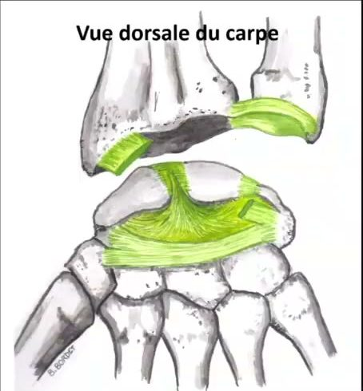
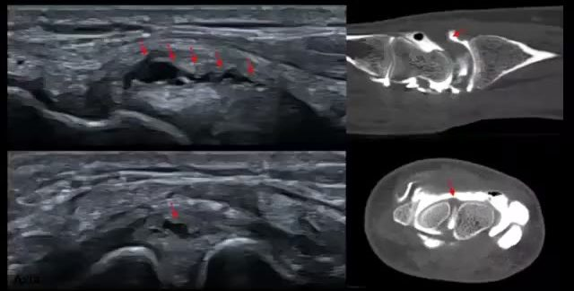
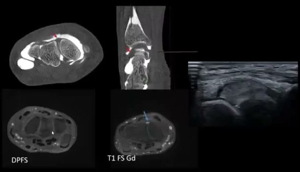

# Anatomie et imagerie du septum dorsal

> [!abstract] L'essentiel
> **Tout kyste dorsal du carpe naît du septum dorsal capsulo-scapho-lunaire (SDCS)** : le chercher en écho, arthroscanner ou IRM 3D, et le décrire aussi dans les lésions scapho-lunaires.

> [!success] À retenir
> 1. Kyste dorsal = **dysplasie mucoïde du SDCS**, **sans communication articulaire** en règle (sauf micro-perforation scapho-lunaire).
> 2. **Dysplasie sans kyste** possible : SDCS épaissi, douloureux, visible seulement après **gadolinium** (rehaussement) ou en arthroscanner.
> 3. Rupture du scapho-lunaire : l'**arche verticale** du SDCS se rompt sur son **versant radial (scaphoïdien)** et flotte attachée au lunatum.

## Images clés
 [▶ 0:09](https://www.youtube.com/watch?v=WlxnDeqxj2U&t=9s)
 [▶ 6:04](https://www.youtube.com/watch?v=WlxnDeqxj2U&t=364s)
 [▶ 6:42](https://www.youtube.com/watch?v=WlxnDeqxj2U&t=402s)

## Points clés
- Décrit pour la première fois par L. Van Overstraeten : tente capsulo-ligamentaire tendue à la face dorsale du ligament scapho-lunaire, s'évasant sur la capsule et convergeant avec le ligament intercarpien dorsal.
- Intra-articulaire mais extrasynovial ; sépare compartiments radio-carpien et médiocarpien ; détendu au repos, son **arche verticale** se tend avec la pression intra-articulaire (aspect arthroscopique).
- Kystes dorsaux du carpe : théorie de la **dysplasie mucoïde kystique** privilégiée (absence d'élément synovial, acide hyaluronique, analogie avec le LCA kystique), intriquée avec une possible brèche articulaire.
- Règle : tout kyste dorsal du carpe doit faire rechercher une origine dans le DCSS ; **pas de communication articulaire** en règle (possible si micro-perforation du scapho-lunaire).
- Le nerf interosseux postérieur, en rapport étroit, serait impliqué dans la douleur (irritation de ses rameaux).
- Dysplasie hypertrophique sans kyste possible : épaississement, inflammatoire (rehaussement) et douloureux.
- L'ossicule épilunaire (environ 1 % des cas selon l'orateur) siège dans le DCSS ; un kyste dorsal peut coexister avec un ossicule.
- Dans les lésions scapho-lunaires, la rupture et le diastasis déchirent l'arche verticale, surtout sur le versant **scaphoïdien** ; l'arche reste attachée à la corne dorsale du lunatum et flotte en arrière de l'interligne radio-carpien.

## Sémiologie et technique d'imagerie
- IRM : difficile ; acquisitions 3D avec reconstructions MPR obliques dans le plan de l'interligne scapho-lunaire pour dérouler les portions dorsale et intermédiaire du ligament et repérer le DCSS ; pas de rehaussement physiologique après gadolinium.
- Arthroscanner : meilleure visibilité (déplissement), coupes sagittales obliques dans l'axe de l'interligne montrant l'ancrage dorsal sur le scaphoïde et la corne dorsale du lunatum.
- Échographie haute fréquence : balayage sagittal du versant radial vers le lunatum ; structure hyperéchogène fine attachée au scapho-lunaire dorsal.
- Kystes : de taille variable, parfois cloisonnés, paroi hyperhémiée au Doppler puissance ou rehaussée en IRM ; petits kystes « en goutte » visibles en 3D.

## Pièges et diagnostics différentiels
- Un DCSS épaissi ou renflé en arthroscanner sans communication n'est pas normal : penser à une dysplasie.
- Absence de kyste en T2 n'élimine pas une dysplasie inflammatoire : l'injection de gadolinium la montre.

> [!WARNING] À ne pas manquer
> Devant une lésion scapho-lunaire, décrire aussi le DCSS (désinsertion scaphoïdienne de l'arche verticale).

> [!TIP] Pour le compte rendu
> Kyste dorsal : préciser son origine sur le DCSS, l'absence/présence de communication articulaire, le rapport avec le nerf interosseux postérieur, et l'état du ligament scapho-lunaire.

## Liens
- Congrès : [[SIMS 2022 - Index]]
- Voir aussi : [[Les ligaments extrinsèques du carpe]], [[Mise au point sur les différentes techniques de reconstruction scapholunaire]], [[Le traitement percutané des kystes]]
