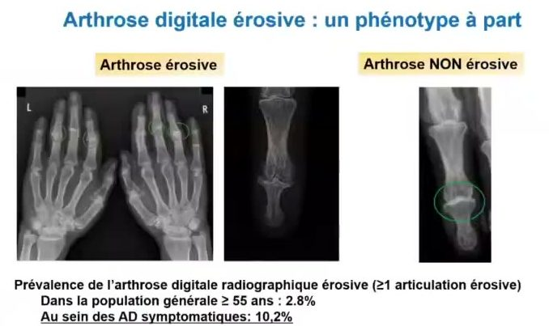
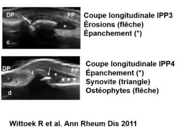
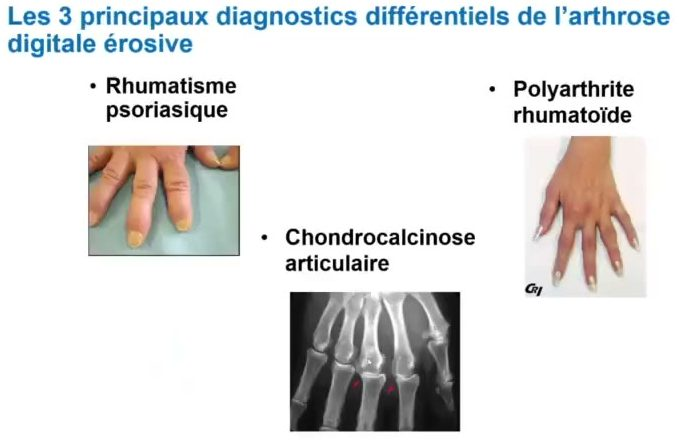

# Arthrose digitale différentes nomenclatures, phénotypes différents

> [!abstract] L'essentiel
> **L'arthrose digitale érosive est un phénotype à part, plus douloureux, inflammatoire et destructeur** : la nommer dès qu'une IPP est érosive.

> [!success] À retenir
> 1. **Arthrose érosive** (≥ 1 articulation érosive) : **2,8 %** de la population ≥ 55 ans mais **10,2 %** des arthroses digitales symptomatiques ; érosion **centrale** en **aile de mouette**.
> 2. Plus de **synovite** en échographie (épanchement, Doppler) que l'arthrose non érosive ; différentiels : **rhumatisme psoriasique**, **chondrocalcinose**, **PR**.
> 3. **Arthrose des MCP sans atteinte des IPP** → remettre en cause le diagnostic (chondrocalcinose, hémochromatose) ; base du pouce et doigts longs associés chez **75 %** des patients.

## Images clés
 [▶ 7:39](https://www.youtube.com/watch?v=DJ9VuawNLpE&t=459s)
 [▶ 8:39](https://www.youtube.com/watch?v=DJ9VuawNLpE&t=519s)
 [▶ 9:06](https://www.youtube.com/watch?v=DJ9VuawNLpE&t=546s)

## Points clés
- Diagnostic clinique (douleurs mécaniques, raideur progressive ; critères américains des années 1990 surtout utilisés dans les essais) confirmé par la radiographie.
- Fréquence : une femme sur deux et un homme sur quatre au cours de la vie ; après 65 ans (Framingham), signes radiographiques chez 70 % des hommes et > 80 % des femmes, mais symptômes à un instant donné chez 14 % des femmes et 7 % des hommes.
- Recommandations européennes (EULAR) : éducation, exercices, orthèse (portée au moins 3 mois), AINS topiques voire généraux, antalgiques, chondroïtine sulfate (déremboursée), infiltrations dans les formes inflammatoires, chirurgie en cas d'échec.
- Essais négatifs (méthotrexate, hydroxychloroquine, colchicine…) : bloquer l'inflammation ne suffit pas et/ou populations trop hétérogènes (32 articulations concernées).
- **Facteurs de risque** : âge > 50 ans, sexe féminin, périménopause (rôle hormonal), génétique (héritabilité ~60 %), contraintes mécaniques (base du pouce, MCP), obésité et syndrome métabolique (risque ×2, via les adipokines, sans composante mécanique à la main).
- **Localisation** : base du pouce (trapézo-métacarpienne ± STT) — symétrique, perte de force de la pince, facteurs mécaniques ; IPP/IPD — nodosités d'Heberden et de Bouchard, possible forme érosive, facteurs systémiques. Chevauchement important : 75 % des patients ont les deux.
- Cohorte DIGICOD (426 patients, arthrose sévère, moitié érosive) : arthrose radiographique des MCP (Kellgren-Lawrence ≥ 2 sur au moins 2 MCP) chez un tiers, peu sévère, peu symptomatique, quasi jamais érosive ; associée à l'âge, aux métiers manuels, au nombre d'IPP atteintes et à l'arthrose STT, sans lien cardio-métabolique. **Une arthrose des MCP sans atteinte des IPP doit remettre en cause le diagnostic.**
- **Arthrose érosive** : plutôt destructrice qu'érosive (érosions centrales par effondrement de la plaque sous-chondrale) ; plus douloureuse, plus handicapante, plus inflammatoire (infiltrats lymphocytaires synoviaux, synovites cliniques et échographiques avec Doppler, CRP ultrasensible corrélée au nombre d'articulations érosives) ; probablement un phénotype distinct.
- Phénotypage par symptômes (score AUSCAN douleur, raideur, fonction + gêne esthétique) : 5 clusters, dont des patients sans symptôme, d'autres avec gêne esthétique isolée, d'autres très douloureux et handicapés.

## Sémiologie et technique d'imagerie
- Radiographie : aspect en **aile de mouette** puis destruction plus évoluée dans l'arthrose érosive ; gradation Kellgren-Lawrence.
- Échographie : synovite, épaississement synovial, signal Doppler.

## Pièges et diagnostics différentiels
- Arthrose érosive : rhumatisme psoriasique, chondrocalcinose, polyarthrite rhumatoïde.
- Atteinte MCP isolée : chercher une autre cause.

> [!WARNING] À ne pas manquer
> Arthrose « isolée » des MCP sans atteinte IPP : penser à une autre arthropathie.

> [!TIP] Pour le compte rendu
> Préciser la distribution (base du pouce, IPP, IPD, MCP), le caractère érosif (aile de mouette, effondrement sous-chondral) et les signes de synovite active.

## Liens
- Congrès : [[SIMS 2022 - Index]]
- Voir aussi : [[La main cristalline]], [[Les injections articulaires du poignet et de la main]], [[Algorithme diagnostique à propos du gros doigt]]
