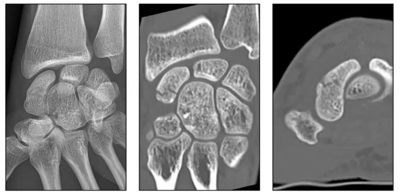
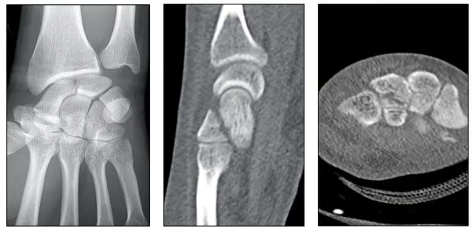
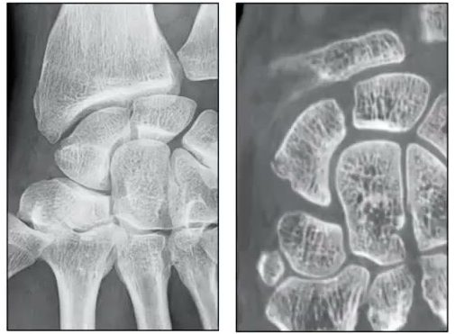

# Fracture occulte du carpe, diagnostic et IA

> [!abstract] L'essentiel
> **Radiographie normale ≠ pas de fracture du carpe : 20 % des fractures du scaphoïde sont occultes** ; passer d'emblée au scanner/cone beam ou à l'IRM plutôt qu'à la radio de contrôle à J10-J14.

> [!success] À retenir
> 1. Bilan initial = **4 incidences** (face, profil strict, 2 obliques dont scaphoïde en inclinaison ulnaire) ; sensibilité radio ≈ **50 %** carpe, **80 %** scaphoïde.
> 2. Radio à **J10-J14 inutile** (≈ **6 semaines** pour voir une anomalie) ; scanner/cone beam (**VPN ≈ 95 %**) ou IRM, performances équivalentes, IRM plus simple à lire (œdème T2, trait T1).
> 3. Regarder systématiquement le **lunatum** et la **deuxième rangée** (trapèze, capitatum), bien plus souvent fracturés que ne le laisse croire la radio ; l'**IA** améliore le lecteur sans le remplacer.

## Images clés
 [▶ 5:54](https://www.youtube.com/watch?v=TkQEa4kvk2Y&t=354s)
 [▶ 7:24](https://www.youtube.com/watch?v=TkQEa4kvk2Y&t=444s)
 [▶ 7:58](https://www.youtube.com/watch?v=TkQEa4kvk2Y&t=478s)

## Points clés
- Définition (ancienne mais de référence, notamment médico-légale) : fracture non détectée sur les radiographies initiales, ou signes subtils visibles seulement rétrospectivement, confirmée par une autre technique.
- Causes : fracture non déplacée, unicorticale ou purement trabéculaire ; faible contraste (patient obèse) ; incidence, exposition, complexité anatomique ; **observateur** (expérience, fatigue : moins performant à 19 h qu'à 8 h).
- Examen clinique décevant : valeur prédictive positive d'environ 20 % ; aucun signe ne permet d'exclure ou d'affirmer une fracture du scaphoïde.
- Sensibilité des radiographies : environ 50 % pour le carpe ; au mieux 80 % pour le scaphoïde, soit **20 % de fractures du scaphoïde occultes**.
- Bilan obligatoire : **4 incidences** (face, profil strict, deux obliques dont une incidence dégageant le scaphoïde en inclinaison ulnaire, type Schreck).
- Avec l'imagerie en coupe, le scaphoïde reste prédominant mais les fractures du **lunatum et de la deuxième rangée** (trapèze, capitatum) sont bien plus fréquentes qu'on ne le pensait.
- Contrôle radiographique à J10-J14 : stratégie insuffisante, il faut environ 6 semaines pour voir apparaître une anomalie ; une radiographie normale à 6 semaines sert toutefois de *gold standard* d'absence de fracture.
- Scanner (ou cone beam, performances identiques mais non côté) : excellente spécificité, valeur prédictive négative d'environ 95 %.
- IRM : sensibilité équivalente au scanner, mais lecture plus simple pour un radiologue débutant ou fatigué (œdème en T2, trait en T1) ; montre aussi les contusions osseuses sans fracture.
- IA (réseaux de neurones, *deep learning*) : couches successives activées par des motifs, apprentissage par rétrocontrôle ; améliore les performances et les conditions de travail.

## Sémiologie et technique d'imagerie
- Scanner : trait cortical ou trabéculaire, souvent unicortical et non déplacé.
- IRM : œdème médullaire en T2 FS / DP FS, trait en hyposignal T1 ; contusions isolées sans trait.
- Échographie performante entre des mains expertes, mais non retenue par l'orateur pour une pratique standardisée.

## Pièges et diagnostics différentiels
- Fracture unicorticale du scaphoïde manquée au scanner en fin de vacation.
- Fractures du trapèze ou du capitatum invisibles sur toutes les incidences.
- Les sensibilités publiées dépendent de l'expérience des lecteurs et des conditions de lecture.

> [!WARNING] À ne pas manquer
> Un bilan radiographique normal n'exclut pas une fracture : 20 % des fractures du scaphoïde sont occultes, et le lunatum comme la deuxième rangée sont souvent oubliés.

> [!TIP] Pour le compte rendu
> Vérifier la présence des 4 incidences, analyser systématiquement lunatum et deuxième rangée, et proposer en deuxième ligne le scanner (ou cone beam) ou l'IRM selon l'accès et l'habitude, plutôt qu'une radiographie à J14.

## Liens
- Congrès : [[SIMS 2022 - Index]]
- Voir aussi : [[Retard de consolidation, pseudarthrose et nécrose du scaphoïde]], [[Actualités en pathologies traumatiques]]
