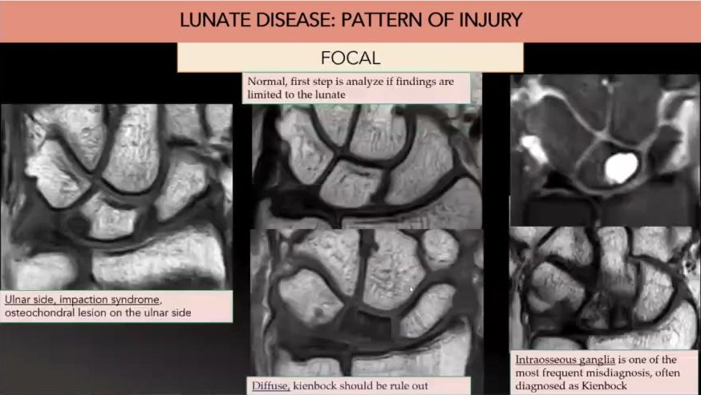
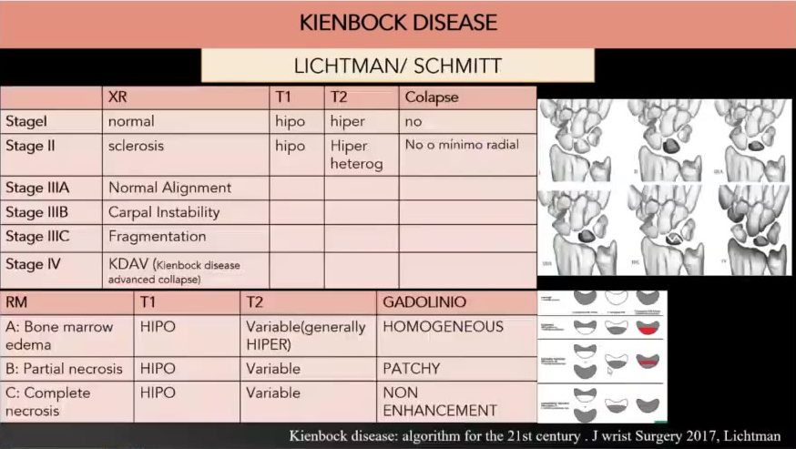
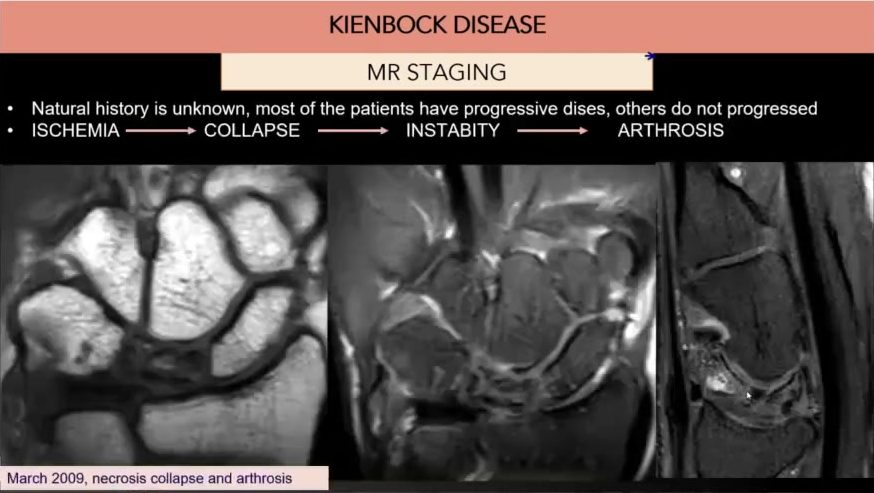

# Imagerie et pronostic de la maladie de Kienböck

> [!abstract] L'essentiel
> **Devant un lunatum anormal, regarder d'abord la distribution** : ulnaire = conflit ulnocarpien, radiale = kyste, diffuse = Kienböck ; puis stade de Lichtman et rehaussement.

> [!success] À retenir
> 1. **Kyste intra-osseux** = premier faux Kienböck ; atteinte **ulnaire** + variance positive = **conflit ulnocarpien** ; variance mesurée sur radio en **position neutre**.
> 2. **Lichtman** : I IRM seule, II sclérose, **IIIA** collapsus aligné, **IIIB** instabilité carpienne, **IIIC** fragmentation (non reconstructible), IV arthrose.
> 3. **Gadolinium** aux stades précoces : rehaussement homogène / partiel / absent (Schmitt) ; faible rehaussement → collapsus plus fréquent → suivi rapproché.

## Images clés
 [▶ 5:23](https://www.youtube.com/watch?v=MixjCy7xY_E&t=323s)
 [▶ 8:26](https://www.youtube.com/watch?v=MixjCy7xY_E&t=506s)
 [▶ 10:48](https://www.youtube.com/watch?v=MixjCy7xY_E&t=648s)

## Points clés
- Lunatum central, intercalé entre scaphoïde, triquetrum, radius et capitatum ; souvent pris à tort pour une maladie de Kienböck.
- Facteurs anatomiques associés : **petit lunatum** (volume cité de 230-250 mm³), facette proximale de type 1 (angle > 130°, classification d'Antuña Zapico) associée à une variance ulnaire négative, **variance ulnaire négative**, inclinaison radiale augmentée (normale 16-28°), vascularisation précaire (apport dorsal unique, peu d'anastomoses).
- Variance à mesurer uniquement sur radiographie en position neutre.
- **Distribution** : focale ulnaire → conflit ulnocarpien (surtout si variance positive) ; focale radiale → kyste intra-osseux (parfois communicant, bilatéral, avec œdème, curetage exceptionnel) ou géodes sur lésion scapho-lunaire chronique ; diffuse → Kienböck, mais aussi arthropathie inflammatoire (polyarthrite rhumatoïde, rhumatisme psoriasique) ou arthrose si le reste du carpe est atteint.
- **Lunatomalacie de l'enfant** : forme infantile (< 12 ans) et juvénile (> 13 ans), excellent pronostic ; chez les plus âgés environ 30 % progressent et nécessitent une égalisation (exemple de revascularisation à 60 mois, cas de Bruno Vande Berg).
- **Classification de Lichtman (1977)** : I radiographie normale ; II sclérose ; III collapsus (IIIA sans, IIIB avec désaxation carpienne, migration proximale du capitatum) ; IV arthrose carpienne. Complétée par l'IRM pour le stade I (hyposignal T1, hypersignal T2, sans collapsus).
- **Rehaussement (Schmitt)** : homogène (œdème bien vascularisé), partiel (nécrose partielle), absent (nécrose complète, T2 variable) ; attention à l'ischémie transitoire. Un faible rehaussement est associé à un collapsus ultérieur plus fréquent : surveillance rapprochée.
- **Traitement** : stades 0-II bien vascularisés : raccourcissement radial (ou ulnaire), décompression, greffe vascularisée ; IIIA avec vascularisation partielle : raccourcissement ou résection de la première rangée ; lunatum non reconstructible : arthrodèses partielles (scapho-capitate) ; arthrose diffuse : arthrodèse totale.

## Sémiologie et technique d'imagerie
- Radiographies en position neutre : alignement, variance, collapsus.
- Scanner : fragments, fragmentation.
- IRM : localisation des lésions, œdème, injection de gadolinium surtout aux stades précoces, lésions associées (ligaments, TFCC).

## Pièges et diagnostics différentiels
- Atteinte ulnaire du lunatum avec ulna longue = conflit ulnocarpien, pas Kienböck.
- Kyste ou géodes radiales, arthropathies inflammatoires.
- Le stade IIIA/IIIB (désaxation) marque le tournant thérapeutique ; la fragmentation rend le lunatum non reconstructible.

> [!WARNING] À ne pas manquer
> Un lunatum faiblement rehaussé évolue plus souvent vers le collapsus : suivi rapproché avant fragmentation, qui limite fortement les options thérapeutiques.

> [!TIP] Pour le compte rendu
> Indiquer distribution des anomalies, variance ulnaire, stade de Lichtman, collapsus, fragmentation, alignement carpien, pattern de rehaussement et arthrose.

## Liens
- Congrès : [[SIMS 2022 - Index]]
- Voir aussi : [[Le conflit ulnocarpien et le conflit styloïdo-triquétral]], [[Retard de consolidation, pseudarthrose et nécrose du scaphoïde]]
