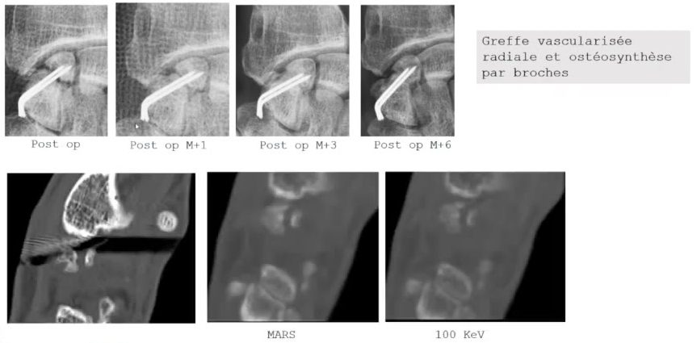
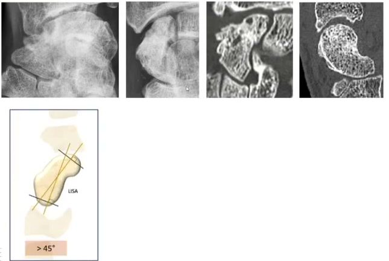
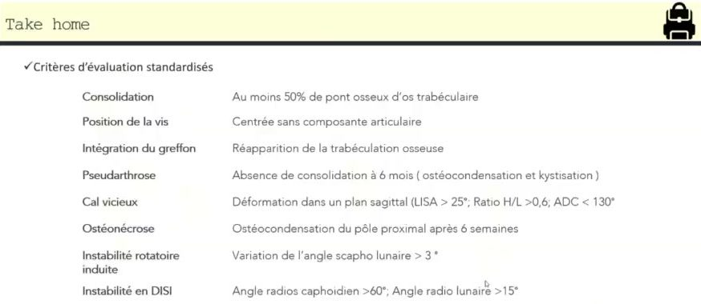

# Imagerie postopératoire du scaphoïde

> [!abstract] L'essentiel
> **Fracture fraîche vissée : la radiographie suffit ; pseudarthrose greffée : scanner obligatoire (réduction d'artefacts) pour affirmer le pont osseux et mesurer la déformation.**

> [!success] À retenir
> 1. **Consolidation = ≥ 50 % de pont osseux** trabéculaire ; **pseudarthrose = absence de consolidation à 6 mois** (condensation, kystisation des berges).
> 2. Vis **centrée, sans débord articulaire** (< 2 mm toléré) ; **instabilité rotatoire induite** si l'angle scapho-lunaire varie de **> 3°** ; condensation du pôle proximal après **6 semaines** → ostéonécrose.
> 3. Cal vicieux en *humpback* : angle intrascaphoïdien élevé (> 45° sur le schéma présenté), **rapport H/L > 0,6**, **angle dorsal < 130°** ; DISI si radio-scaphoïdien **> 60°** et radio-lunaire **> 15°**.

## Images clés
 [▶ 5:50](https://www.youtube.com/watch?v=ESimvLy420s&t=350s)
 [▶ 6:50](https://www.youtube.com/watch?v=ESimvLy420s&t=410s)
 [▶ 8:26](https://www.youtube.com/watch?v=ESimvLy420s&t=506s)

## Points clés
- Indications opératoires élargies (techniques percutanées et arthroscopiques) ; objectif du suivi : dépister une évolution défavorable avant l'arthrose radio-carpienne.
- **Évolution simple** : radiographie à J+15 (sevrage de l'attelle), au minimum 3 incidences (face, profil, grand axe du scaphoïde) ; 2e contrôle à 8-10 semaines ; consolidation complète habituellement à 3 mois (disparition du trait, pont osseux).
- Reproductibilité médiocre des radiographies : certaines équipes font un scanner systématique, sans bénéfice clinique démontré.
- **Matériel** : vis dans le grand axe, centrée, perpendiculaire au trait ; une inadéquation crée une instabilité, une chambre de mobilité et un retard de consolidation.
- **Débord articulaire** de la vis : toléré s'il est < 2 mm ; s'il est franc, discuter l'ablation (sous réserve de lésions chondrales irréversibles).
- **Instabilité rotatoire induite** : comparer les angles (scapho-lunaire, radio-carpiens) pré- et postopératoires ; une compression excessive peut horizontaliser le scaphoïde.
- **Après pseudarthrose** : scanner indispensable. Consolidation si **> 50 % de pont osseux** de part et d'autre du foyer ; retard de consolidation toléré jusqu'à 6 mois ; pseudarthrose si écart persistant avec sclérose des berges. Une ostéocondensation croissante du pôle proximal peut annoncer un défaut de vascularisation.
- Complications : bascule ventrale du fragment distal (déformation en « dos de baleine », *humpback*) puis instabilité rotatoire de type DISI.
- **Déformation** (reconstructions dans le grand axe du scaphoïde) : angle intrascaphoïdien pathologique si > 45°, rapport hauteur/longueur pathologique si > 0,6, angle dorsal du scaphoïde pathologique si < 130°. L'angle intrascaphoïdien serait le mieux corrélé à l'évolution, le rapport hauteur/longueur le plus reproductible.

## Sémiologie et technique d'imagerie
- Scanner en double énergie, avec ou sans algorithme de réduction des artefacts métalliques, pour visualiser la trabéculation au contact des broches.
- Greffon : impossible de distinguer les types de greffe (cortico-spongieuse, spongieuse, vascularisée ou non) sans le compte rendu opératoire ; rechercher la réapparition de la trabéculation. Une zone claire en périphérie du greffon est tolérée jusqu'à un an.

## Pièges et diagnostics différentiels
- Artefacts métalliques masquant la consolidation sur acquisition standard.
- Consolidation acquise mais déformation globale persistante, source de douleurs et de raideur, voire d'arthrose (controversé).

> [!WARNING] À ne pas manquer
> Après greffe pour pseudarthrose, ne pas conclure à la consolidation sur la seule radiographie : le scanner est l'examen de référence.

> [!TIP] Pour le compte rendu
> Grille standardisée : consolidation (pourcentage de pontage), position du matériel et débord articulaire, intégration du greffon, angles de déformation, alignement carpien (DISI).

## Liens
- Congrès : [[SIMS 2022 - Index]]
- Voir aussi : [[Pseudarthrose du scaphoïde, les possibilités thérapeutiques]], [[Retard de consolidation, pseudarthrose et nécrose du scaphoïde]]
