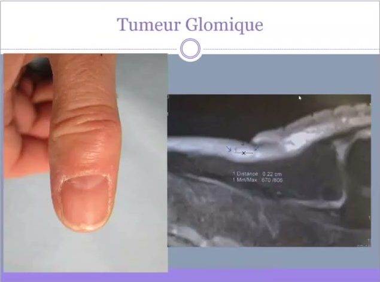
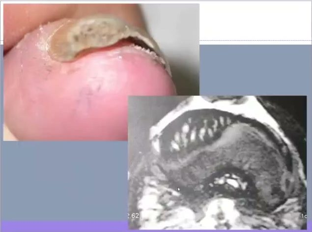
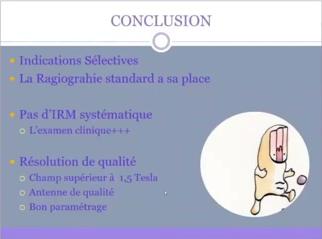

# Indication de l'imagerie en pathologie unguéale

> [!abstract] L'essentiel
> **L'ongle est clinique à 90 % : radiographie d'abord, IRM sélective (≥ 1,5 T, antenne dédiée) pour un processus expansif sous-unguéal douteux** ou un bilan préopératoire.

> [!success] À retenir
> 1. Signes de **processus expansif sous-unguéal** : macrolunule, ongle en pince, hypercourbure, gouttière longitudinale → imagerie si diagnostic incertain.
> 2. **Radiographie** suffisante pour l'**exostose sous-unguéale** (ado, gros orteil) et **indispensable** dans le **carcinome épidermoïde** (os normal → exérèse sans amputation).
> 3. IRM : **glomique** atypique ou volumineuse, **kyste mucoïde sous-matriciel**, **onychomatricome**, kyste épidermique (exérèse complète), séquelles traumatiques réparables ; ligne rouge sans kératose distale → mélanome achromique.

## Images clés
 [▶ 5:48](https://www.youtube.com/watch?v=21FIzmGtDvE&t=348s)
 [▶ 7:28](https://www.youtube.com/watch?v=21FIzmGtDvE&t=448s)
 [▶ 13:15](https://www.youtube.com/watch?v=21FIzmGtDvE&t=795s)

## Points clés
- Matrice et lit reposent directement sur la phalange : clé de l'interprétation des signes cliniques.
- Signes de **processus expansif sous-unguéal** (compression de la matrice/du lit par en dessous) : macrolunule, érythème de la lunule, hypercourbure transversale, ongle en pince, gouttière/cannelure longitudinale, éclatement des couches superficielles.
- **Kyste mucoïde** du repli proximal : gouttière longitudinale de largeur variable selon les poussées, arthrose IPD à la radiographie ; pas d'imagerie si évident, IRM si doute. Formes **sous-matricielles** : grande source d'errance (ongle bombé, hyperkératose d'accrochage, ongle en pince si latéral, large pédicule articulaire).
- **Exostose sous-unguéale** : adolescent 12–18 ans, gros orteil, nodule ferme télangiectasique sensible ; la radiographie suffit.
- **Onychopapillome** : ligne rouge, petit décollement distal, hémorragies filiformes, petite lésion kératosique sous-unguéale distale ; sans cette lésion, une ligne rouge peut être un mélanome achromique → IRM utile.
- **Fibrokératome** : lésion fibreuse dans une gouttière longitudinale (uni, bi ou trilobé) ; IRM si doute post-traumatique.
- **Tumeur glomique** : diagnostic clinique (douleur au froid, au chaud, aux variations thermiques, au choc, à la pression ; ligne érythémateuse, fissure distale) ; IRM pour les formes atypiques, peu douloureuses, volumineuses (défect de tablette, méplat phalangien) ou du lit (tache bleutée).
- **Onychomatricome** : « pieuvre » insérée sur la matrice, digitations dans des logettes de la tablette (xanthonychie longitudinale, ongle épaissi), formes géantes en « sabot » pouvant déformer la phalange ; belles images IRM.
- **Kyste épidermique** post-chirurgical ou post-traumatique : poussées inflammatoires, écoulement ; IRM utile car l'exérèse doit être complète sous peine de récidive ; peut comprimer la phalange.
- **Fibromyxome acral** : déformation de l'ongle, masse érodant la phalange.
- **Kérato-acanthome** : tumeur épithéliale à croissance rapide, très douloureuse, lyse phalangienne ; différentiel du carcinome.
- **Carcinome épidermoïde** : la radiographie est nécessaire — normale, elle autorise l'exérèse totale de l'appareil unguéal sans amputation.
- Mélanome : quasi jamais besoin du radiologue, sauf forme nodulaire exceptionnelle mimant un kyste mucoïde hémorragique.
- Post-traumatique (doigt de porte) : bride matricielle, fibrokératome cicatriciel, encoche épidermique → lésions améliorables chirurgicalement, identifiées en IRM.
- Malformations de l'enfant (syndrome COIF des deux index avec phalangette bifide, malalignement congénital, micronychie) et **pachydermopériostite psoriasique** (gros orteil en saucisse, périostite irrégulière).

## Sémiologie et technique d'imagerie
- La radiographie standard garde toute sa place : trop d'IRM sont faites sans radiographie préalable.
- IRM et échographie de haute résolution, indications sélectives.

## Pièges et diagnostics différentiels
- Ligne rouge sans lésion kératosique distale : penser au mélanome achromique.
- Patients adressés avec imagerie sans examen clinique préalable.

> [!WARNING] À ne pas manquer
> Carcinome épidermoïde unguéal : radiographie indispensable avant décision thérapeutique (atteinte osseuse ou non).

> [!TIP] Pour le compte rendu
> Préciser la nature probable, le siège (sous-matriciel, lit, repli), la taille et l'atteinte osseuse ; éléments utiles au chirurgien pour les tumeurs volumineuses.

## Liens
- Congrès : [[SIMS 2022 - Index]]
- Voir aussi : [[Radio anatomie de l'ongle]], [[Tumeurs de l'ongle, il n'y a pas que la glomique]], [[Prise en charge chirurgicale des lésions traumatiques et tumorales de l'ongle]]
