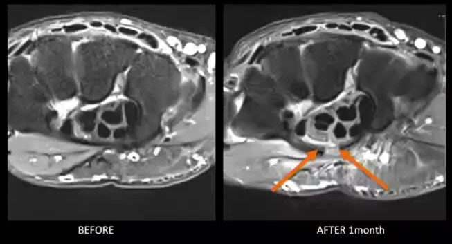
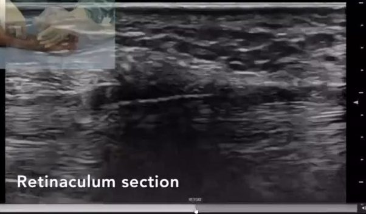

# L'échochirurgie du canal carpien

> [!abstract] L'essentiel
> **Libération échoguidée du canal carpien : section rétrograde du rétinaculum sous anesthésie locale, récupération 2 à 3 fois plus rapide** qu'en mini-open, résultats identiques à long terme.

> [!success] À retenir
> 1. Écho préthérapeutique : confirmer la compression et **redresser les diagnostics alternatifs** ; repérer **branche motrice, arcade palmaire superficielle**, variantes.
> 2. Technique : **hydrodissection** (chambre de sécurité), incision **2-3 mm**, contrôle continu du médian en petit axe, section **rétrograde** jusqu'au crochet de l'hamatum.
> 3. Série **> 1 200 cas**, recul **> 6 ans** : **95 %** de satisfaction, reprise d'activité à **J3**, ecchymoses **1 %**, aucune complication majeure.

## Images clés
 [▶ 4:17](https://www.youtube.com/watch?v=xYcfs5v4fGw&t=257s)
 [▶ 6:03](https://www.youtube.com/watch?v=xYcfs5v4fGw&t=363s)

## Points clés
- Mêmes indications que la chirurgie : syndrome du canal carpien qui s'aggrave ou résiste à un traitement médical bien conduit (> 6 mois, infiltration, orthèse).
- Cible : ligament annulaire antérieur du carpe (rétinaculum des fléchisseurs) ; proximité du canal de Guyon, de la branche motrice, de l'arcade palmaire superficielle, des branches de division et de la branche cutanée palmaire.
- Chirurgie conventionnelle : environ 150 000 interventions/an en France, 500 000 aux États-Unis ; répartition ciel ouvert/endoscopie environ 70/30 ; complications rares (plaies nerveuses, algodystrophie, cicatrices douloureuses, retard de reprise). Plus la technique est mini-invasive, plus la reprise est rapide.
- Apport de l'échographie : confirmer le diagnostic et **redresser des diagnostics alternatifs** (thrombose artérielle, lupus, fibromatose palmaire, tumeurs compressives…), visualiser les structures à risque (branche motrice visible dans 100 % des cas selon l'orateur), suivre le patient en postopératoire.
- Technique en 4 temps : anesthésie locale par voie transverse avec **hydrodissection** créant une chambre de sécurité ; incision punctiforme (2–3 mm) ouvrant le fascia antébrachial ; positionnement du couteau sous le ligament avec contrôle continu du nerf médian (petit axe surtout ; crochet de l'hamatum = repère distal) ; section **rétrograde** au crochet (l'antérograde est jugée plus dangereuse : arcade et branches de division juste en aval).
- IRM postopératoire initiale : libération complète dans 100 % des cas.
- Suites : pas d'adrénaline, de garrot ni de bloc plexique → mobilisation immédiate des doigts, pansement retiré à 48 h, pas de soins infirmiers ni de kinésithérapie.
- Expérience : environ 200 patients/an, plus de 1 000 cas en cours d'analyse, aucune complication majeure (ni section nerveuse, ni algodystrophie, ni plaie vasculaire, ni hématome) ; complications mineures (ecchymoses), 2 reprises (main dysmorphique ; récidive probablement par section incomplète, relibérée avec bon résultat à plus de 2 ans), 2 à 3 crises microcristallines postopératoires simulant une infection.
- Bilan affiché : plus de 1 200 cas, recul supérieur à 6 ans, satisfaction 95 %, reprise d'activité à J3 (plages ecchymotiques 1 %, sensibilité du talon de la main 1 % entre M1 et M3).
- Résultats à long terme identiques entre techniques ; récupération 2 à 3 fois plus rapide qu'en mini-open sur les 2–3 premiers mois.

## Sémiologie et technique d'imagerie
- Contrôle final : la lame passe de part et d'autre du ligament, structures adjacentes épargnées ; retrait dans le petit axe.
- Canal très étroit : l'hydrodissection permet d'écarter le nerf et de passer entre artère et nerf, même sans l'espace de 3 mm autrefois jugé nécessaire.

## Pièges et diagnostics différentiels
- Crise microcristalline postopératoire (main inflammatoire, VS élevée à J3) à ne pas confondre avec une infection.
- Ligament très épais et résistant chez les travailleurs manuels.

> [!WARNING] À ne pas manquer
> Ce n'est pas un geste « de coin de table » : formation anatomique, entraînement sur sujets anatomiques et salle interventionnelle ou bloc indispensables.

> [!TIP] Pour le compte rendu
> En bilan préthérapeutique : confirmer la compression du médian, rechercher une cause secondaire, décrire branche motrice, arcade vasculaire et variantes ; en contrôle : continuité de la section du ligament.

## Liens
- Congrès : [[SIMS 2022 - Index]]
- Voir aussi : [[Traitement à l'aiguille des pathologies de la main]], [[Les injections abarticulaires]], [[Actualités en pathologies neurovasculaires de la main et du poignet]]
