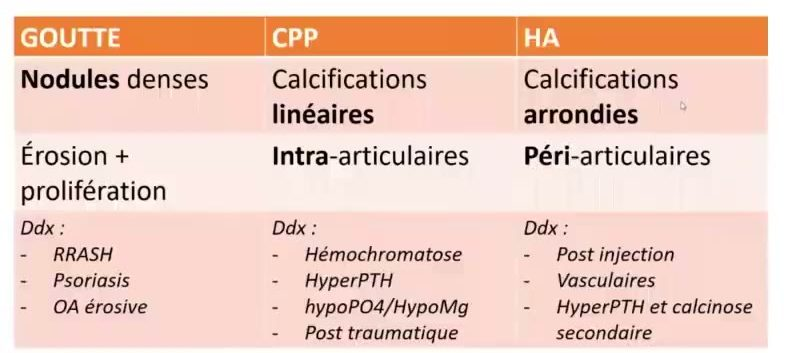
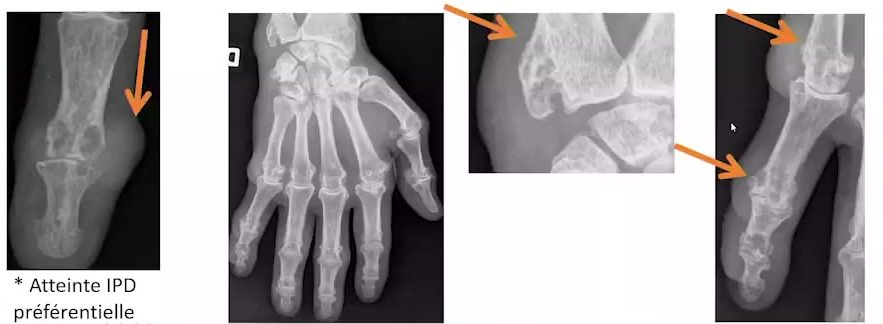
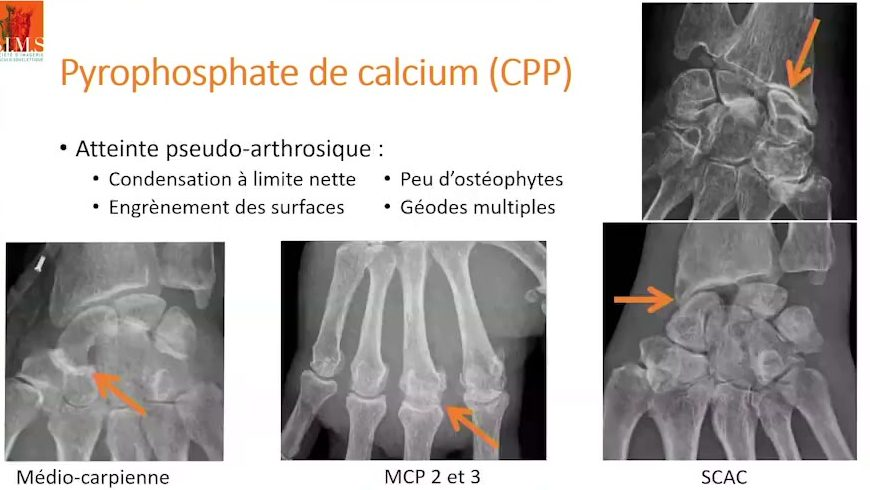

# La main cristalline

> [!abstract] L'essentiel
> **Goutte = nodules denses + érosion avec spicule ; CPP = calcifications linéaires intra-articulaires ; HA = calcifications arrondies périarticulaires** : la radiographie tranche.

> [!success] À retenir
> 1. **Goutte** : tophus dense asymétrique, **érosion + prolifération (spicule)**, IPD préférentielle ; doute → **scanner double énergie** (fenêtre parties molles).
> 2. **CPP pseudo-arthrosique** : topographie atypique **médiocarpienne, STT, MCP 2-3** (crochets), **SCAC** ; condensation nette, géodes multiples, peu d'ostéophytes → évoquer aussi **hémochromatose, hyperparathyroïdie**.
> 3. **Crise d'hydroxyapatite** : mime fracture, arthrite septique ou tumeur (masse rehaussée en IRM) → **radio/scanner** pour voir la calcification ; résorption spontanée en **quelques semaines**.

## Images clés
 [▶ 8:51](https://www.youtube.com/watch?v=THAkD3BLmeg&t=531s)
 [▶ 1:12](https://www.youtube.com/watch?v=THAkD3BLmeg&t=72s)
 [▶ 5:31](https://www.youtube.com/watch?v=THAkD3BLmeg&t=331s)

## Points clés
- **Goutte** à la main/au poignet : plus fréquente si début tardif, forme d'emblée évoluée polyarticulaire, chez la femme et sous diurétiques.
- Sémiologie goutteuse : d'abord le **tophus** (nodule des parties molles légèrement dense, généralement non calcifié, asymétrique, à épicentre périarticulaire, plus souvent du côté de l'extension), puis érosions disproportionnées par rapport au pincement, associées à une **prolifération osseuse (spicule)**.
- **Pyrophosphate de calcium (CPPD)** : « chondrocalcinose » = terme descriptif (calcification linéaire du cartilage hyalin ou du fibrocartilage, ex. TFCC), fréquente et asymptomatique chez le sujet âgé (jusqu'à 40 % vers 80–85 ans) ; dépôts périarticulaires (ligament luno-triquétral, capsule, synoviale — parfois plus floconneux) et intratendineux, linéaires épousant les fibres (ex. fléchisseur ulnaire du carpe).
- Formes cliniques CPPD : **pseudo-goutte** (monoarthrite aiguë ; poignet = 2e site le plus fréquent ; après 65 ans très évocateur) ; **pseudo-rhumatoïde** (MCP, carpe) ; **pseudo-arthrosique**, la plus fréquente (pincement, sclérose, ostéophytes, géodes) à topographie évocatrice : **STT, MCP des 2e et 3e rayons (ostéophytes en crochet), première rangée du carpe** → SCAC (équivalent du SLAC) ; forme **pseudo-neuropathique** destructrice rapide (plus rare au poignet).
- Signes CPPD : atteinte médiocarpienne et STT disproportionnée par rapport à la rhizarthrose, aspect « engrené » radio-scaphoïdien (scaphoïde encastré dans la styloïde radiale), stades analogues au SLAC (grade 2 radio-scaphoïdien, grade 3 luno-capitatum).
- **Hydroxyapatite** : calcifications périarticulaires ovalaires, nuageuses, bien limitées, contours flous et « queue de comète » en phase de résorption ; sites : FCU, capsule, ligaments extrinsèques, MCP, IP. Résorption spontanée en quelques semaines.
- Crise d'hydroxyapatite : tableau aigu bruyant mimant fracture, arthrite septique, ténosynovite ou tumeur ; en IRM, masse palmaire iso T1, hyper T2 non liquidienne rehaussée → le scanner/la radiographie montrent la calcification et redressent le diagnostic.
- Résorption intraosseuse possible (interruption de la corticale palmaire de P1) avec œdème médullaire en T2 FS/T1 gado mais **sans remplacement médullaire en T1** → inflammatoire, ni infectieux ni tumoral ; ténosynovite associée, sédimentation de lait calcique.

## Sémiologie et technique d'imagerie
- Scanner : le contraste tophus/tissus mous ressort mieux sur les reconstructions en fenêtre parties molles qu'en fenêtre osseuse.
- **Scanner double énergie** : met en évidence l'urate (ex. nodules atypiques chez un patient avec CPPD → urate sur une MCP).

## Pièges et diagnostics différentiels
- Fines calcifications d'hydroxyapatite méconnues en IRM : toujours confronter à la radiographie/au scanner.
- CPPD pseudo-arthrosique : diagnostic différentiel avec l'hémochromatose (MCP 2–3, crochets).
- Distinction parfois difficile CPPD synoviale floconneuse vs hydroxyapatite.

> [!WARNING] À ne pas manquer
> Masse palmaire inflammatoire « tumorale » en IRM : rechercher une calcification d'hydroxyapatite avant d'évoquer une tumeur ou une infection.

> [!TIP] Pour le compte rendu
> Préciser la forme (linéaire intra-articulaire vs arrondie périarticulaire), la topographie (STT, MCP 2–3, première rangée), les érosions et spicules, et proposer un scanner double énergie en cas de doute sur une goutte.

## Liens
- Congrès : [[SIMS 2022 - Index]]
- Voir aussi : [[Arthrose digitale différentes nomenclatures, phénotypes différents]], [[Algorithme diagnostique à propos du gros doigt]]
