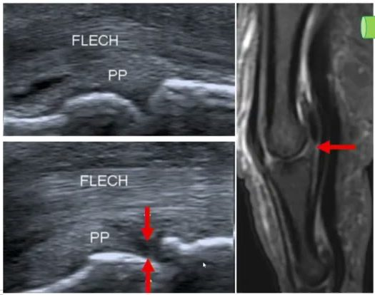
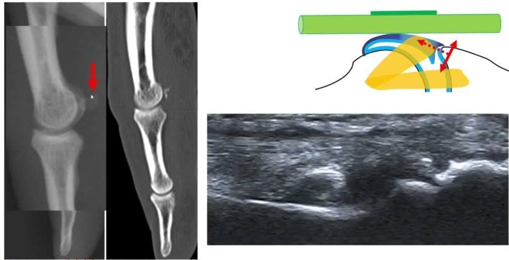
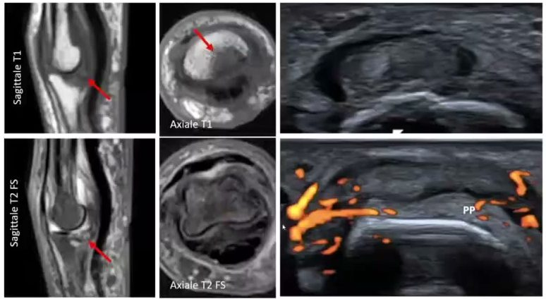

# La plaque palmaire des doigts

> [!abstract] L'essentiel
> **Lésion de plaque palmaire = hyperextension de l'IPP avec désinsertion quasi toujours distale** : le couple radio-échographie suffit ; le risque est l'enraidissement douloureux en flexion, pas l'instabilité.

> [!success] À retenir
> 1. Désinsertion **distale** (attaches rigides) dans la quasi-totalité des cas ; **arrachement du rebord palmaire** de la base de P2 = pathognomonique ; chercher un fragment rétracté jusqu'au col.
> 2. Ne pas confondre le **récessus articulaire distal** (central, fin, bien limité) avec une désinsertion (large, mal limitée, **latéralisée**).
> 3. Rechercher extension au **ligament collatéral principal** et lésion **dorsale** (bandelette médiane) ; chirurgie rare, prise en charge **précoce** pour éviter la raideur.

## Images clés
 [▶ 8:52](https://www.youtube.com/watch?v=lLcFyzp-DVA&t=532s)
 [▶ 10:37](https://www.youtube.com/watch?v=lLcFyzp-DVA&t=637s)
 [▶ 9:48](https://www.youtube.com/watch?v=lLcFyzp-DVA&t=588s)

## Points clés
- Macro-architecture : coussin fibrocartilagineux palmaire de toutes les articulations des doigts longs et du pouce (homologue de la plaque plantaire) ; corps offrant une surface de glissement aux fléchisseurs ; deux attaches proximales fines et élastiques ; deux attaches distales épaisses et rigides, ancrées au périoste par des fibres de Sharpey.
- En coupe sagittale : section méniscoïde, face superficielle extra-articulaire (glissement tendineux, poulies), face profonde articulaire au contact du cartilage de la tête, **petit récessus articulaire** entre les attaches distales.
- Micro-architecture **trilamellaire** : couche palmaire (fibres transversales, insertion des ligaments collatéraux accessoires), couche intermédiaire (maillage enchevêtré, résiste à la torsion), couche profonde (fibres longitudinales, ancrage, s'oppose à l'hyperextension).
- **Complexe palmo-latéral** : ligament collatéral accessoire inséré sur le corps de la plaque et ligament collatéral principal ; continuum poulie (A1 à la MCP, A3 à l'IPP, A5 à l'IPD) – plaque – ligaments collatéraux.
- Biomécanique en flexion active, en 3 temps : glissement proximal, soulèvement (initié par la poulie, ligaments collatéraux en tension), enroulement sur le rebord phalangien, permis par le récessus articulaire.
- Pathologie essentiellement traumatique par **hyperextension** ; ruptures quasi toujours **distales** (attaches rigides), très rarement proximales ; IPP surtout, en contexte sportif.
- Lésions possibles : désinsertion distale fibrocartilagineuse ; arrachement du rebord palmaire de la base phalangienne (pathognomonique) ; fragment rétracté en boule par la plaque jusqu'au col de la phalange ou du métacarpien ; extension de la désinsertion au ligament collatéral principal.

## Sémiologie et technique d'imagerie
- Échographie : coupes sagittales étendues latéralement pour voir toutes les attaches (distales toujours visibles, proximales selon la sonde) ; coupes axiales en « ascenseur » : coussin hyperéchogène homogène sous les fléchisseurs.
- IRM : plaque normalement en hyposignal ; rupture parfois ténue (perte de l'hyposignal), plus facile à voir en échographie selon l'orateur.
- Signes associés : hyperhémie Doppler, ténosynovite, synovite réactionnelle ; petits fragments parfois visibles seulement en échographie.

## Pièges et diagnostics différentiels
- **Récessus articulaire distal** physiologique : central, fin, hypoéchogène, bien limité, à ne pas prendre pour une désinsertion (qui est plus large, mal limitée, latéralisée).
- Rechercher une fracture controlatérale du rebord dorsal de la base phalangienne (atteinte de la bandelette médiane de l'appareil extenseur par contrecoup).

> [!WARNING] À ne pas manquer
> Le risque n'est pas tant l'instabilité de l'IPP que l'enraidissement douloureux en flexion : prise en charge la plus précoce possible.

> [!TIP] Pour le compte rendu
> Préciser le siège de la désinsertion (distale), l'existence et le déplacement d'un fragment osseux, une rétraction, l'extension aux ligaments collatéraux et une lésion dorsale associée. La chirurgie est rare, même avec atteinte collatérale.

## Liens
- Congrès : [[SIMS 2022 - Index]]
- Voir aussi : [[Le locked finger]], [[Les poulies du doigt traumatique]], [[Traumatismes des articulations interphalangiennes]]
