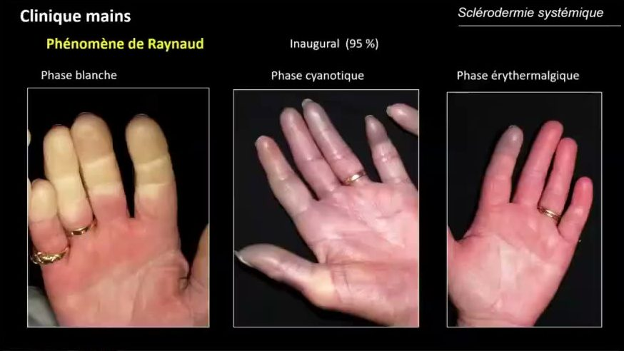
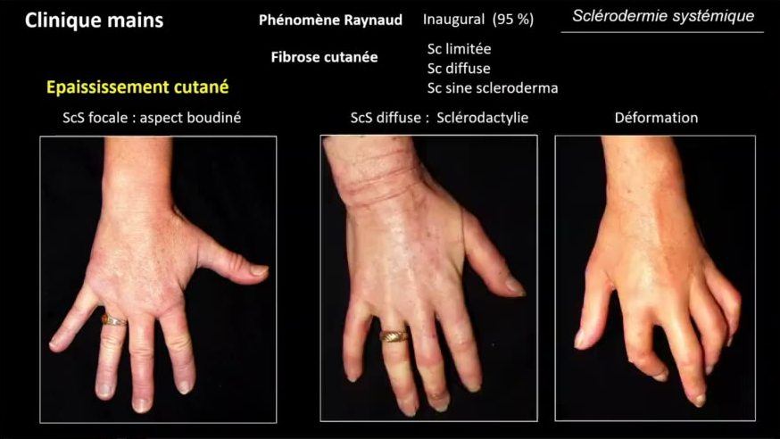
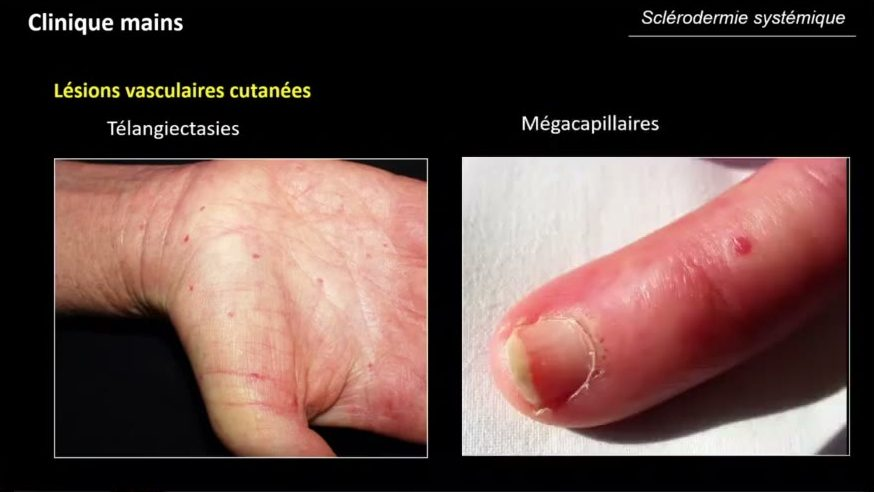

# La sclérodermie, de la clinique à l'imagerie

> [!abstract] L'essentiel
> **Main « connectivite » : chercher d'abord un Raynaud (inaugural dans 95 %)**, puis télangiectasies, mégacapillaires et ulcères pulpaires, même sans sclérose cutanée.

> [!success] À retenir
> 1. Classification **ACR/EULAR** : sclérodermie systémique si score **≥ 9** ; aucun critère radiologique.
> 2. Forme ***sine scleroderma*** (≈ **10 %**) : main d'aspect normal → Raynaud + capillaroscopie + **AAN**.
> 3. Mégacapillaires du bord unguéal visibles à l'œil nu (≈ **80 %**) ; ulcères pulpaires ischémiques, **calcinose** sous-cutanée ou mécaniques → à rechercher en radiographie.

## Images clés
 [▶ 0:58](https://www.youtube.com/watch?v=UB66FIivq6I&t=58s)
 [▶ 1:31](https://www.youtube.com/watch?v=UB66FIivq6I&t=91s)
 [▶ 2:09](https://www.youtube.com/watch?v=UB66FIivq6I&t=129s)

## Points clés
- Maladie rare : prévalence de 158 à 228 cas par million d'habitants en France, âge de survenue 45-64 ans, prédominance féminine.
- Critères de classification cutanés, vasculaires, cardio-pulmonaires (hypertension artérielle pulmonaire, fibrose pulmonaire) et biologiques ; un score supérieur ou égal à 9 permet de retenir une sclérodermie systémique. **Aucun critère radiologique** dans la classification, ce que l'orateur regrette.
- Première question face à une main suspecte : existe-t-il un **phénomène de Raynaud** triphasique (phase blanche, cyanique, érythrosique) ? Il est quasi constant dans la sclérodermie et inaugural dans 95 % des cas.
- La peau n'est pas toujours atteinte : doigts boudinés, puis sclérodactylie de plus en plus déformante ; environ 10 % des patients ont une forme *sine scleroderma* avec examen de la main strictement normal.
- Télangiectasies palmaires et faciales : regarder le visage et les paumes.
- Microangiopathie organique : mégacapillaires du bord unguéal, visibles à l'œil nu dans environ 80 % des cas sans capillaroscope.
- Ulcérations digitales : soit ischémiques, soit associées à des calcifications sous-cutanées (deuxième mécanisme), soit mécaniques par micro-traumatismes sur doigts rétractés.
- Diagnostic : œil clinique, capillaroscopie si nécessaire, anticorps antinucléaires.

## Sémiologie et technique d'imagerie
- La vidéo s'arrête au moment du passage à la radiographie : seule l'introduction clinique est disponible.
- À retenir pour l'imagerie : rechercher calcifications sous-cutanées et stigmates d'ulcérations digitales chroniques.

## Pièges et diagnostics différentiels
- Forme *sine scleroderma* : main d'aspect normal, le diagnostic repose alors sur le Raynaud, la capillaroscopie et la biologie.
- Distinguer main « mécanique » (arthrose) et main « connectivite ».

> [!WARNING] À ne pas manquer
> Un phénomène de Raynaud sur une main explorée doit faire évoquer une sclérodermie systémique, même en l'absence d'atteinte cutanée visible.

> [!TIP] Pour le compte rendu
> Signaler calcifications sous-cutanées, ulcérations ou résorptions et suggérer, si le contexte s'y prête, une capillaroscopie et un bilan d'auto-immunité (AAN).

## Liens
- Congrès : [[SIMS 2022 - Index]]
- Voir aussi : [[Les nouveautés dans le suivi de la polyarthrite rhumatoïde]]
