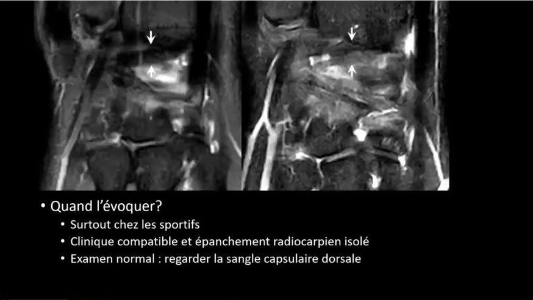
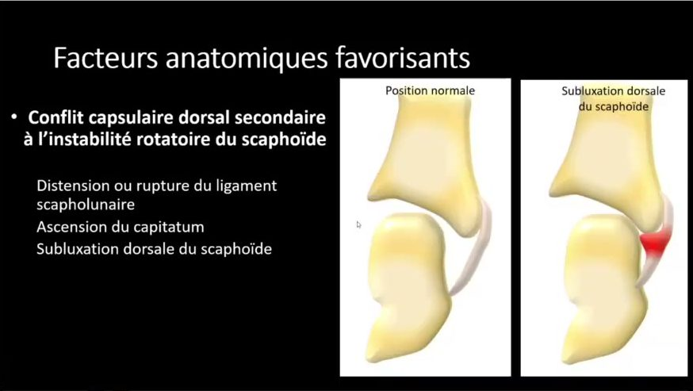

# Le conflit capsulaire dorsal du poignet

> [!abstract] L'essentiel
> **Sportif en hyperextension avec douleur dorso-radiale et IRM « normale » : regarder la sangle capsulaire dorsale** (ligament scapho-triquétral dorsal épaissi, hypersignal T2).

> [!success] À retenir
> 1. Signe IRM : **épaississement** du ligament scapho-triquétral dorsal (≈ **95 %**) ± **hypersignal T2** (> **50 %**), mesuré en sagittal sur le scaphoïde.
> 2. Évoquer devant gymnaste/haltérophile + **épanchement radio-carpien isolé** ; cause associée fréquente (**62 %**), dont kyste scapho-lunaire (**35 %**).
> 3. Toujours chercher une **instabilité scapho-lunaire** (subluxation dorsale du scaphoïde) responsable d'un conflit **secondaire**.

## Images clés
 [▶ 9:46](https://www.youtube.com/watch?v=oI4aREbAvNg&t=586s)
 [▶ 4:11](https://www.youtube.com/watch?v=oI4aREbAvNg&t=251s)

## Points clés
- Clinique : douleur dorsale et radiale juste sous le tubercule de Lister, majorée par l'extension passive (pas contrariée), douleur à la palpation.
- Mécanisme : macro-traumatisme en hyperextension ou micro-traumatismes répétés par surcharge axiale en extension (gymnastique, haltérophilie). Mécanisme présumé : incarcération capsulaire postérieure lors de l'extension.
- Anatomie, de la superficie à la profondeur : court extenseur radial du carpe, branche distale du nerf interosseux postérieur, capsule renforcée par les ligaments radio-triquétral dorsal et scapho-triquétral dorsal, puis plan ligamentaire scapho-lunaire et son septum capsulo-scapho-lunaire dorsal (DCSS).
- Conséquences : synovite focale aiguë, épaississement fibreux capsulaire chronique, irritation du nerf interosseux postérieur ; en limite de définition : contusions, fractures (scaphoïde, lunatum, radius), ostéophytose dorsale.
- **Forme secondaire** : instabilité rotatoire du scaphoïde (pré-dynamique, dynamique ou statique) ; le diastasis scapho-lunaire permet l'ascension du capitatum qui repousse le scaphoïde en subluxation dorsale, favorisant le conflit.
- Historique : *dorsal wrist impingement* de Watson ; atteinte capsulaire décrite par Henry en 2007 ; littérature quasi exclusivement chirurgicale, petites séries, IRM décrite comme négative.
- Étude locale (gymnastes et haltérophiles de niveau fédéral, 36 IRM sur 4 ans pour douleur dorso-radiale) : épaississement du ligament scapho-triquétral dorsal dans environ 95 % des cas, hypersignal T2 dans un peu plus de 50 %, autre cause possible associée dans 62 % (kyste scapho-lunaire 35 %, contusions osseuses).
- Traitement sans consensus : repos et anti-inflammatoires, puis infiltration radio-carpienne ou de la branche distale du nerf interosseux postérieur (échoguidée), enfin synovectomie postérieure chirurgicale (résection de la bride fibreuse en regard de l'interligne radio-scaphoïdien).

## Sémiologie et technique d'imagerie
- Échographie : synovite radio-carpienne dorsale hypervascularisée ; épaississement capsulaire comparatif.
- IRM : coupe sagittale sur le scaphoïde, mesure de la capsule au niveau du ligament scapho-triquétral dorsal ; bords irréguliers, feutrés, épaissis, hypersignal T2 ; coupes coronales sur la sangle capsulaire dorsale.
- Radiographies : ostéophytes dorsaux du scaphoïde.

## Pièges et diagnostics différentiels
- Aigu : fractures et contusions du scaphoïde ou du radius, rupture du ligament scapho-lunaire.
- Chronique : kyste scapho-lunaire, syndrome de croisement distal (2e/3e compartiments), lésion scapho-lunaire, maladie de Kienböck, etc.
- Les formes aiguës, les plus fréquentes, guérissent spontanément et ne sont jamais imagées.

> [!WARNING] À ne pas manquer
> Chercher une instabilité scapho-lunaire sous-jacente, cause d'un conflit capsulaire dorsal secondaire.

> [!TIP] Pour le compte rendu
> Chez un sportif avec douleur dorso-radiale et épanchement radio-carpien isolé ou examen normal, décrire l'épaisseur et le signal de la capsule dorsale (ligament scapho-triquétral dorsal) et les lésions associées.

## Liens
- Congrès : [[SIMS 2022 - Index]]
- Voir aussi : [[Les ligaments du carpe à connaître]], [[Le conflit ulnocarpien et le conflit styloïdo-triquétral]]
