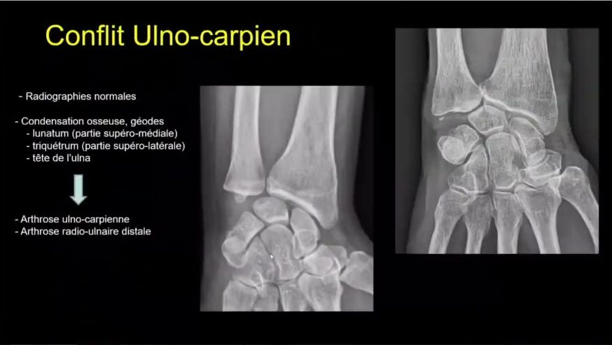
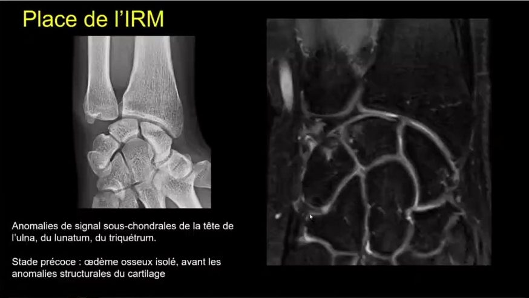
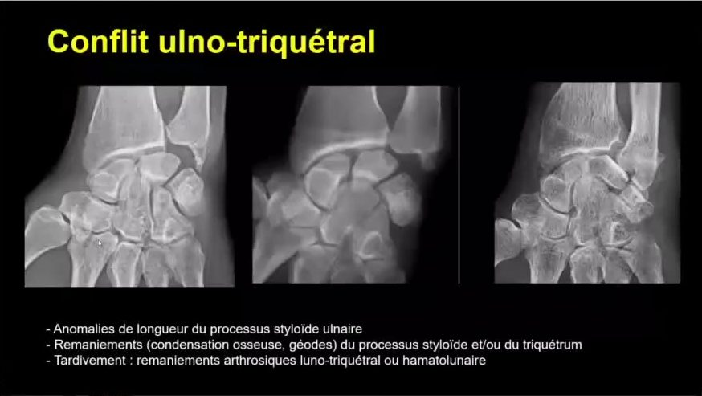

# Le conflit ulnocarpien et le conflit styloïdo-triquétral

> [!abstract] L'essentiel
> **Douleur mécanique du bord ulnaire : chercher une variance ulnaire positive (conflit ulnocarpien) ou une styloïde ulnaire longue (conflit styloïdo-triquétral)** ; l'IRM voit l'œdème avant la radio.

> [!success] À retenir
> 1. **Variance ulnaire** sur face paume à plat (± 1–2 mm normal) ; elle **augmente en pronation** et en prise de force — conflit possible même à variance nulle.
> 2. Signes : condensation/géodes du **versant ulnaire (supéro-médial) du lunatum**, du triquetrum et de la tête ulnaire ; **œdème sous-chondral en IRM T2 FS** au stade précoce ; arthroscanner pour disque, cartilage et LLT.
> 3. Styloïde ulnaire **> 6 mm** → conflit styloïdo-triquétral (clichés dynamiques en inclinaison) ; Kienböck = atteinte du versant **radial** du lunatum ; penser **Madelung**.

## Images clés
 [▶ 5:56](https://www.youtube.com/watch?v=R_8mwl9GfuM&t=356s)
 [▶ 8:39](https://www.youtube.com/watch?v=R_8mwl9GfuM&t=519s)
 [▶ 11:30](https://www.youtube.com/watch?v=R_8mwl9GfuM&t=690s)

## Points clés
- Transmission des forces de compression : environ 50 % par la fossette scaphoïdienne du radius, 35 % par la fossette lunarienne, 15 % par le disque articulaire (TFCC). Toute modification de longueur de l'ulna modifie fortement cette répartition.
- **Conflit ulnocarpien** : idiopathique (ulna longue congénitale) ou acquis (raccourcissement post-traumatique du radius) ; possible même avec une ulna de longueur normale ou courte.
- Lésions : disque articulaire, lésions ostéochondrales de la tête ulnaire, du versant ulnaire du lunatum et du triquetrum, ligament luno-triquétral ; puis arthrose radio-ulnaire distale et ulnocarpienne.
- Clinique : douleur du bord ulnaire du carpe à la mobilisation, caractère dynamique et mécanique.
- **Variance ulnaire** sur radiographie de face, paume à plat : neutre si les tangentes sont au même niveau, négative si l'ulna est en retrait, positive si elle dépasse ; ± 1 à 2 mm considérés comme normaux.
- Piège : la position paume à plat est en pronation ; la variance augmente en pronation et diminue en supination. Mesures non validées en scanner/IRM (positionnement variable).
- Facteur prédisposant : **déformation de Madelung** (défaut de croissance congénital du radius distal, plus fréquent chez la femme, souvent bilatéral) : radius « pentu », carpe triangulaire, RUD élargie, ligament de Vickers, épiphysiodèse focale ulnaire du radius.
- **Conflit styloïdo-triquétral** : entre l'extrémité de la styloïde ulnaire et le triquetrum ; facteur favorisant : styloïde > 6 mm sur la face ; ou triquetrum mal positionné (arthrodèse) ; possible idiopathique. Coexistence possible des deux conflits (exemple sur Madelung).

## Sémiologie et technique d'imagerie
- Radiographie : normale au début, puis condensation et micro-géodes du **versant ulnaire du lunatum**, du pôle supéro-latéral du triquetrum, de la tête ulnaire ; arthrose au stade tardif.
- Clichés dynamiques (inclinaison radiale) : démasquent le contact lunatum-tête ulnaire ou styloïde-triquetrum.
- Scanner : condensation, micro-géodes, mais n'évalue ni cartilage ni disque.
- IRM (T2 FS) : œdème osseux lunatum, triquetrum, tête ulnaire, styloïde, bien avant les signes radiographiques.
- Arthroscanner : perforation du disque, chondrolyse, ligament luno-triquétral.

## Pièges et diagnostics différentiels
- **Maladie de Kienböck** : anomalies débutant sur le versant **radial** du lunatum (et non ulnaire).
- Calcifications microcristallines associées.
- Synostose luno-triquétrale (rôle favorisant incertain).

> [!WARNING] À ne pas manquer
> Variance ulnaire mesurée sur un cliché non standardisé (rotation) : risque de fausse ulna longue ou courte.

> [!TIP] Pour le compte rendu
> Donner la variance ulnaire et les conditions de réalisation, la topographie des remaniements (versant ulnaire du lunatum, triquetrum, tête ulnaire, styloïde), l'état du disque, du ligament luno-triquétral et du cartilage.

## Liens
- Congrès : [[SIMS 2022 - Index]]
- Voir aussi : [[Imagerie et pronostic de la maladie de Kienböck]], [[Actualités en pathologies traumatiques]], [[Le conflit capsulaire dorsal du poignet]]
