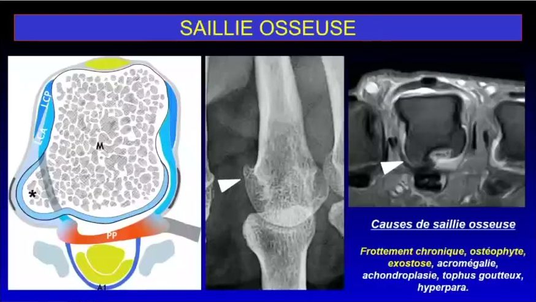
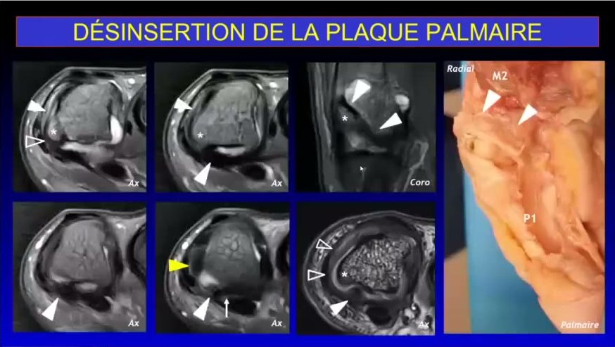
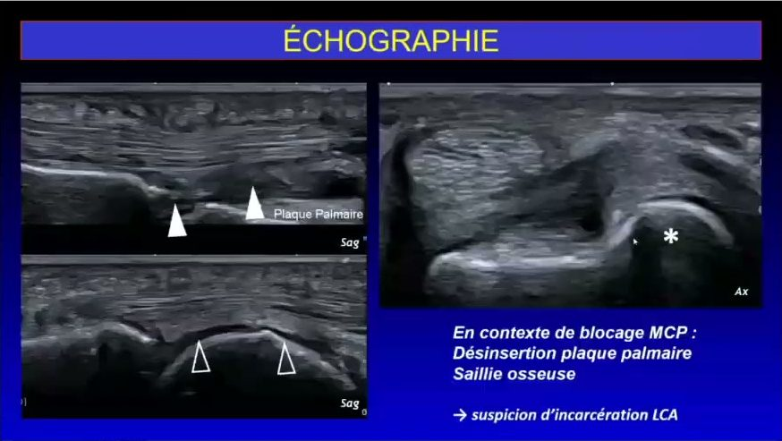

# Le locked finger

> [!abstract] L'essentiel
> **MCP bloquée en flexion (index) = triade saillie osseuse palmo-radiale + incarcération du collatéral accessoire + désinsertion de la plaque palmaire** : traitement chirurgical.

> [!success] À retenir
> 1. Clinique opposée au doigt à ressaut : blocage de la **MCP en flexion ≈ 25-40°**, extension impossible, IPP libre.
> 2. **Radio** : saillie osseuse de la tête métacarpienne (ostéophyte, exostose, frottement, tophus…) ; **écho** : désinsertion de la **plaque palmaire** + saillie → suspecter l'incarcération.
> 3. **IRM** (axial ++) : collatéral accessoire tendu, incarcéré palmairement à la saillie, jonction plaque-LCA rétractée « en boule » ; préciser le côté pour le chirurgien.

## Images clés
 [▶ 3:18](https://www.youtube.com/watch?v=5pyFs-bBuGE&t=198s)
 [▶ 6:15](https://www.youtube.com/watch?v=5pyFs-bBuGE&t=375s)
 [▶ 7:31](https://www.youtube.com/watch?v=5pyFs-bBuGE&t=451s)

## Points clés
- À distinguer du doigt à ressaut (très fréquent) : blocage de l'IPP, réductible au début, MCP mobile.
- *Locked finger* : rare, blocage de la **MCP en flexion** (environ 25-40°), extension impossible au-delà, flexion conservée, IPP normale ; tableau opposé point par point au doigt à ressaut.
- Concerne surtout le 2e ou le 3e métacarpien (index le plus souvent).
- Anatomie : ligament collatéral principal (tête métacarpienne → base de P1) ; ligament collatéral accessoire, insertion commune avec le principal, inséré sur la plaque palmaire en continuité parfaite (indissociables à la dissection).
- Plusieurs types (blocages en extension, aléatoires) ; la communication porte sur le type 1 par incarcération du collatéral accessoire.
- **Saillie osseuse** palmaire et radiale de la tête métacarpienne : congénitale, acquise (frottement chronique), ostéophyte d'arthropathie, exostose.
- **Incarcération** du collatéral accessoire, palmaire par rapport à la saillie.
- **Désinsertion de la plaque palmaire** homolatérale à la saillie, constamment retrouvée en imagerie ; étude cadavérique : saillie simulée + incarcération + désinsertion de la plaque = blocage ; sans désinsertion de la plaque, pas de blocage ; la désincarcération libère le doigt.
- Traitement : réduction manuelle sous anesthésie (locale, générale ou bloc) discutée, sans traitement étiologique ; la chirurgie (résection du collatéral accessoire incarcéré et de la saillie, suture capsulaire) est la plus pérenne.

## Sémiologie et technique d'imagerie
- Radiographies : rechercher la saillie osseuse.
- IRM : coupes axiales de référence pour le collatéral accessoire, coronales pour le principal, sagittales pour la plaque ; saillie et asymétrie de la tête, mise en tension du collatéral accessoire, rétraction « en boule » de la jonction plaque-collatéral accessoire ; en coronal, structure qui barre la tête métacarpienne (bord libre rétracté proximalement et du côté opposé).
- Échographie : décevante pour le collatéral accessoire, mais montre bien la plaque palmaire et la saillie osseuse.

## Pièges et diagnostics différentiels
- Doigt à ressaut (blocage de l'IPP, MCP mobile).
- Blocages en extension ou aléatoires, d'autres mécanismes.

> [!WARNING] À ne pas manquer
> Blocage de la MCP + saillie osseuse + désinsertion de la plaque palmaire en échographie : suspecter une incarcération du collatéral accessoire et la rechercher en IRM.

> [!TIP] Pour le compte rendu
> Décrire les trois éléments de la triade (saillie, collatéral accessoire, plaque palmaire) et leur côté, pour guider la réduction ou la chirurgie.

## Liens
- Congrès : [[SIMS 2022 - Index]]
- Voir aussi : [[La plaque palmaire des doigts]], [[Les poulies du doigt traumatique]]
