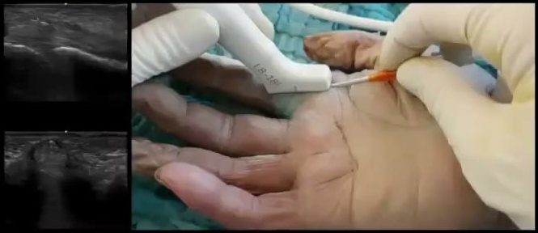
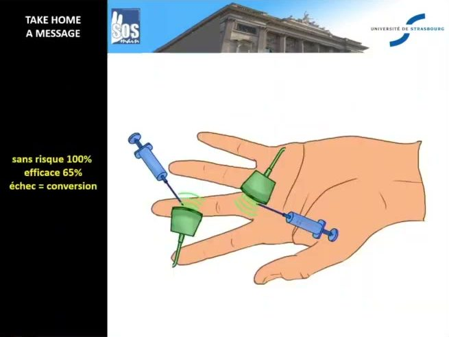
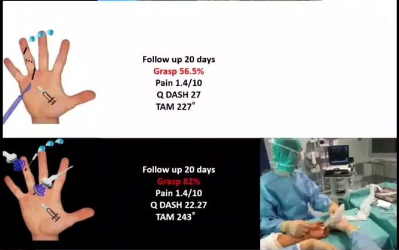

# Le traitement chirurgical des phlegmons des fléchisseurs au stade précoce

> [!abstract] L'essentiel
> **Phlegmon des fléchisseurs au stade précoce : lavage percutané échoguidé par deux cathéters, moins agressif que l'ouverture** ; conversion immédiate si échec.

> [!success] À retenir
> 1. Aux urgences : gaine **> 20 % plus large** que le doigt controlatéral en écho axiale = argument pour la chirurgie.
> 2. Technique échoguidée : sans risque, efficace **≈ 65 %** (cadavre) ; à J20, force de préhension **82 % vs 56,5 %** et TAM **243° vs 227°** par rapport à l'ouverture.
> 3. **Synovite** (stade 2) ou obstruction → ouverture + synovectomie ; seringue sans pas de vis pour éviter l'injection sous pression.

## Images clés
 [▶ 2:27](https://www.youtube.com/watch?v=lbzSb1wEBrE&t=147s)
 [▶ 5:10](https://www.youtube.com/watch?v=lbzSb1wEBrE&t=310s)
 [▶ 6:44](https://www.youtube.com/watch?v=lbzSb1wEBrE&t=404s)

## Points clés
- Signes de **Kanavel** : porte d'entrée, douleur le long de la gaine digitale majorée à la pression de son cul-de-sac proximal, doigt en crochet.
- Aide au diagnostic aux urgences proposée par l'équipe : en échographie axiale, une augmentation de **plus de 20 %** du diamètre de la gaine par rapport au doigt controlatéral est un argument pour la chirurgie.
- Technique historique de Neviaser (1978) : ouverture de la base de la gaine, lavage-drainage sur plusieurs jours (abandonné) ; en cas de synovite : ouverture complète et synovectomie, source de raideur.
- Technique échoguidée : un cathéter proximal dans la gaine et un cathéter distal (plus difficile, la gaine s'arrêtant à mi-hauteur de la phalange moyenne), lavage au sérum physiologique de proximal vers distal.
- Étude cadavérique (8 mains) : réussite 65 % ; cathéter proximal bien placé dans 85 % des cas, tendon fléchisseur jamais sectionné, quelques lésions minimes.
- Causes d'échec : obstruction distale (le liquide ne ressort pas → doigt en crochet expérimental, analogue au pus) ; obstruction proximale (mauvaise technique ou synovite intense) avec risque d'injection sous pression.
- Étude clinique : 16 patients par groupe (Neviaser avec lavage peropératoire seul vs technique échoguidée) ; à 20 jours, force (préhension 82 % vs 56,5 %), utilisation fonctionnelle (QuickDASH 22 vs 27) et mobilité digitale (TAM 243° vs 227°) meilleures avec la technique échoguidée (différence non significative pour la mobilité) ; une récidive dans le groupe classique ; 4 conversions pour synovectomie (stade 2).
- Reprise du travail rapportée à une semaine dans un cas.

## Sémiologie et technique d'imagerie
- Échographie diagnostique : mesure comparative du diamètre de la gaine en coupe axiale (seuil de 20 % par rapport au controlatéral).
- Échographie peropératoire : repérage de la gaine en coupes longitudinale et axiale, suivi de l'aiguille et du cathéter, contrôle de la diffusion du lavage.

## Pièges et diagnostics différentiels
- Utiliser une seringue sans pas de vis pour éviter une injection sous pression si le cathéter est bloqué.
- La technique ne s'adresse qu'au stade précoce : une synovite impose l'ouverture et la synovectomie.

> [!WARNING] À ne pas manquer
> Le phlegmon des fléchisseurs est une urgence chirurgicale ; l'échec du lavage percutané impose l'ouverture immédiate au bloc.

> [!TIP] Pour le compte rendu
> Mesurer le diamètre de la gaine du doigt suspect et du controlatéral, rechercher un épanchement et une synovite (épaississement), et signaler l'argument chirurgical si l'augmentation dépasse 20 %.

## Liens
- Congrès : [[SIMS 2022 - Index]]
- Voir aussi : [[Algorithme diagnostique à propos du gros doigt]], [[Les injections abarticulaires]]
