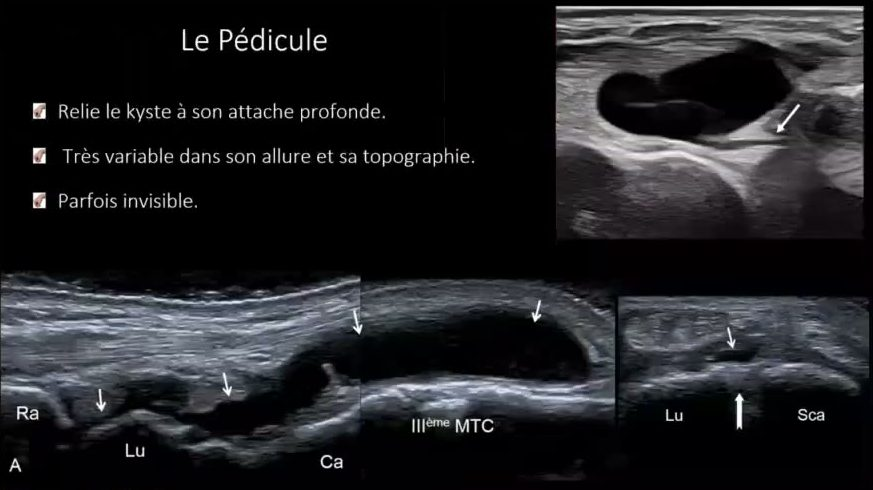
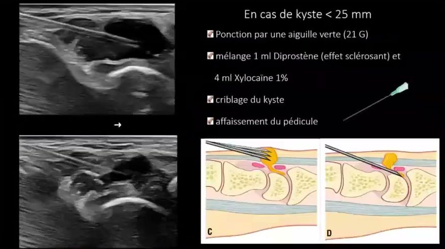
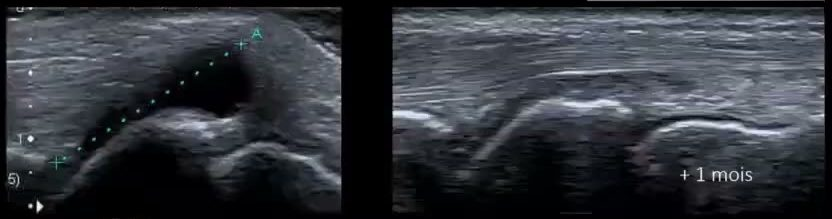

# Le traitement percutané des kystes

> [!abstract] L'essentiel
> **Kyste mucoïde symptomatique du poignet : ponction-affaissement échoguidée en première intention** : traiter la cavité **et** le pédicule, récidive **≈ 20 %**.

> [!success] À retenir
> 1. Attendre d'abord : disparition spontanée **1 fois sur 2**, souvent à **6 mois** ; traiter si douleur, gêne, croissance ou préjudice esthétique.
> 2. Kyste **≥ 25 mm** ou cloisonné : fluidifier (lidocaïne) et aspirer à **18 G** ; **< 25 mm** : **21 G**, **1 mL Diprostène + 4 mL lidocaïne 1 %**, criblage puis **affaissement du pédicule** au ras du lunatum.
> 3. Suites : compression, **orthèse 1 semaine** ; rester au ras du lunatum (**nerf interosseux postérieur**), prudence à la **gouttière du pouls**.

## Images clés
 [▶ 4:28](https://www.youtube.com/watch?v=CBxbBVk9JKQ&t=268s)
 [▶ 6:28](https://www.youtube.com/watch?v=CBxbBVk9JKQ&t=388s)
 [▶ 7:12](https://www.youtube.com/watch?v=CBxbBVk9JKQ&t=432s)

## Points clés
- Kyste mucoïde = environ **60 % des tumeurs de la main** et première cause de masse palpable du poignet ; sujet jeune, prédominance féminine, traumatisme retrouvé dans 15 % des cas ; douloureux à un moment dans 70 % des cas.
- Évolution imprévisible : disparition spontanée environ une fois sur deux (40 % cité en conclusion), souvent à 6 mois → d'abord attendre.
- Le plus fréquent : kyste de la gouttière du pouls ; le plus fréquent symptomatique : **kyste dorsal**.
- Physiopathologie : dégénérescence mucoïde capsulaire d'hypersollicitation. Le lunatum tend vers l'extension, le scaphoïde vers la flexion ; le segment dorsal du ligament scapho-lunaire (pivot fonctionnel) subit un cisaillement transmis à la capsule → œdème, dégénérescence mucoïde, microvésicules confluentes, kyste.
- Extension dans le **septum capsulaire dorsal scapho-lunaire (DCSS)** puis issue entre ligament radio-carpien dorsal et ligament intercarpien dorsal, vers le sous-cutané.
- Deux composantes à traiter : la **cavité** (gel épais « gelée de pomme » : acide hyaluronique, albumine, glucosamine, globulines, coagulant vite) et le **pédicule** vers l'attache capsulo-ligamentaire.
- Indications : douleur, gêne fonctionnelle (quotidienne, sportive), augmentation de taille, préjudice esthétique.
- Alternatives : écrasement et ponction simple (récidives élevées), chirurgie ouverte ou endoscopique (récidives les plus faibles mais cicatrice fibreuse et dissection).

## Sémiologie et technique d'imagerie
- Patient en décubitus, bras le long du corps, poignet en légère flexion ; patch anesthésiant 1 h 30 avant (effet rassurant) ; asepsie stricte.
- Kyste ≥ 25 mm et/ou cloisonné : 1er temps à l'aiguille rose (18 G) — fluidification par 1 à 2 mL de lidocaïne puis aspiration.
- Kyste < 25 mm (ou 2e temps) : aiguille verte (21 G), seringue de 5 mL (1 mL de corticoïde, pour son effet sclérosant, + 4 mL de lidocaïne) : **criblage** du sac par allers-retours, puis **affaissement du pédicule** au ras du lunatum sans entrer dans l'articulation, permettant la vidange articulaire et sous-cutanée.
- Compression digitale, orthèse environ une semaine (récurrence d'environ 20 %), éviter les mouvements forcés précoces ; prévenir d'une ecchymose transitoire.
- Même principe pour les kystes de poulie (aiguille 25 G) ; kystes de la gouttière du pouls plus délicats (proximité vasculo-nerveuse).

## Pièges et diagnostics différentiels
- Branche terminale du nerf interosseux postérieur au contact du kyste et du segment dorsal scapho-lunaire : rester au ras du pôle supérieur du lunatum (névromes décrits après ponction).

> [!WARNING] À ne pas manquer
> Kyste de la gouttière du pouls : structures artérielles et nerveuses proches, geste plus risqué.

> [!TIP] Pour le compte rendu
> Préciser taille, cloisons, localisation, pédicule et son attache (DCSS, scapho-lunaire), rapports avec l'artère radiale ou le nerf interosseux postérieur.

## Liens
- Congrès : [[SIMS 2022 - Index]]
- Voir aussi : [[Anatomie et imagerie du septum dorsal]], [[Traitement à l'aiguille des pathologies de la main]]
