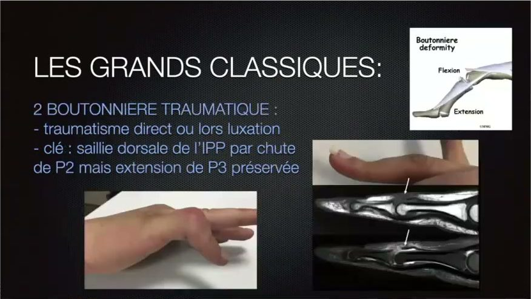
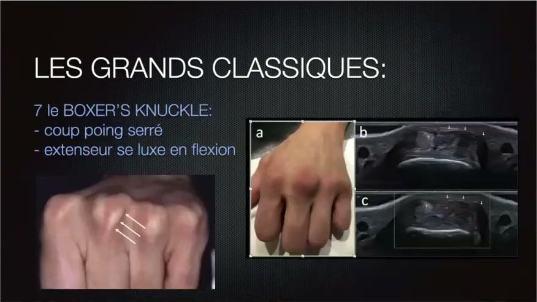

# Les déformations post-traumatiques

> [!abstract] L'essentiel
> **Devant un doigt traumatique, regarder la main avant l'image : cascade digitale, rotation, testing tendineux** ; et réorienter l'imagerie si la demande ne colle pas.

> [!success] À retenir
> 1. **Trouble rotatoire** : en flexion, les doigts doivent converger vers le **tubercule du scaphoïde** ; une déviation rotatoire = souvent **chirurgie**, à signaler explicitement.
> 2. Grands classiques : **mallet finger** (P3 tombante réductible), **boutonnière** (chute de P2, P3 en extension), **col de cygne**, **jersey finger** (4e doigt, plus de flexion de l'IPD), **rupture de poulie** (grimpeur, « crac »).
> 3. **Boxer's knuckle** (coup de poing) : luxation de l'extenseur en flexion → **échographie dynamique** ; plaie punctiforme + doigt inflammatoire = **phlegmon**, urgence chirurgicale.

## Images clés
 [▶ 8:50](https://www.youtube.com/watch?v=xtiPwIslzpw&t=530s)
 [▶ 10:23](https://www.youtube.com/watch?v=xtiPwIslzpw&t=623s)

## Points clés
- Le radiologue doit parfois apporter ou corriger le diagnostic quand l'imagerie demandée n'est pas la bonne.
- **Interrogatoire** : terrain (sujet jeune → traumatique ; sujet âgé goutteux → arthrite microcristalline plutôt qu'infectieuse), circonstances (rugby avec maillot arraché → jersey finger ; claquement en escalade → poulie ; coup de poing → lésion de l'appareil extenseur à la MCP), antécédents chirurgicaux et traumatismes anciens négligés.
- **Inspection** : aspect harmonieux, **cascade digitale** préservée en flexion, désaxation, œdème.
- **Troubles de rotation** : subtils et difficiles à voir en imagerie ; en flexion, les axes des doigts doivent converger vers le **tubercule du scaphoïde**. Une déviation rotatoire est souvent synonyme de traitement chirurgical.
- Examen de base : sensibilité, écartement des doigts, ouverture complète de la main, testing des fléchisseurs (superficiel et profond) et des extenseurs, stabilité articulaire.
- **Mallet finger** : P3 tombante, mobilité passive conservée, extension active absente ; arrachement tendineux pur, osseux ou avec fracture articulaire.
- **Boutonnière** : rupture de la bandelette médiane, chute de P2 et hyperextension paradoxale de P3.
- **Col de cygne** : déformation inverse, de causes multiples (dont lésion de la plaque palmaire) ; consulter un chirurgien quand l'hyperextension devient gênante.
- Entorses : un œdème important peut masquer une luxation.
- **Jersey finger** : 4e doigt le plus souvent, P3 « molle », plus aucune flexion active de l'IPD.
- **Rupture de poulie** : claquement parfois audible, prise en semi-arqué, grimpeurs de niveau intermédiaire à bon.
- **Lésion de l'extenseur à la MCP** (coup de poing mal protégé) : luxation statique ou dynamique de l'extenseur, idéalement évaluée en échographie dynamique.

## Sémiologie et technique d'imagerie
- Radiographies typiques reconnaissables « en un quart de seconde » : fracture désaxée, arrachements.
- Échographie dynamique pour l'instabilité de l'extenseur à la MCP et les poulies.

## Pièges et diagnostics différentiels
- **Infections** : arthrites bactériennes et ténosynovites après plaies punctiformes (épines végétales, morsures, perforation par une boucle d'oreille) ; ce sont des urgences chirurgicales.
- Dactylite sans rapport avec un traumatisme récent.

> [!WARNING] À ne pas manquer
> Un trouble rotatoire digital ou une plaie punctiforme infectée (phlegmon des fléchisseurs) relèvent d'une prise en charge chirurgicale rapide.

> [!TIP] Pour le compte rendu
> Relier l'image au mécanisme et à la clinique ; signaler explicitement un trouble rotatoire ou une déviation axiale, et réorienter l'imagerie si la demande ne correspond pas au tableau.

## Liens
- Congrès : [[SIMS 2022 - Index]]
- Voir aussi : [[Traumatismes des articulations interphalangiennes]], [[Les poulies du doigt traumatique]], [[Prise en charge médicale des entorses du doigt]]
