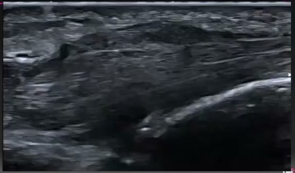
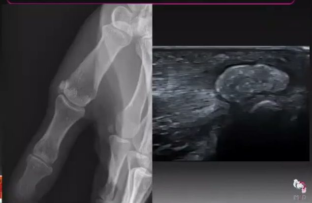

# Les injections abarticulaires

> [!abstract] L'essentiel
> **Ténosynovite sténosante de la main : échoguidage par voie longitudinale distale, dilacération du rétinaculum puis injection dans la gaine dans le même geste** : ≈ 90 % de guérison du doigt à ressaut.

> [!success] À retenir
> 1. **De Quervain** : aspect « roue et pneu », chercher un **septum** intercompartimental (injection ciblée) ; éviter la voie axiale (**branche sensitive du nerf radial**).
> 2. Aiguille **25 G** (doigt à ressaut, De Quervain) ; **27 G** et prudence pour le **FCR** (rhizarthrose, rhumatisme inflammatoire : risque de rupture) ; anticoagulants non contre-indiqués.
> 3. Corticoïdes **dopants depuis le 1er janvier 2022** chez le sportif de compétition ; calcification d'hydroxyapatite = lavage/fragmentation, guérison en quelques jours.

## Images clés
 [▶ 6:28](https://www.youtube.com/watch?v=d2CFkwq2cmk&t=388s)
 [▶ 10:04](https://www.youtube.com/watch?v=d2CFkwq2cmk&t=604s)

## Points clés
- Échoguidage avec sonde « club de golf » haute fréquence ; la bonne technique est celle que l'on maîtrise ; respect des procédures (indication, asepsie, consentement).
- **Dopage** : depuis le 1er janvier 2022, les infiltrations de corticoïdes sont considérées comme dopantes : chez le sportif de compétition, se coordonner avec le staff pour le calendrier.
- Pas de problème avec anticoagulants et antiagrégants : cibles superficielles, saignement contrôlable.
- Produits : hydrocortisone (moins d'atrophie cutanée réputée), corticoïdes retard, anesthésiques locaux, acide hyaluronique, PRP, sérum physiologique, agents sclérosants ; ozone proposé par une équipe dans le canal carpien.
- **De Quervain** : épaississement hyperhémique du rétinaculum du 1er compartiment (court extenseur et long abducteur du pouce). Aiguille 25 G ; voie longitudinale préférée (rétinaculum vu en entier, abord distal, dilacération puis, dans le même geste, entrée dans la gaine) ; la voie axiale expose à la branche sensitive du nerf radial.
- Septum intercompartimental (petit spicule) : rétinaculum épaissi pour un seul tendon → injection ciblée dans la gaine concernée.
- **Doigt à ressaut** : même technique longitudinale, patient assis (allongé pour le pouce), abord distal, aiguille 25 G éventuellement courbée ; environ **90 % de guérison** selon la littérature ; une équipe ajoute de l'acide hyaluronique à 2 semaines.
- Autres : ténosynovite de l'ECU (voie latérale, trituration) ; ténosynovite du **fléchisseur radial du carpe** à risque de rupture (aiguille 27 G, prudence, terrain d'arthropathie STT/rhizarthrose ou de rhumatisme inflammatoire) ; boxer's knuckle (lésion de bandelette sagittale).
- **Canal carpien** : indication si clinique + EMG ± échographie, forme modérée non chirurgicale ; voie radiale (en avant, en arrière ou à travers le FCR) ou voie ulnaire (repérer le canal de Guyon).
- Névromes post-traumatiques (nerf digital, branche sensitive du radial) : injection au contact sous échographie.
- Dupuytren : dilacération du nodule (25 ou 21 G) avec mélange anesthésique-corticoïde, section de la bride.
- Calcification d'hydroxyapatite : lavage/fragmentation au sérum physiologique ou à la lidocaïne comme à l'épaule, guérison en quelques jours.

## Sémiologie et technique d'imagerie
- Aspect axial de « roue et pneu » au 1er compartiment : pneu = rétinaculum épaissi hyperhémique, roue = gaine tendineuse.
- Bulles dans la gaine = bon positionnement.

## Pièges et diagnostics différentiels
- Branche sensitive du nerf radial en voie axiale au 1er compartiment.
- Tendon FCR fragile (rhumatismes inflammatoires) : risque de rupture.

> [!WARNING] À ne pas manquer
> Statut dopant des infiltrations de corticoïdes chez le sportif de compétition.

> [!TIP] Pour le compte rendu
> Indiquer la cible (rétinaculum, gaine, nerf), la présence d'un septum, la voie, le calibre d'aiguille, le produit et la dilacération éventuelle.

## Liens
- Congrès : [[SIMS 2022 - Index]]
- Voir aussi : [[Les injections d'agents thérapeutiques de la main]], [[Traitement à l'aiguille des pathologies de la main]], [[L'échochirurgie du canal carpien]]
