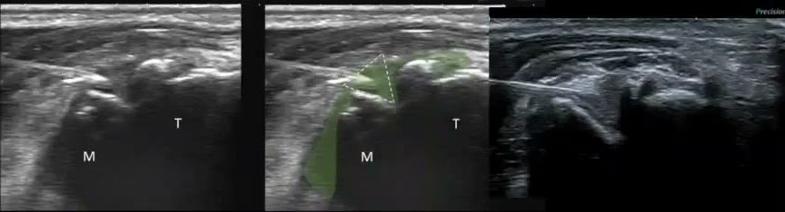
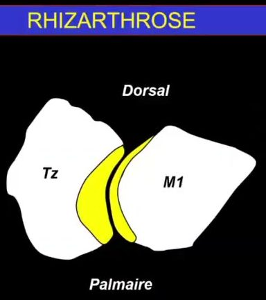
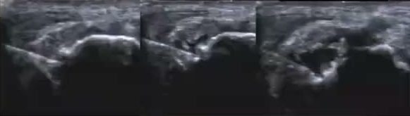

# Les injections articulaires du poignet et de la main

> [!abstract] L'essentiel
> **Doigts et trapézo-métacarpienne : échoguidage sans contraste, volume < 1 mL** ; poignet : radioscopie, qui montre les communications et permet une ponction unique.

> [!success] À retenir
> 1. TM : **voie palmaire transmusculaire** (ostéophytes palmaires divergents) ; plus la rhizarthrose est évoluée, plus l'échoguidage est **facile**.
> 2. **Fuite extra-articulaire dès < 1 mL** : le contraste « consomme » le volume utile → s'en passer quand l'écho suffit.
> 3. Poignet : radioscopie (souvent couplée à l'**arthroscanner**) ; **pisotriquétrale** en hypersupination ; toxine botulique **50 UI dans 1 mL** efficace sur la douleur de rhizarthrose (essai RHIBOT).

## Images clés
 [▶ 4:02](https://www.youtube.com/watch?v=jb98Vfoee94&t=242s)
 [▶ 3:03](https://www.youtube.com/watch?v=jb98Vfoee94&t=183s)
 [▶ 4:35](https://www.youtube.com/watch?v=jb98Vfoee94&t=275s)

## Points clés
- Pratique observée au cabinet : opérateurs de plus de 50 ans → quasi tout sous radioscopie ; moins de 50 ans → IPD, IPP, MCP et **trapézo-métacarpienne** sous échographie ; le poignet reste sous radioscopie pour tous.
- Trapézo-métacarpienne sous radioscopie : main à plat, ponction à quelques millimètres de la base de M1, trajet ascendant vers l'interligne, contrôle par contraste.
- Trapézo-métacarpienne sous échographie : **voie palmaire transmusculaire**, sonde sur la pente proximale de l'éminence thénar dans l'axe de la première commissure, aiguille parallèle à la sonde, cible = triangle articulaire.
- Physiopathologie de la rhizarthrose : les ostéophytes **dorsaux convergent** et barrent la voie dorsale, tandis que les ostéophytes **palmaires divergent** et ouvrent la voie palmaire : plus l'arthrose est évoluée, plus l'échoguidage est facile.
- Capacité articulaire très faible : en cadavre, fuite dès moins de 1 mL et fuite majeure à 1 mL. Injecter du contraste « consomme » le volume utile : tout ce qui est injecté ensuite fuit.
- Étude randomisée RHIBOT, toxine botulique vs placebo dans la rhizarthrose (50 UI dans 1 mL, *Lancet Rheumatology*, sous presse en juin 2022) : diminution franche de la douleur sur 6 mois ; une fuite de toxine se traduit immédiatement par une perte de force de la pince.
- IPD/IPP/MCP : ponction de proximal en distal, dans le triangle articulaire ou directement dans le récessus proximal distendu ; petites seringues (< 1 mL), arrêt dès résistance et distension.
- Poignet sous radioscopie justifié : injections souvent couplées à un arthroscanner, volume suffisant pour contraste + corticoïde, et visualisation des communications intercompartimentales permettant **une seule ponction** pour plusieurs compartiments (ex. polyarthrite rhumatoïde atteignant trois compartiments).
- Pisotriquétrale : ne communique pas toujours avec la médiocarpienne ; injectée sous radioscopie en hypersupination (« technique du verre renversé » pour positionner le patient).

## Sémiologie et technique d'imagerie
- Vérifier en échographie la position de l'aiguille dans le triangle articulaire et la diffusion intra-articulaire du produit ; bulles/distension du récessus comme témoin.

## Pièges et diagnostics différentiels
- Injection périarticulaire (« pâté » autour de l'articulation) aux doigts : inefficacité possible et complications cutanées.
- Risque allergique au produit iodé à mettre en balance avec le bénéfice d'une ponction unique au poignet.

> [!WARNING] À ne pas manquer
> Ne pas saturer les petites articulations : volume total < 1 mL, éviter le contraste quand l'échographie suffit.

> [!TIP] Pour le compte rendu
> Mentionner le guidage, la voie d'abord, le volume injecté, la vérification de la diffusion intra-articulaire et, au poignet, les communications intercompartimentales observées.

## Liens
- Congrès : [[SIMS 2022 - Index]]
- Voir aussi : [[Les injections d'agents thérapeutiques de la main]], [[Les injections abarticulaires]], [[Arthrose digitale différentes nomenclatures, phénotypes différents]]
