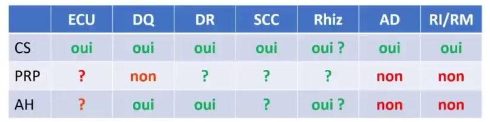
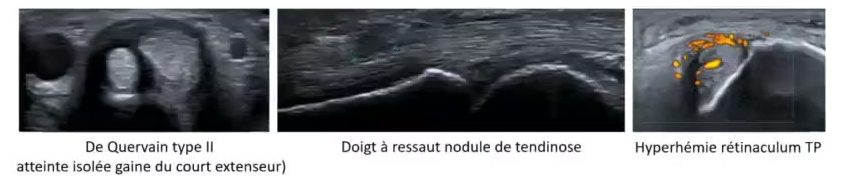

# Les injections d'agents thérapeutiques de la main

> [!abstract] L'essentiel
> **À la main, seuls les corticoïdes sont validés, avec un effet à court terme** ; acide hyaluronique et PRP restent des alternatives de recours. Règle **CQFD** : Complications, Quantité, Fragilité, Douleur.

> [!success] À retenir
> 1. **Canal carpien** : corticoïdes > placebo, attelle et anesthésique seul, quel que soit le produit (**92 %** de succès à 1 mois mais **8 %** à 2 ans) ; hydrodissection échoguidée possible.
> 2. **Acide hyaluronique** dans la **gaine ou le péritendon, jamais en intratendineux** (De Quervain, doigt à ressaut) ; recours si contre-indication, échec ou refus des corticoïdes.
> 3. Risques : **atrophie et dépigmentation cutanée**, rupture tendineuse ; prudence à la **STT** (communication avec la gaine du FCR).

## Images clés
 [▶ 12:02](https://www.youtube.com/watch?v=reKGdlRWpr0&t=722s)
 [▶ 10:57](https://www.youtube.com/watch?v=reKGdlRWpr0&t=657s)

## Points clés
- Définir la **cible** : arthropathie = synoviopathie (épanchement, réaction synoviale), injection strictement intra-articulaire ; tendinopathie = pathologie du péritendon, des gaines, des rétinaculums (le tendon est « victime plus qu'acteur ») ; neuropathie canalaire = nerf symptomatique, cause analysée (intrinsèque, extrinsèque, posturale). Pas de traitement d'anomalies électrophysiologiques asymptomatiques.
- Rationnel des produits : **corticoïdes** = action anti-inflammatoire et antalgique rapide, effets délétères à long terme, répétition si pas de prise en charge associée ; **acide hyaluronique** = action lubrifiante, antalgique, cicatrisante, intéressant dans les gaines synoviales ; **PRP** = relance de la cicatrisation, effet « colle » dans les fissures/clivages, améliore peut-être la qualité sans accélérer la réparation.
- Spécificités de la main, « **CQFD** » : **C**omplications (cutanées — atrophie, dépigmentation —, septiques rares mais graves, ruptures tendineuses, lésions nerveuses), **Q**uantité (petits volumes, conditionnements inadaptés, peu de place pour anesthésique ou contraste), **F**ragilité (patients dont la main est l'outil : musiciens, handicap…), **D**ouleur (innervation riche).
- Indications : canal carpien (surtout corticoïdes), ténosynovites sténosantes (De Quervain, doigt à ressaut, ECU, extenseurs) : corticoïdes ou acide hyaluronique ; synovites inflammatoires/métaboliques : corticoïdes ; arthrose digitale : rhizarthrose, STT, IPP/IPD ; maladie de Dupuytren.
- STT : prudence, communication possible avec la gaine du **fléchisseur radial du carpe** (risque tendineux).
- Pénurie de corticoïdes injectables : 3 à 4 molécules disponibles en France (dont Kenacort, Depo-Medrol).
- Canal carpien : corticoïdes supérieurs au placebo (92 % à 1 mois mais 8 % à 2 ans dans une étude), supérieurs à l'anesthésique seul et à l'attelle, quel que soit le produit ou la dose, résultats comparables à la chirurgie à 2 ans dans une étude, réduction du recours chirurgical à 5 ans ; l'EMG n'est pas prédictif de la réponse ; rôle possible de l'**hydrodissection** sous échoguidage.
- Acide hyaluronique : petite efficacité dans la rhizarthrose (méta-analyses), une seule étude dans le canal carpien ; utile en cas de contre-indication, échec, effets indésirables ou refus des corticoïdes.
- PRP : petites séries, supérieur au placebo et à l'attelle, équivalent aux corticoïdes à 3 mois puis meilleur à plus long terme ; pas de preuve dans la rhizarthrose (étude en cours dans l'arthrose digitale).

## Sémiologie et technique d'imagerie
- Les études anciennes sur la rhizarthrose n'étaient pas toutes échoguidées : à réévaluer sous guidage échographique.

## Pièges et diagnostics différentiels
- Atrophie cutanée après infiltrations répétées (exemple après trois infiltrations de De Quervain) : contre-indique de nouvelles injections et gêne le chirurgien.
- Contraste entre la pratique (injections fréquentes, patients satisfaits) et la rareté des recommandations des sociétés savantes.

> [!WARNING] À ne pas manquer
> Complications cutanées, septiques, tendineuses et nerveuses non négligeables à la main ; vigilance pour la STT (gaine du FCR).

> [!TIP] Pour le compte rendu
> Préciser la cible (articulaire, gaine, rétinaculum, nerf), le produit et le volume injectés, le guidage et l'information du patient sur les risques cutanés.

## Liens
- Congrès : [[SIMS 2022 - Index]]
- Voir aussi : [[Les injections articulaires du poignet et de la main]], [[Les injections abarticulaires]], [[Traitement à l'aiguille des pathologies de la main]]
