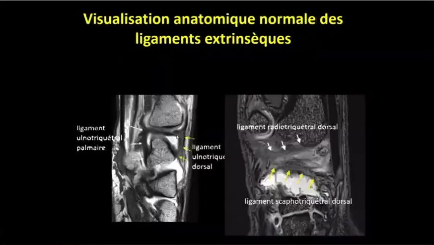
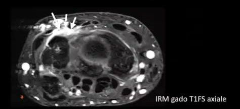
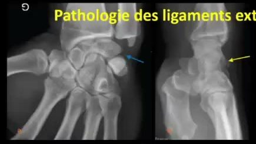

# Les ligaments extrinsèques du carpe

> [!abstract] L'essentiel
> **Ligaments extrinsèques lésés dans ≈ 75 % des traumatismes aigus du poignet : regarder systématiquement la crête dorsale du triquetrum** et conclure sur l'instabilité du carpe.

> [!success] À retenir
> 1. Crête dorsale du triquetrum = insertion des **radio-triquétral, scapho-triquétral et ulno-triquétral dorsaux** : désinsertion possible **sans fragment osseux** → instabilité médiocarpienne.
> 2. Analyse en **axial et sagittal** (coronal = repérage) ; **IRM / arthro-IRM** examens de choix, **écho** valable pour le versant dorsal.
> 3. Toujours coupler aux clichés **neutres et dynamiques** : diastasis scapho-lunaire, DISI / VISI, marche d'escalier luno-triquétrale.

## Images clés
 [▶ 4:12](https://www.youtube.com/watch?v=qC5HvyfFbf8&t=252s)
 [▶ 10:15](https://www.youtube.com/watch?v=qC5HvyfFbf8&t=615s)
 [▶ 10:44](https://www.youtube.com/watch?v=qC5HvyfFbf8&t=644s)

## Points clés
- Ligaments capsulaires extrasynoviaux ; lésés dans environ **3/4 des traumatismes aigus** (contre environ 60 % pour les ligaments intrinsèques), prévalence encore plus élevée en cas d'arrachement osseux.
- Lésions plus fréquentes en distalité (rangée distale, arche ligamentaire) et sur le versant ulnaire (luno-triquétral, ulno-triquétral palmaire).
- **Versant palmaire** : radio-lunaire long et court (stabilisent le versant radial du lunatum), radio-scapho-capitatum (retient le pôle distal du scaphoïde de la flexion palmaire, aidé du ligament scapho-trapézien), arche ligamentaire distale (ligament arqué = radio-scapho-capitatum + fibres triquétro-hamato-capitatum côté ulnaire) assurant la cohésion de la rangée distale.
- **Versant dorsal** : le « V » ligamentaire radio-triquétral dorsal + scapho-triquétral dorsal (intercarpien dorsal), plus l'ulno-triquétral dorsal (complexe TFCC). Tous s'insèrent sur la **crête dorsale du triquetrum** : « si vous n'avez qu'un endroit à regarder, c'est celui-là ».
- Le faisceau dorsal du ligament scapho-lunaire est le principal stabilisateur scapho-lunaire ; une lésion des stabilisateurs secondaires (radio-scapho-capitatum, scapho-trapézien) ne suffit pas à elle seule à créer une dissociation : il faut une lésion scapho-lunaire associée.
- Instabilité dissociative = incohérence entre os de la première rangée : DISI (dorsale, lésion scapho-lunaire) ou VISI (palmaire, complexe luno-triquétral). Une lésion scapho-lunaire isolée ne suffit probablement pas à créer une DISI.
- Les déchirures isolées des ligaments radio-carpiens palmaires sont rarement responsables seules d'une instabilité mais peuvent être symptomatiques : immobilisation, rééducation/ergothérapie pour prévenir une instabilité secondaire.

## Sémiologie et technique d'imagerie
- Analyse dans les **plans transverse et sagittal** (et axial oblique reconstruit depuis une acquisition 3D) ; le plan coronal sert à repérer, pas à diagnostiquer une lésion.
- Échographie possible pour les structures dorsales : faisceaux dorsaux scapho-lunaire et luno-triquétral, ligaments extrinsèques dorsaux, crête dorsale du triquetrum.
- Radiographies en position neutre puis dynamiques/stress (ou fluoroscopie) : malalignement intra-rangée ou entre rangées ; signes décrits : diastasis scapho-lunaire, bascule du lunatum (corne palmaire pointant en distal), pincement radio-scaphoïdien.
- Exemples en arthro-IRM : désinsertion radiale du radio-lunaire long et du radio-scapho-capitatum avec subluxation ulnaire du carpe ; déchirure scapho-lunaire + désinsertion radiale des extrinsèques palmaires → instabilité dissociative.

## Pièges et diagnostics différentiels
- Arrachement ligamentaire de la crête dorsale du triquetrum **sans fragment osseux visible** : à rechercher activement.
- Fracture-arrachement de la crête dorsale du triquetrum associée à une déchirure du scapho-triquétral dorsal → risque d'instabilité médiocarpienne voire radio-carpienne.
- Marche d'escalier luno-triquétrale + petit arrachement osseux = instabilité luno-triquétrale.

> [!WARNING] À ne pas manquer
> Regarder systématiquement la crête dorsale du triquetrum (insertions luno-triquétrale, radio-triquétrale dorsale et scapho-triquétrale dorsale) : sa lésion peut mener à une instabilité médiocarpienne.

> [!TIP] Pour le compte rendu
> Décrire séparément ligaments intrinsèques et extrinsèques (palmaires, dorsaux, site de désinsertion radiale ou triquétrale), les arrachements osseux, et l'alignement du carpe en neutre et en dynamique ; conclure sur l'existence ou non d'une instabilité.

## Liens
- Congrès : [[SIMS 2022 - Index]]
- Voir aussi : [[Intérêt de l'exploration dynamique des lésions ligamentaires du poignet]], [[Anatomie et imagerie du septum dorsal]], [[Mise au point sur les différentes techniques de reconstruction scapholunaire]]
