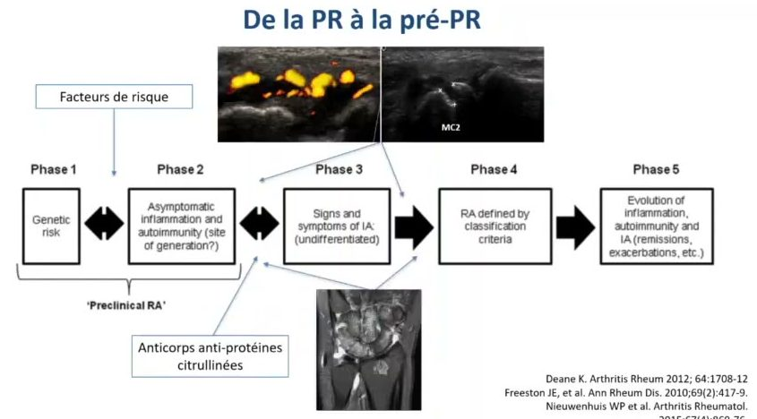
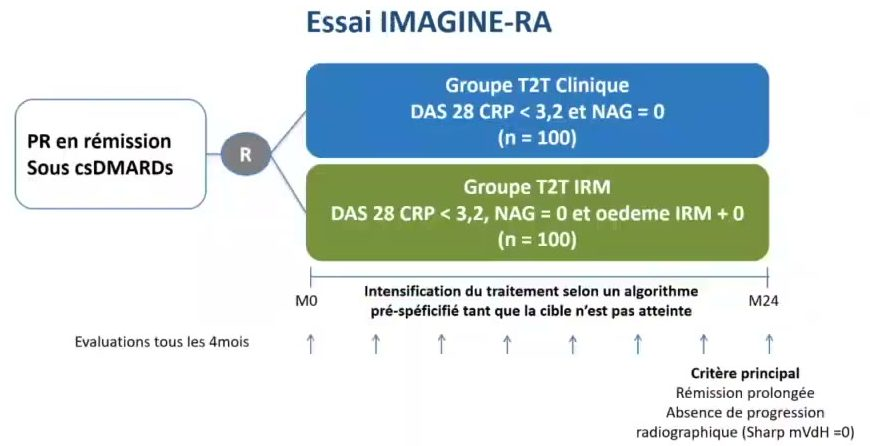
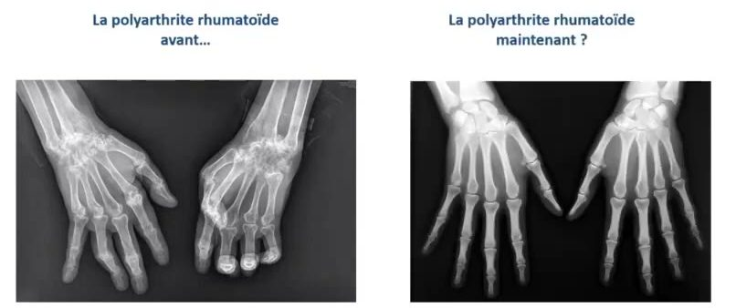

# Les nouveautés dans le suivi de la polyarthrite rhumatoïde

> [!abstract] L'essentiel
> **Viser la rémission en imagerie (Doppler nul, pas d'œdème IRM) n'apporte rien de plus que la rémission clinique et surtraite** : l'imagerie sert au diagnostic, au pronostic et à prédire la rechute.

> [!success] À retenir
> 1. **TaSER, ARCTIC, IMAGINE-RA** : cible échographique ou IRM vs cible clinique → **aucun bénéfice** clinique ni structural, mais **plus de biothérapies** dans le bras imagerie.
> 2. Au diagnostic : **synovite Doppler** et **œdème osseux IRM** prédisent l'érosion et le passage pré-PR → PR ; **80 % des érosions** surviennent dans les **2 premières années**.
> 3. Patient en rémission candidat à l'allègement : signaler une **inflammation infraclinique persistante** (prédictive de rechute).

## Images clés
 [▶ 1:14](https://www.youtube.com/watch?v=n9CR0pYO2t8&t=74s)
 [▶ 7:24](https://www.youtube.com/watch?v=n9CR0pYO2t8&t=444s)
 [▶ 0:14](https://www.youtube.com/watch?v=n9CR0pYO2t8&t=14s)

## Points clés
- Diagnostic plus précoce : critères ACR/EULAR 2010 (clinico-biologiques), anticorps anti-protéines citrullinées (ACPA) présents avant la maladie, concept de « pré-PR ».
- Échographie et IRM détectent des synovites infracliniques ; synovite Doppler positive et œdème osseux IRM sont prédictifs d'une évolution destructrice et du passage pré-PR → PR.
- Fenêtre d'opportunité courte (quelques mois à un an) : 80 % des érosions surviennent dans les deux premières années. On traite « vite et fort ».
- Arsenal élargi : méthotrexate (traitement conventionnel synthétique de référence), anti-TNF depuis les années 2000, puis nombreuses biothérapies.
- Stratégie *treat-to-target* (contrôle serré) avec scores composites cliniques et CRP/VS : l'espérance de vie des patients rejoint celle de la population générale.
- Étude TaSER (écossaise) : PR récentes (< 12 mois), cible clinique vs cible échographique (une seule articulation Doppler positive tolérée), évaluation mensuelle, 18 mois : **aucune différence** clinique ni IRM.
- Étude ARCTIC (nordique) : patients naïfs, seuil de DAS plus strict (1,6 au lieu de 3,2), bras rémission clinique + absence de synovite échographique, 24 mois, critère de non-progression (Sharp modifié, delta < 0,5) : **aucune différence**.
- Essai IMAGINE-RA (IRM) : patients déjà en rémission sous csDMARD, 2 × 100 patients, 24 mois, IRM tous les 4 mois, intensification tant que persiste l'œdème : pas de différence clinique ni structurale, mais **beaucoup plus de traitements** (passage plus rapide aux biothérapies) dans le bras imagerie.

## Sémiologie et technique d'imagerie
- Échographie : synovite en mode B et Doppler.
- IRM : œdème osseux (ostéite), facteur prédictif d'érosion.
- Radiographies : comparaison évolutive.

## Pièges et diagnostics différentiels
- Chez les patients très détruits, l'imagerie aide à distinguer poussée inflammatoire et poussée dégénérative.
- La persistance de synovites ou d'érosions infracliniques chez un patient en rémission est prédictive de la rechute lors de la décroissance thérapeutique.

> [!WARNING] À ne pas manquer
> Ne pas pousser à l'escalade thérapeutique sur une synovite infraclinique isolée : la cible du *treat-to-target* reste clinique et biologique.

> [!TIP] Pour le compte rendu
> Au diagnostic : quantifier synovites Doppler, œdème osseux et érosions (valeur pronostique). En suivi d'un patient en rémission candidat à un allègement : signaler explicitement la persistance ou non d'une inflammation infraclinique.

## Liens
- Congrès : [[SIMS 2022 - Index]]
- Voir aussi : [[La sclérodermie de la clinique à l'imagerie]]
