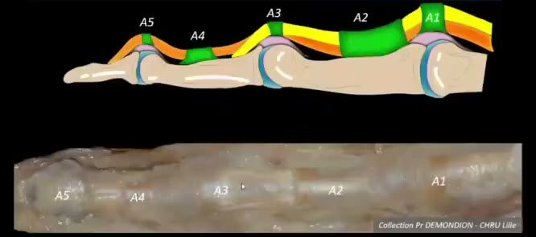
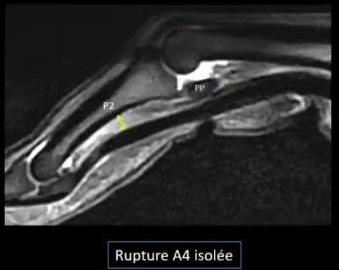

# Les poulies du doigt traumatique

> [!abstract] L'essentiel
> **Rupture de poulie = diagnostic sur signes indirects en flexion contrariée** : diastasis tendon-os pour A2/A4, **diastasis tendon-plaque** pour démasquer une atteinte de A3.

> [!success] À retenir
> 1. **Échographie dynamique** en première intention ; en IRM, **au moins une séquence en flexion** (contrariée ou passive), sinon faux négatif.
> 2. **Distance tendon-os** : en regard de **P1 (A2)** ou de **P2 (A4)** pour une rupture isolée.
> 3. **A3 rompue** : la plaque palmaire reste collée à l'os → **liquide entre plaque et fléchisseur superficiel** ; rupture combinée A2-A3 ou A3-A4, à signaler au chirurgien.

## Images clés
 [▶ 0:11](https://www.youtube.com/watch?v=UFDC7Yyp1lU&t=11s)
 [▶ 6:50](https://www.youtube.com/watch?v=UFDC7Yyp1lU&t=410s)

## Points clés
- Poulies : renforcements fibreux de la gaine des fléchisseurs formant le canal digital ; poulies osseuses (A2 sur P1, A4 sur P2) et articulaires (A1, A3, A5) insérées sur les plaques palmaires.
- Rôle : plaquer les tendons contre os et articulations, transformer la traction longitudinale en rotation angulaire (préhension).
- Mécanisme : contraintes excessives doigt fléchi ; sport roi : l'**escalade**, mais aussi gestes anodins (sac lourd porté par un doigt).
- Rupture complète : décollement des fléchisseurs (effet « corde d'arc », *bowstring*), base du diagnostic.
- Les études de référence (une cadavérique, une clinique) fondaient le diagnostic sur le diastasis tendon-os mesuré en échographie.
- En 2022, IRM plus accessible et meilleure résolution : interruption directe de la poulie parfois visible en axial, mais l'échographie reste en première intention (même sémiologie) ; en aigu, l'échographie ne montre pas l'interruption directe et le diagnostic reste possible.
- **Poulie A3** : rupture isolée exceptionnelle, ruptures combinées A2-A3 ou A3-A4 non rares. Ancienne stratégie : seuil de diastasis tendon-os plus élevé que pour A2 isolée, mais valeurs millimétriques proches et site de mesure peu reproductible en regard de l'IPP.
- Approche d'une équipe autrichienne : A3 intacte → en flexion, la traction tendineuse soulève la plaque palmaire ; A3 rompue → plaque recollée à l'os, apparition d'un **diastasis tendon-plaque** (liquide ou sang entre plaque et tendons).
- Mesure à faire entre la plaque et la face profonde du fléchisseur superficiel (déjà latéralisé à ce niveau vers sa terminaison sur P2).

## Sémiologie et technique d'imagerie
- Échographie : poulie normale = fine bande arciforme trifoliée à centre hypoéchogène ; examen **dynamique en flexion contrariée** (doigt de l'examinateur contre le doigt du patient, sonde sur A2 et P1) ; coupes sagittales au milieu de P1 (A2) et de P2 (A4), puis en regard de l'IPP (A3).
- IRM : bande en hyposignal ; au moins une séquence en flexion (contrariée, reproduisant la prise) ; la **flexion passive** (doigt bloqué) est une alternative jugée satisfaisante par plusieurs auteurs.
- Rupture A2 : diastasis tendon-os en regard de P1 ; A4 : en regard de P2 ; A2-A3 ou A3-A4 : diastasis tendon-os + diastasis tendon-plaque en regard de l'IPP.

## Pièges et diagnostics différentiels
- En position neutre, la rupture peut passer inaperçue.
- Mesure en regard de l'articulation très variable selon le site.

> [!WARNING] À ne pas manquer
> Une IRM des poulies sans séquence en flexion peut être faussement normale.

> [!TIP] Pour le compte rendu
> Préciser la ou les poulies rompues (A2, A3, A4), les distances tendon-os et tendon-plaque, et la position d'examen (flexion contrariée ou passive).

## Liens
- Congrès : [[SIMS 2022 - Index]]
- Voir aussi : [[La plaque palmaire des doigts]], [[Les déformations post-traumatiques]], [[Le locked finger]]
