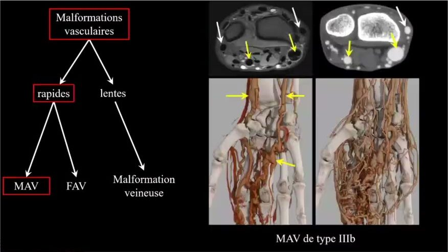
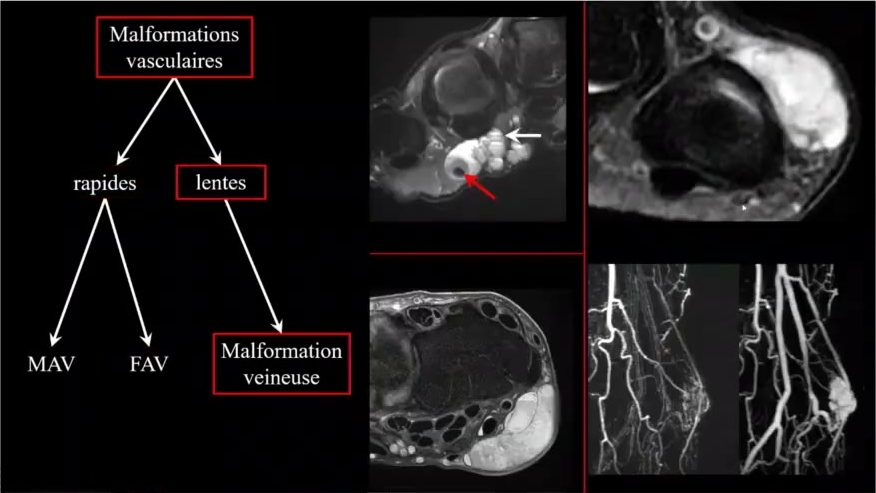

# Les tumeurs et malformations vasculaires de la main

> [!abstract] L'essentiel
> **Lésion vasculaire de la main : trancher d'abord flux rapide ou lent, malformation ou tumeur (ISSVA)** : l'angioscanner ou l'angio-IRM dynamique est décisif.

> [!success] À retenir
> 1. **Flux rapide** (MAV, FAV) : flow-voids, artère nourricière, veine de drainage précoce, « blush » de shunts → **angioscanner multiphasique** avec reconstructions 3D.
> 2. **Malformation veineuse** (la plus fréquente) : lacs polylobés, **niveaux liquides**, **phlébolithes**, rehaussement retardé, pas d'artère dilatée ; ne pas confondre phlébolithes et flow-voids.
> 3. Tumeur glomique, hémangiome épithélioïde (engaine une artère), Maffucci ; **atypie = biopsie** (angiosarcome sur lymphœdème, **acrométastase** de cancer du rein).

## Images clés
 [▶ 2:27](https://www.youtube.com/watch?v=G-5LbxY4oYM&t=147s)
 [▶ 5:32](https://www.youtube.com/watch?v=G-5LbxY4oYM&t=332s)

## Points clés
- Classification de l'**ISSVA** (malformation = anomalie de morphogenèse ; tumeur = lésion proliférative), complétée par l'OMS ; à visée thérapeutique, classification de Houdart modifiée par des équipes coréennes.
- Diagnostic : histoire clinique + examen + imagerie, histologie si besoin. Lésions superficielles, risque hémorragique maîtrisé : appliquer les règles carcinologiques.
- **Malformations à flux rapide** : malformation artério-veineuse (aspect de « blush » fait de multiples petits shunts sur angioscanner multiphasique) et fistule artério-veineuse (artère nourricière, veine à rehaussement précoce, connexion identifiable). Risque d'ischémie, de nécrose, voire d'amputation.
- **Malformations à flux lent** (veineuses), les plus fréquentes : lacs vasculaires polylobés, niveaux liquides, zones hypo-intenses (fibrine, phlébolithes), rehaussement décalé d'environ 5 s par rapport à la phase artérielle, pas de veine dilatée.
- **Hémangiome capillaire lobulaire** (granulome pyogénique, botryomycome) : après une piqûre ou une égratignure, chez l'homme jeune, la femme enceinte et l'enfant ; lésion exophytique friable, hypervascularisée.
- **Hémangiome à cellules fusiformes** : isolé ou multiple ; associé aux enchondromes dans le syndrome de Maffucci (dysplasie mésodermique non héréditaire), avec risque accru de tumeurs dans d'autres sites (gliome/astrocytome, CHC, cholangiocarcinome, adénocarcinome pancréatique) : prise en charge globale.
- **Hyperplasie endothéliale papillaire** : prolifération sur thrombus organisé ; plages en hypersignal T1 non effacées par la saturation de graisse (sang), rehaussement périphérique et central ; souvent < 2 cm, aux extrémités. Forme secondaire sur malformation non identifiable en imagerie.
- **Hémangiome épithélioïde** : prolifération pariétale engainant et sténosant une artère (ulnaire, radiale), bien visible en échographie et en angio-IRM.
- **Angiosarcome** : sur lymphœdème chronique (souvent après cancer du sein), nodules hypervascularisés ; pronostic effroyable.
- **Tumeur glomique extra-unguéale** : pas de prédominance féminine, triade clinique absente, lésion douloureuse de quelques millimètres, très vascularisée ; la sonde réveille la douleur ; pas de connexion nerveuse ; pic artériel précoce et retour veineux rapide à l'angioscanner.

## Sémiologie et technique d'imagerie
- Échographie Doppler en première intention.
- Angioscanner (une détection de 4 cm suffit) préféré pour la résolution spatiale et temporelle ; angio-IRM dynamique multiphasique avec reconstructions 3D.
- IRM : flow-voids (flux rapide), niveaux liquides (fenêtrage adapté), hypersignal T1 du sang.

## Pièges et diagnostics différentiels
- Sans séquence dynamique, une MAV nodulaire est décrite comme une simple « boule ».
- Ne pas confondre phlébolithes/fibrine et flow-voids.
- Lésions traumatiques ou micro-traumatiques : faux anévrisme partiellement thrombosé.
- Acrométastase (exemple d'un cancer du rein).

> [!WARNING] À ne pas manquer
> Une masse vasculaire atypique de la main peut être un angiosarcome ou une métastase : au moindre doute, contrôle histologique selon les règles carcinologiques.

> [!TIP] Pour le compte rendu
> Préciser flux rapide ou lent, présence d'une artère nourricière ou de fistules, rapports artériels (sténose, engainement), et proposer angioscanner ou angio-IRM dynamique pour cartographier l'angioarchitecture avant geste.

## Liens
- Congrès : [[SIMS 2022 - Index]]
- Voir aussi : [[Les tumeurs malignes de la main]], [[Imagerie de la maladie de Dupuytren des doigts]]
