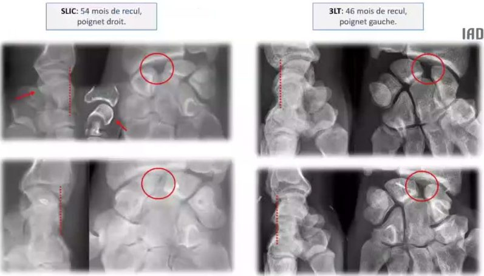
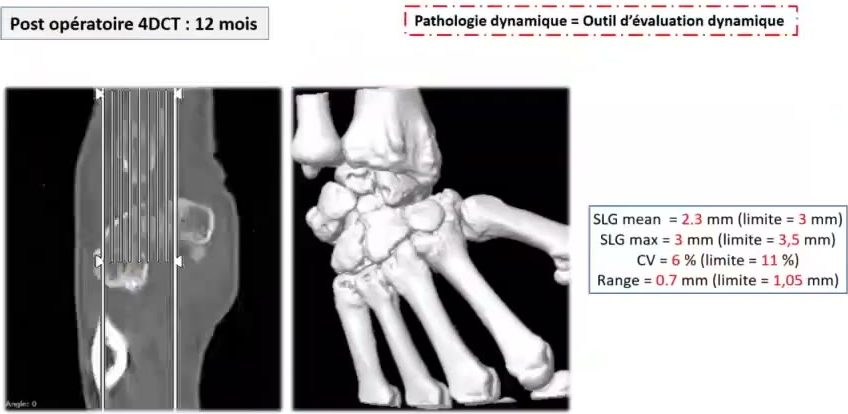
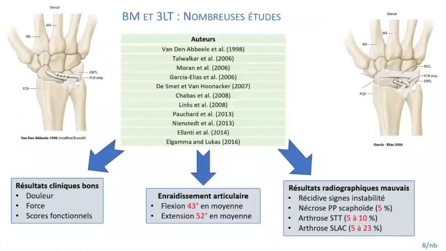

# Mise au point sur les différentes techniques de reconstruction scapholunaire

> [!abstract] L'essentiel
> **Ligamentoplastie scapho-lunaire = instabilité réductible sans arthrose** ; le scanner dynamique (4D) devient l'outil pour juger le recentrage du pôle proximal du scaphoïde.

> [!success] À retenir
> 1. **Arthrose = contre-indication** : la rechercher et la décrire (SLAC, STT) ; préciser lésion partielle/complète, **septum dorsal**, réductibilité.
> 2. Ténodèses au FCR (Brunelli modifiée, 3LT) : clinique bonne mais raideur (flexion **43°**, extension **52°**), nécrose du pôle proximal **5 %**, SLAC **5-23 %**.
> 3. Post-op : position des tunnels/ancres, **diastasis SL** (4DCT : écart moyen < **3 mm**), **pôle proximal recentré** sous le radius ; radios simples peu fiables (influence de ± 20° de flexion-extension).

## Images clés
 [▶ 7:15](https://www.youtube.com/watch?v=4hURxOy27sM&t=435s)
 [▶ 8:28](https://www.youtube.com/watch?v=4hURxOy27sM&t=508s)
 [▶ 4:22](https://www.youtube.com/watch?v=4hURxOy27sM&t=262s)

## Points clés
- Deux conditions d'indication : **absence d'arthrose** et **instabilité réductible** ; la réductibilité est difficile à quantifier, même en peropératoire (radiographie, arthroscopie).
- Pas de technique de référence : ligamentoplasties radio-carpiennes ou intracarpiennes, à ciel ouvert ou sous arthroscopie, avec des greffons variés.
- Historique cité : ligamentoplastie à l'extensor carpi radialis brevis (1991, trois tunnels capitatum/pôle proximal du scaphoïde/lunatum, pontant la radio-carpienne), modification de 1992 évitant ce pontage ; transferts actifs ECRB/ECRL pour limiter la flexion du scaphoïde ; ancrage pôle distal-lunatum avec suture au radio-carpien dorsal (2011).
- Techniques les plus étudiées : au **flexor carpi radialis** via un tunnel transscaphoïdien palmaire → dorsal (Brunelli et modifications ; ténodèse « triple » de Garcia-Elias 2006 avec ancrage lunatum et passage dans le radio-carpien dorsal ; variantes reconstruisant aussi l'intercarpien dorsal).
- Transplants artificiels (Internal Brace, seuls ou hybrides avec palmaris longus) ; technique « 360 » reconstruisant scapho-lunaire dorsal, palmaire et intercarpien ; techniques arthroscopiques pour les instabilités peu déplacées.
- Littérature : bons résultats cliniques mais enraidissement (flexion moyenne 43°, extension 52°) et résultats radiographiques médiocres et variables (récidive des signes d'instabilité, nécrose du pôle proximal du scaphoïde 5 %, arthrose STT 5 à 10 %, arthrose SLAC 5 à 23 %).
- Technique **SLIC** (scapho-luno-intercarpienne, Nancy) : voie dorsale, transplant libre de palmaris longus précontraint, reconstruction du scapho-lunaire dorsal et de l'intercarpien dorsal, ancrages intraosseux, sans abord palmaire ni sacrifice du FCR.
- Résultats rapportés par l'orateur (étude prospective comparative vs ténodèse) : amélioration douleur et force, absence d'aggravation de la raideur préopératoire, flexion meilleure qu'avec la ténodèse, tendance à la normalisation des paramètres radiographiques et **recentrage systématique du pôle proximal du scaphoïde** sous le radius.
- Lésions partielles (scapho-lunaire dorsal, septum dorsal) = instabilité débutante : techniques arthroscopiques (capsulodèse) envisageables.

## Sémiologie et technique d'imagerie
- Évaluation de la technique : études anatomo-radiologiques sur pièces (section des stabilisateurs puis reconstruction), puis **scanner dynamique** sur pièces mobilisées et chez les patients, avec analyse quantitative.
- La subluxation dorsale du pôle proximal du scaphoïde (composante rotatoire) est un paramètre clé à évaluer, potentiellement pathognomonique des stades précoces selon l'orateur.

## Pièges et diagnostics différentiels
- Mesures radiographiques seules potentiellement biaisées pour juger l'efficacité d'une ligamentoplastie.

> [!WARNING] À ne pas manquer
> Une arthrose installée contre-indique ces reconstructions : la rechercher et la décrire explicitement.

> [!TIP] Pour le compte rendu
> En préopératoire : stade de la lésion (partielle/complète, septum dorsal), réductibilité, arthrose. En postopératoire : position des tunnels/ancrages, alignement scapho-lunaire, position du pôle proximal du scaphoïde, souffrance du pôle proximal.

## Liens
- Congrès : [[SIMS 2022 - Index]]
- Voir aussi : [[Intérêt de l'exploration dynamique des lésions ligamentaires du poignet]], [[Les ligaments extrinsèques du carpe]], [[Anatomie et imagerie du septum dorsal]]
