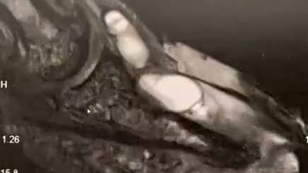
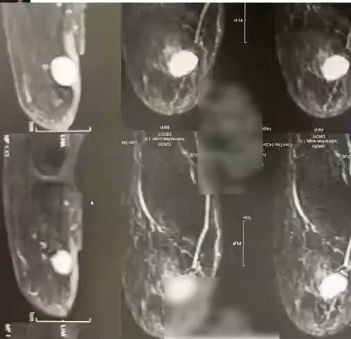
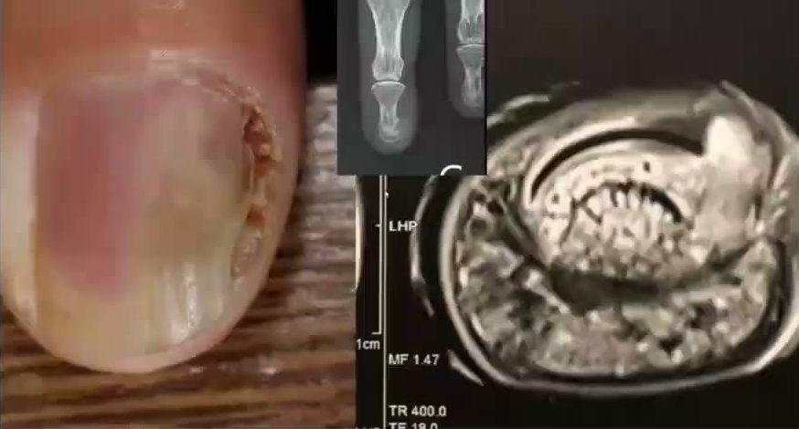

# Prise en charge chirurgicale des lésions traumatiques et tumorales de l'ongle

> [!abstract] L'essentiel
> **L'IRM millimétrique est la cartographie du chirurgien de l'ongle** : elle choisit la voie qui épargne la matrice et peut permettre un traitement conservateur en RCP.

> [!success] À retenir
> 1. **Kyste mucoïde** : montrer le **pédicule vers l'IPD** et l'ostéophyte → section du pédicule par voie dorso-latérale, sans exérèse sous-matricielle.
> 2. **Tumeur glomique / kyste épidermoïde** récidivants : préciser la position par rapport à **matrice, lit et logette osseuse** ; tout point dans la matrice = dystrophie définitive.
> 3. **Carcinome épidermoïde** : l'IRM (atteinte osseuse, marges) oriente vers une **résection monobloc conservatrice** plutôt que l'amputation ; mélanome : IRM peu utile au diagnostic.

## Images clés
 [▶ 4:07](https://www.youtube.com/watch?v=oCCp4Qqr2xg&t=247s)
 [▶ 6:09](https://www.youtube.com/watch?v=oCCp4Qqr2xg&t=369s)
 [▶ 8:49](https://www.youtube.com/watch?v=oCCp4Qqr2xg&t=529s)

## Points clés
- Un bel ongle nécessite une matrice parfaite, une tablette adhérant à un lit parfait, une longueur et largeur suffisantes et un support osseux normal.
- Complications chirurgicales : cicatrice matricielle transversale → ongle feuilleté (séparation des contributions des matrices) ; cicatrice longitudinale ou **simple point de suture** dans la matrice → strie ou fissure ; absence de lit → onycholyse ou pachyonychie, parfois exérèse de l'appareil et ongle en trompe-l'œil.
- Tumeurs périphériques de l'ongle : peu de problème ; imagerie inutile.
- **Kyste mucoïde (arthrosynovial)** issu d'un ostéophyte de l'IPD : grâce à l'IRM, changement de technique — plus besoin de retirer le kyste sous-matriciel en totalité. Voie dorso-latérale sur l'IPD, grattage de l'ostéophyte (bec de perroquet) à la lame 15, section du pédicule, affaissement du kyste qui s'assèche seul : cicatrices plus petites, cuticule et repli respectés, matrice préservée.
- **Tumeurs glomiques et kystes épidermoïdes** sous l'ongle, la matrice ou le lit : difficiles, récidivent souvent après abord inapproprié ; l'IRM fournit la cartographie.
- Tumeur glomique en 3e récidive (abords latéraux successifs, tumeur friable) : abord par le lit, récliner la matrice aux instruments de microchirurgie, coaguler le fond de la logette phalangienne, contre-incision pulpaire pour glisser le lit ; **pas de point dans le lit ni dans la matrice** : surjet intradermique de nylon retiré de part et d'autre ; repousse normale.
- Kyste épidermique post-traumatique fistulisé (ostéolyse, écoulement purulent, colonisation bactérienne) : relèvement de la bandelette terminale de l'extenseur, curetage sous la matrice, repousse à 3 mois.
- **Carcinome épidermoïde** : radiographie normale → exérèse de l'appareil unguéal ; avec atteinte osseuse, l'IRM moderne a permis en RCP un traitement conservateur par résection monobloc (phalange partielle, marges osseuses et pulpaires) et reconstruction au lieu d'une amputation.
- Surveillance postopératoire en IRM (nodule : récidive vs kyste épidermoïde ou matriciel).
- **Mélanome** : l'IRM n'apporte quasiment rien au diagnostic (stades sans atteinte osseuse), éventuellement à la surveillance ou aux complications.

## Sémiologie et technique d'imagerie
- IRM haute résolution millimétrique : rapport de la lésion avec la matrice, le lit, l'IPD, l'os ; reconstructions 3D scanner jugées spectaculaires mais inutiles.

## Pièges et diagnostics différentiels
- Point de suture « résorbable » dans la matrice aux urgences = cicatrice et dystrophie définitive.

> [!WARNING] À ne pas manquer
> Toute traversée de la matrice laisse une séquelle : l'imagerie doit permettre de choisir la voie qui l'épargne.

> [!TIP] Pour le compte rendu
> Cartographier la lésion (sus/sous-matricielle, lit, pédicule articulaire, ostéophyte, logette osseuse, atteinte osseuse et marges) : c'est ce qui conditionne la voie d'abord et la conservation.

## Liens
- Congrès : [[SIMS 2022 - Index]]
- Voir aussi : [[Tumeurs de l'ongle, il n'y a pas que la glomique]], [[Indication de l'imagerie en pathologie unguéale]], [[Radio anatomie de l'ongle]]
