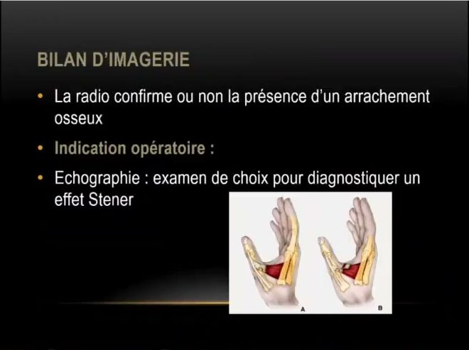
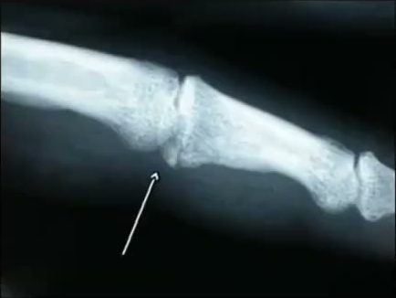
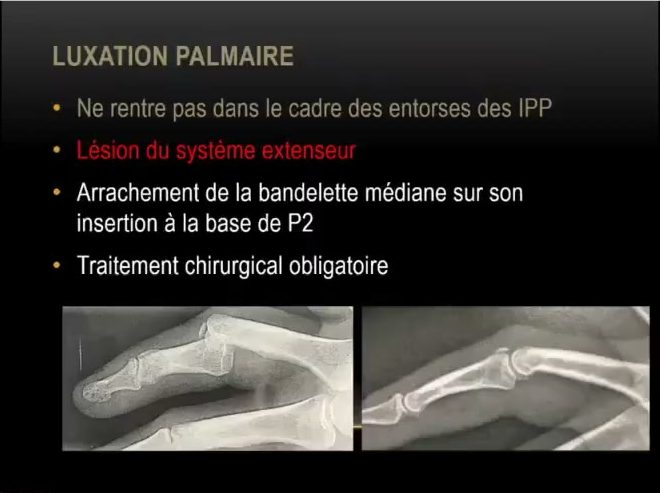

# Prise en charge médicale des entorses du doigt

> [!abstract] L'essentiel
> **Pas d'entorse bénigne du doigt : radio pour l'arrachement, échographie pour l'effet Stener du pouce, immobilisation courte en extension puis mobilisation précoce.**

> [!success] À retenir
> 1. Pouce du skieur : **effet Stener** (LCU interposé sous l'aponévrose de l'adducteur) → **échographie** = examen de choix, **indication chirurgicale**.
> 2. IPP : attelle en **extension stricte ≤ 10 jours** (nocturne la 2e semaine), suivi radiographique hebdomadaire ; défaut d'extension **> 30°** persistant → orthèse dynamique (Capener).
> 3. **Luxation palmaire de l'IPP** = arrachement de la **bandelette médiane** (base de P2) : pas une entorse, **chirurgie obligatoire** ; arrachement de la plaque palmaire à chercher sur le profil strict.

## Images clés
 [▶ 3:21](https://www.youtube.com/watch?v=YIZ1XeAHcIU&t=201s)
 [▶ 10:46](https://www.youtube.com/watch?v=YIZ1XeAHcIU&t=646s)
 [▶ 11:58](https://www.youtube.com/watch?v=YIZ1XeAHcIU&t=718s)

## Points clés
- **MCP** : flexion-extension et rotation ; en flexion, le faisceau principal du ligament collatéral se tend et verrouille la rotation ; en extension, latéralités plus importantes côté ulnaire que radial. Plaque palmaire épaisse ; verrouillage tendineux dorsal par les **bandelettes sagittales**, dont la rupture peut se réparer chirurgicalement.
- Test : MCP fléchie et IPP fléchie, puis stress radial et ulnaire pour localiser la laxité.
- Les entorses des collatéraux de MCP laissent rarement une instabilité, mais des douleurs prolongées (plus de 6 mois, parfois un an), surtout au passage des intrinsèques.
- Signe clinique utilisé dans le service de l'orateur : un doigt qui « plonge » lors de la mobilisation active traduit une rupture complète du ligament collatéral radial ; rupture des deux faisceaux = indication chirurgicale.
- Immobilisation classique des MCP en flexion à 45° ; l'équipe de l'orateur immobilise en **extension**, en particulier après chirurgie, pour respecter l'ancrage ligamentaire et éviter la flexion de la plaque palmaire ; pas plus de 3 semaines.
- **MCP du pouce** (accident de ski) : ligament collatéral ulnaire ; échographie = examen de référence, couplée aux radiographies (arrachement), pour rechercher l'**effet Stener** (interposition de l'aponévrose de l'adducteur) : indication chirurgicale systématique, sinon MCP douloureuse et non fonctionnelle.
- Luxation dorsale de MCP avec incarcération des sésamoïdes : réduction par opérateur entraîné (exagérer la luxation puis pousser la base de P1 sur la tête métacarpienne), contrôle radiographique.
- Rupture de la capsule dorsale avec désinsertion de l'extenseur du pouce : flessum de MCP difficilement réductible si non immobilisé en extension.
- **IPP** : « épicentre » de la chirurgie de la main (Curtis) ; *critical corner* (jonction ligament collatéral principal-plaque palmaire) ; stabilité conservée même après excision d'un collatéral grâce aux forces de compression ; plaque palmaire avec « queue d'hirondelle ».
- Perte de flexion et d'extension par rétraction distale de la plaque palmaire ; flessum dû à une immobilisation trop longue ou en mauvaise position (« fausse flexion » de l'IPP).
- Protocole : attelle thermoplastique en extension (3 min de réalisation), pas plus de 10 jours, nocturne seulement la 2e semaine ; suivi hebdomadaire avec radiographies. Principe de James : MCP protégées en flexion, IPP en extension (isométrie des collatéraux de l'IPP). Séries publiées : 90 patients en 2006 (90 % de bons résultats) ; série de 2019 : meilleurs résultats de la prise en charge précoce.
- **Luxation palmaire de l'IPP** : lésion de l'appareil extenseur, strictement chirurgicale.

## Sémiologie et technique d'imagerie
- Radiographies : arrachements, réduction, contrôles évolutifs.
- Échographie : effet Stener, ligaments collatéraux, bandelettes sagittales.

## Pièges et diagnostics différentiels
- Banaliser une entorse de l'IPP (« un peu de strapping ») : bons résultats 6 fois sur 10, les 4 autres sont « dramatiques ».
- Luxation de l'IPP méconnue, parfois pendant des années.

> [!WARNING] À ne pas manquer
> L'effet Stener du pouce est une indication chirurgicale obligatoire : il doit être recherché et explicitement mentionné en échographie.

> [!TIP] Pour le compte rendu
> Préciser ligament et faisceau atteints, interposition de l'adducteur, fragment osseux, état de la plaque palmaire et des bandelettes sagittales.

## Liens
- Congrès : [[SIMS 2022 - Index]]
- Voir aussi : [[Traumatismes des articulations interphalangiennes]], [[La plaque palmaire des doigts]]
