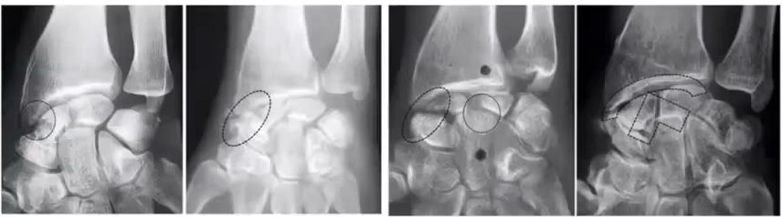
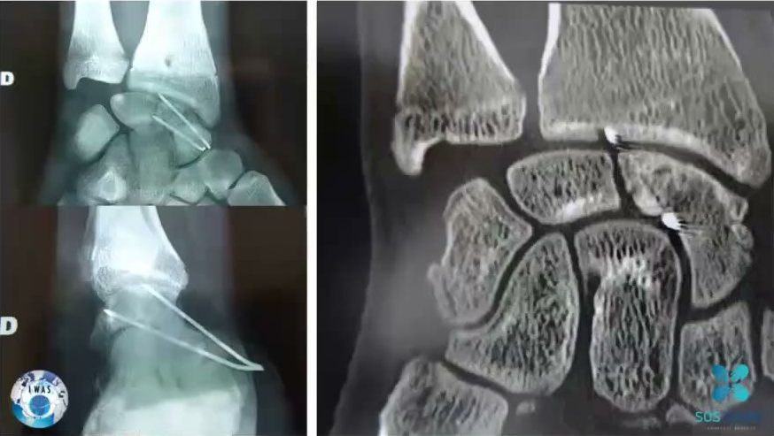
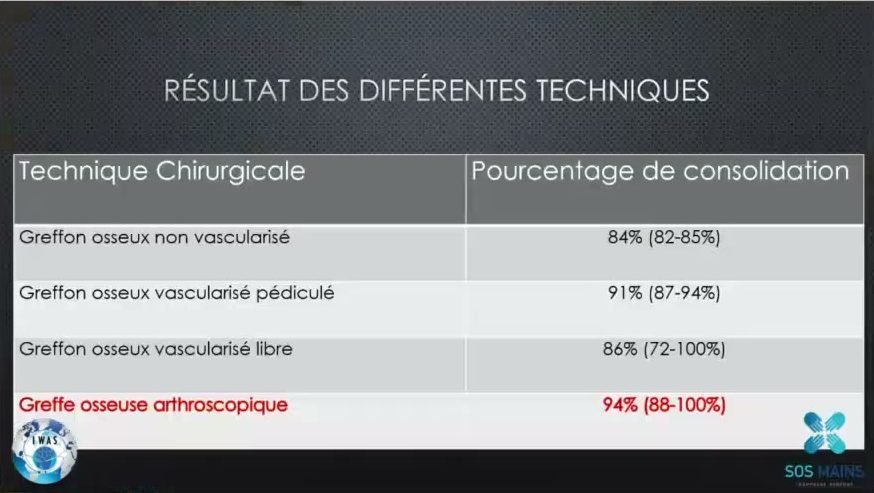

# Pseudarthrose du scaphoïde, les possibilités thérapeutiques

> [!abstract] L'essentiel
> **Pseudarthrose du scaphoïde (> 6 mois) = chirurgie obligatoire pour éviter le SNAC wrist** ; la greffe arthroscopique (≈ 94 % de consolidation) devient le standard.

> [!success] À retenir
> 1. Consolidation : greffe **non vascularisée 84 %**, **vascularisée pédiculée 91 %**, vascularisée libre **86 %**, **arthroscopique 94 %** (88-100 %).
> 2. Le CR oriente la technique : siège **proximal ou corporéal**, perte de substance, **humpback**, vitalité du pôle proximal, ligament scapho-lunaire, stade **SNAC**.
> 3. Après greffe arthroscopique : **scanner à 3 mois** pour juger l'ostéo-intégration (zone greffée parfois > 1/3 du scaphoïde, ne pas la prendre pour un défect).

## Images clés
 [▶ 0:45](https://www.youtube.com/watch?v=YqpHaHAnDEE&t=45s)
 [▶ 7:46](https://www.youtube.com/watch?v=YqpHaHAnDEE&t=466s)
 [▶ 8:07](https://www.youtube.com/watch?v=YqpHaHAnDEE&t=487s)

## Points clés
- Définition retenue : absence de consolidation après **6 mois**.
- La pseudarthrose rompt la chaîne cinétique du carpe et évolue vers le **SNAC wrist** (*scaphoid nonunion advanced collapse*) : arthrose radio-carpienne puis médio-carpienne puis globale.
- Pas de place pour le traitement orthopédique.
- **Ostéosynthèse sans greffe** : dans les premiers mois (zone grise entre 3 et 6 mois), en l'absence de déformation ou de perte de substance ; percutanée, sous contrôle arthroscopique (vérification de l'intégrité du ligament scapho-lunaire et de l'absence de saillie de la vis dans le cartilage).
- **Greffes non vascularisées** au-delà : technique de Matti-Russe (greffon rectangulaire encastré, prélevé sur la crête iliaque ou la face dorsale du radius) ; technique de Fisk-Fernandez (greffon cunéiforme par voie antérieure pour corriger la déformation en flexion, *humpback deformity*, et restaurer la hauteur).
- **Greffes vascularisées pédiculées** : pour les pseudarthroses proximales, les échecs chirurgicaux ou un doute sur la vascularisation du fragment proximal ; techniquement plus difficiles, incertitude sur la viabilité du pédicule, variations anatomiques. En France : lambeau de Kuhlmann-Mathoulin (palmaire, branche de l'artère radiale) et lambeau de Zaidemberg (styloïde radiale, branche de l'artère radiale, avec périoste).
- **Greffe libre vascularisée** du condyle fémoral médial (technique américaine) : lourde, anastomose microchirurgicale termino-latérale sur l'artère radiale.
- **Greffe arthroscopique** (pratiquée depuis une dizaine d'années) : avivement à la curette par voie médio-carpienne jusqu'à l'os vascularisé, comblement par carottes spongieuses prélevées au radius, montage léger par deux broches (« la biologie avant la mécanique ») ; ostéo-intégration au scanner à 3 mois ; consolidation d'environ 95 %.
- Taux de consolidation présentés (diapo) : greffon non vascularisé 84 % (82-85 %), vascularisé pédiculé 91 % (87-94 %), vascularisé libre 86 % (72-100 %), greffe arthroscopique 94 % (88-100 %).
- Choix thérapeutique selon l'expérience du chirurgien et le niveau lésionnel : pseudarthrose proximale → arthroscopie ou greffon vascularisé pédiculé ou libre ; pseudarthrose du corps → arthroscopie, greffon non vascularisé ou vascularisé libre.

## Sémiologie et technique d'imagerie
- Scanner et IRM identifient la fracture initialement méconnue et son évolution vers la pseudarthrose.
- Scanner de contrôle à 3 mois après greffe arthroscopique pour juger l'intégration.

## Pièges et diagnostics différentiels
- La pseudarthrose du pôle proximal était la plus difficile à traiter avant l'arthroscopie.
- La zone de greffe peut représenter plus d'un tiers de la surface du scaphoïde : ne pas la confondre avec un défect.

> [!WARNING] À ne pas manquer
> Une pseudarthrose non traitée évolue vers le SNAC wrist : le diagnostic doit déboucher sur une prise en charge chirurgicale en milieu spécialisé.

> [!TIP] Pour le compte rendu
> Préciser la topographie (proximale ou corporéale), la perte de substance, la déformation en flexion (*humpback*), l'état du pôle proximal et du ligament scapho-lunaire, éléments qui orientent le choix technique. Taux de réussite global d'environ 90 %.

## Liens
- Congrès : [[SIMS 2022 - Index]]
- Voir aussi : [[Retard de consolidation, pseudarthrose et nécrose du scaphoïde]], [[Imagerie postopératoire du scaphoïde]]
