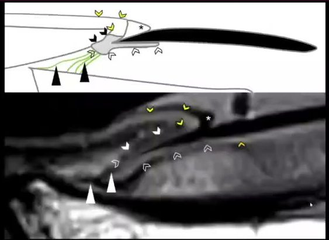
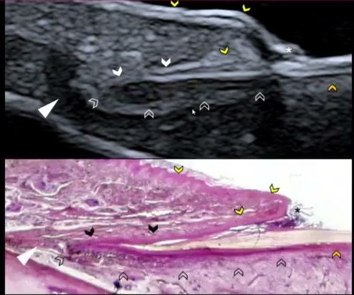
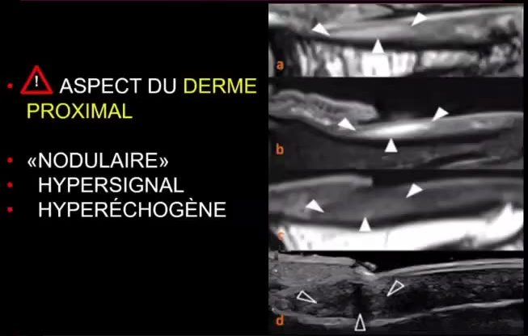

# Radio anatomie de l'ongle

> [!abstract] L'essentiel
> **Situer toute lésion unguéale par rapport à la matrice, au lit et à la tablette** ; trois aspects normaux simulent une tumeur glomique ou un kyste.

> [!success] À retenir
> 1. Matrice en **V** sagittal (proximale → couche dorsale, distale → couche ventrale de la tablette) ; atteinte matricielle = **onychodystrophie**, atteinte du lit = **onycholyse**.
> 2. Pièges : **derme proximal pseudonodulaire** (hypersignal, hyperéchogène, toujours au même endroit, sans scalloping), **hypervascularisation physiologique du lit**, **veine axiale** sous le repli (pseudo-kyste mucoïde).
> 3. Technique : IRM avec fine couche de **vaseline** sur la tablette ; écho **très haute fréquence (33-70 MHz)**, matrice distale bien vue en sagittal.

## Images clés
 [▶ 4:53](https://www.youtube.com/watch?v=1cPTf7bEu74&t=293s)
 [▶ 6:05](https://www.youtube.com/watch?v=1cPTf7bEu74&t=365s)
 [▶ 8:36](https://www.youtube.com/watch?v=1cPTf7bEu74&t=516s)

## Points clés
- Structures : **matrice** (fabrique la tablette, ~0,1 mm/jour aux mains, moins aux pieds), **replis** (orientent la croissance, protègent), **lit** (adhésion à la phalange, sans hypoderme), fermeture proximale par la cuticule et distale par l'**hyponychium**.
- Atteinte matricielle → **onychodystrophie** ; atteinte du lit → **onycholyse** (décollement).
- Tablette : kératinisée, ~0,5 mm, trois couches histologiques (dorsale, intermédiaire, ventrale) ; incolore, sa couleur dépend du support : lunule blanche (fin de la matrice distale), rose sur le lit vasculaire, blanche après la bande onychodermique.
- Matrice proximale (dorsale) → couche superficielle de la tablette ; matrice distale (ventrale) → couche profonde. Matrice en **V** sur les coupes sagittales, la matrice distale formant un renflement plus épais.
- Attaches ligamentaires de l'appareil unguéal à la phalange : l'atteinte unguéale du psoriasis pourrait être enthésique.

## Sémiologie et technique d'imagerie
- **IRM** : tablette vide de signal ; pour voir sa forme, la recouvrir d'une fine couche de vaseline (préférable au gel). En coupe axiale à la racine, la tablette est prise en sandwich entre matrice proximale (au-dessus) et matrice distale (en dessous). Lit en signal élevé sous la tablette.
- **Échographie 33 MHz** : tablette trilamellaire (blanc-noir-blanc) mais proportions non conformes à l'histologie (artefact dorsal) ; matrice distale bien vue en sagittal (aspect en « queue de mouton »), matrice proximale difficile ; coupes axiales décevantes (courbure de l'ongle) ; lit mal vu sous la tablette épaisse.
- **Échographie 70 MHz** (Vevo) : trilamellaire conforme à l'histologie (dorsale 1/5, intermédiaire 3/5, ventrale 1/5), matrices et lit mieux visibles, y compris en axial ; hyponychium visible.
- Kératine distale : noire en IRM, hyperéchogène avec cône d'ombre en échographie.

## Pièges et diagnostics différentiels
- **Derme proximal pseudonodulaire** : signal T1 plus élevé et rehaussement plus intense que le derme distal ; toujours au même endroit, ovalaire, allongé, sans scalloping → à ne pas confondre avec une tumeur glomique.
- **Hypervascularisation physiologique du lit** : ne pas conclure à une tumeur sur l'hypervascularisation ; certaines tumeurs glomiques paraissent même hypovasculaires par rapport au derme normal.
- **Veine(s) axiale(s)** passant sous le repli : en IRM, pseudo-kyste mucoïde issu d'une IPD arthrosique ; en échographie, structure tubulée avec flux Doppler.

> [!WARNING] À ne pas manquer
> Ne pas prendre le derme proximal ni la veine axiale pour une tumeur glomique ou un kyste mucoïde.

> [!TIP] Pour le compte rendu
> Situer précisément une lésion par rapport à la matrice (proximale/distale), au lit et à la tablette : c'est ce qui conditionne le risque de dystrophie postopératoire.

## Liens
- Congrès : [[SIMS 2022 - Index]]
- Voir aussi : [[Indication de l'imagerie en pathologie unguéale]], [[Tumeurs de l'ongle, il n'y a pas que la glomique]], [[Prise en charge chirurgicale des lésions traumatiques et tumorales de l'ongle]]
