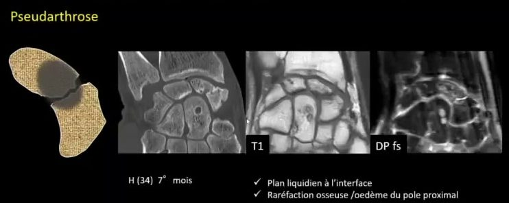
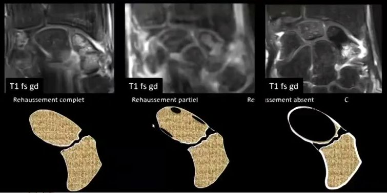
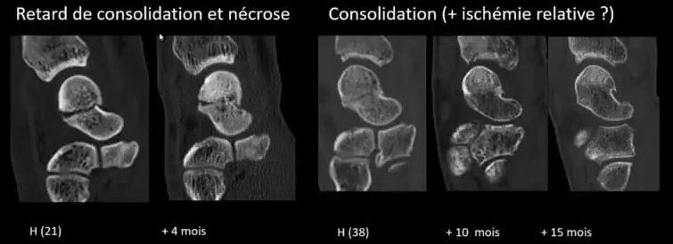

# Retard de consolidation, pseudarthrose et nécrose du scaphoïde

> [!abstract] L'essentiel
> **Scaphoïde : le scanner juge la consolidation, l'IRM injectée la perfusion du pôle proximal** ; patterns souvent intermédiaires, à lire avec la date et la topographie du trait.

> [!success] À retenir
> 1. **Pseudarthrose** : berges sclérosées et corticalisées, micro-géodes, **plan liquidien à l'interface** (DP FS).
> 2. **T1 FS gado** : rehaussement complet = pôle perfusé ; **absent = nécrose** ; partiel (zones sous-chondrales) fréquent et non conclusif.
> 3. **Densification scanographique du pôle proximal ≠ nécrose** : peut être perfusé ; un aspect « œdémateux » ne garantit pas non plus la vascularisation.

## Images clés
 [▶ 2:35](https://www.youtube.com/watch?v=gbOGbJ3rgl4&t=155s)
 [▶ 5:25](https://www.youtube.com/watch?v=gbOGbJ3rgl4&t=325s)
 [▶ 6:10](https://www.youtube.com/watch?v=gbOGbJ3rgl4&t=370s)

## Points clés
- Scaphoïde, clé de voûte du carpe ; vascularisation rétrograde (branche dorsale de l'artère radiale), pôle proximal hypovascularisé.
- Évolution classique d'une fracture méconnue : pseudarthrose puis arthrose radio-scaphoïdienne, parfois peu symptomatique pendant des années.
- **Consolidation normale** : estompement du trait, restauration de la continuité corticale et trabéculaire ; raréfaction osseuse régionale possible chez le sujet jeune.
- **Retard de consolidation** : situation instable, peut encore évoluer vers la consolidation.
- **Pseudarthrose** : situation figée, plutôt irréversible : berges sclérosées, micro-géodes, néo-articulation avec espace liquidien.
- **Nécrose** : le plus souvent post-traumatique ; rare origine systémique (exemple de nécrose bilatérale du pôle proximal chez une patiente sclérodermique).
- Le gadolinium aide : rehaussement harmonieux de part et d'autre du trait = fracture perfusée (plutôt retard de consolidation) ; absence de rehaussement du pôle proximal = nécrose. Patterns intermédiaires fréquents (zones sous-chondrales non rehaussées).
- Un hyposignal T1 modéré avec hypersignal DP FS (œdème) rehausse en général ; un hyposignal T1 marqué du pôle proximal évoque l'absence de perfusion, mais un aspect « œdémateux » ne garantit pas la vascularisation.
- Discordance fréquente : pôles proximaux densifiés au scanner aussi bien vascularisés que dévascularisés ; la densification peut traduire une raréfaction différée des os voisins. Grandes divergences dans la littérature sur l'intérêt du gadolinium.
- Causes de la complexité : fracture, réparation normale ou anormale, troubles de perfusion absolus ou relatifs, contraintes biomécaniques, dans un espace très restreint.

## Sémiologie et technique d'imagerie
- Scanner : se focaliser sur la continuité corticale et trabéculaire du trait ; une densification discrète des berges peut annoncer une pseudarthrose ; berges corticalisées + micro-lacunes = pseudarthrose.
- IRM : T1, DP/T2 FS, injection avec saturation de graisse ; signal normalisé au site fracturaire = probable consolidation ; analyse des chondropathies associées.
- Scintigraphie : hyperfixation mais résolution spatiale insuffisante pour juger la perfusion.

## Pièges et diagnostics différentiels
- Ne pas conclure à une nécrose sur une densification scanographique isolée du pôle proximal.
- Moelle grasse normale du pôle proximal sans œdème : normale ou nécrosée ? Comparer au radius.
- Ischémie transitoire possible.

> [!WARNING] À ne pas manquer
> Une même image peut correspondre à des diagnostics très différents selon l'ancienneté de la fracture : la date et la topographie du trait sont indispensables à l'interprétation.

> [!TIP] Pour le compte rendu
> Scanner : décrire la consolidation (pontage, sclérose des berges, géodes). IRM : signal du trait, signal et rehaussement du pôle proximal, cartilage, en restant prudent sur le terme « nécrose ».

## Liens
- Congrès : [[SIMS 2022 - Index]]
- Voir aussi : [[Pseudarthrose du scaphoïde, les possibilités thérapeutiques]], [[Imagerie postopératoire du scaphoïde]], [[Fracture occulte du carpe, diagnostic et IA]]
