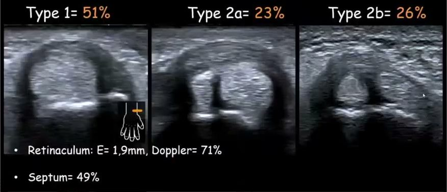
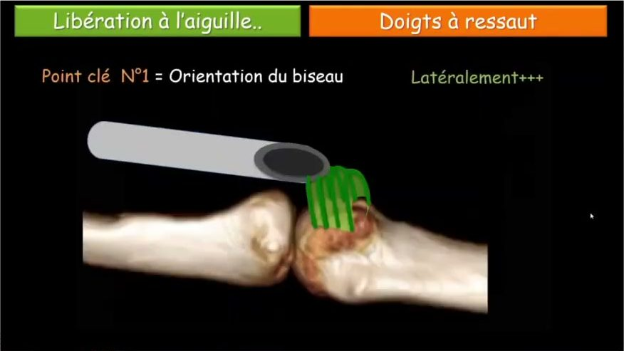
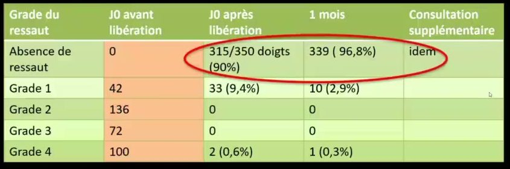

# Traitement à l'aiguille des pathologies de la main

> [!abstract] L'essentiel
> **Une aiguille 21 G sous échographie libère la poulie A1 du doigt à ressaut : 90 % de ressauts levés à J0, 97 % à 1 mois** ; aussi De Quervain et ECU.

> [!success] À retenir
> 1. Doigt à ressaut : **biseau orienté latéralement** (perpendiculaire aux fibres de A1), allers-retours sans toucher le tendon + **0,5 mL** de corticoïde ; satisfaction **98 %** ; au pouce, attention au **nerf collatéral radial**.
> 2. **De Quervain** : repérer d'abord la **branche sensitive du nerf radial** ; rétinaculum épais (**≈ 1,9 mm**, Doppler **71 %**), **cloison dans 49 %** à décrire (types 1 / 2a / 2b) ; échec **× 14** en contexte d'arrêt de travail.
> 3. **Kyste dorsal du carpe** (ponction + criblage du collet) : 68 % améliorés mais seulement **21 % de guérison**, **15 % opérés** ; **ECU sténosant** si rétinaculum **> 1,3 mm**.

## Images clés
 [▶ 7:24](https://www.youtube.com/watch?v=QugC65VIs6E&t=444s)
 [▶ 4:41](https://www.youtube.com/watch?v=QugC65VIs6E&t=281s)
 [▶ 5:05](https://www.youtube.com/watch?v=QugC65VIs6E&t=305s)

## Points clés
- **Calcifications** (MCP) : comme à l'épaule, adaptation de la classification de Molé ; calcification hypoéchogène, molle, en migration (« queue de comète ») = bon pronostic. Aiguille 25 G + lidocaïne → cavitation et issue de « lait calcique ».
- **Kystes dorsaux** : vidange puis traitement du collet dans le DCSS (sur le faisceau dorsal scapho-lunaire). Résultats préliminaires (diapo) : 68 % de patients améliorés, mais seulement 21 % de guérison, 68 % de récidive, 15 % opérés secondairement.
- **Doigt à ressaut** (tutoriel en ligne) : patient allongé, aiguille 21 G précourbée avec **biseau orienté latéralement** (perpendiculaire aux fibres de la poulie A1), anesthésie locale abondante dans la gaine, allers-retours sans toucher le tendon ; flexion-extension pour céder un ressaut résiduel ; injection finale de 0,5 mL de Diprostène.
- Pouce : poulie oblique, barrage de compresses pour le gel, mouvements ascensionnels plutôt qu'allers-retours ; attention au rameau interdigital radial croisant la poulie (névromes rapportés).
- Résultats doigt à ressaut (série de 350) : 90 % de disparition complète du ressaut à J0, 97 % de bons résultats à 1 mois avec infiltration concomitante ; douleur modérée 13 %, plus importante 6 % ; satisfaction 98 %.
- Complication : ténosynovite exsudative très inflammatoire 1 à 2 mois après le geste, cédant à une infiltration de corticoïde.
- **De Quervain** : repérage préalable de la branche sensitive du nerf radial, abord longitudinal distal, aiguille au zénith du rétinaculum (épaisseur moyenne 1,9 mm, hyperhémie Doppler dans 71 % des cas, cloison dans 49 %) ; trois types (1 : 51 %, 2a : 23 %, 2b : 26 %) : sans cloison (zénith), rétinaculum épais + cloison (zénith + grattage de la cloison), épaississement isolé autour du court extenseur du pouce (zénith + cloison). Critère de fin : diffusion harmonieuse intragainée sans fuite sous-cutanée.
- Résultats De Quervain : amélioration significative douleur/fonction à 1 mois et durable ; satisfaction 81 %, 6 % d'échecs complets, majoration des douleurs ~3 jours dans 19 % des cas (arrêt de travail 3 jours, attelle) ; pas d'influence de la cloison ; échec 14 fois plus fréquent en contexte d'arrêt de travail.
- **ECU sténosant** : rétinaculum > 1,3 mm, hypertrophique et inflammatoire, déprimant le tendon.
- Arguments pour l'aiguille : pas de bistouri (moins conflictuel avec les chirurgiens), absence de marquage CE coûteux pour un dispositif dédié, faible coût, approche « low-tech ».

## Pièges et diagnostics différentiels
- Allers-retours sur une poulie oblique du pouce : risque de lésion tendineuse.

> [!WARNING] À ne pas manquer
> Branche sensitive du nerf radial (De Quervain) et rameau interdigital radial du pouce : à repérer avant le geste.

> [!TIP] Pour le compte rendu
> Décrire épaisseur et hyperhémie du rétinaculum, présence et type de cloison (De Quervain), épaisseur de la poulie, échostructure d'une calcification.

## Liens
- Congrès : [[SIMS 2022 - Index]]
- Voir aussi : [[Les injections abarticulaires]], [[Le traitement percutané des kystes]], [[L'échochirurgie du canal carpien]]
