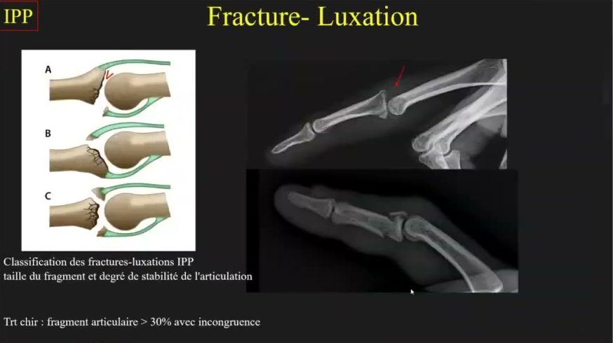
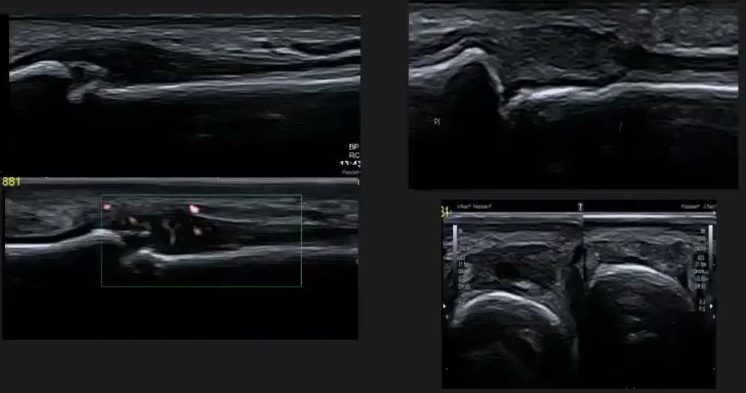
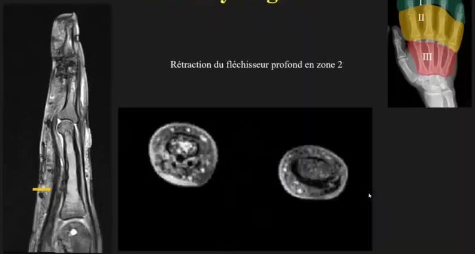

# Traumatismes des articulations interphalangiennes

> [!abstract] L'essentiel
> **Traumatisme IP : radiographies face + profil + 3/4 d'abord (arrachement, subluxation, rotation), échographie pour extenseur et fléchisseur, IRM pour les cas difficiles** ; ne pas rater le jersey finger.

> [!success] À retenir
> 1. Fracture-luxation de l'IPP : chirurgie si **fragment articulaire > 30 %** avec incongruence ; chercher le **signe du V** (réduction imparfaite).
> 2. **Mallet finger** : chirurgie si fragment **> 1/3** de la surface articulaire avec subluxation ; sinon attelle en extension (risque de **col de cygne**).
> 3. **Jersey finger** méconnu dans **50 %** des cas, traitement toujours chirurgical : préciser le **niveau de rétraction du fléchisseur profond** (IRM si zone 2) et la taille du fragment.

## Images clés
 [▶ 5:03](https://www.youtube.com/watch?v=j7seCBe-JTw&t=303s)
 [▶ 7:47](https://www.youtube.com/watch?v=j7seCBe-JTw&t=467s)
 [▶ 10:22](https://www.youtube.com/watch?v=j7seCBe-JTw&t=622s)

## Points clés
- IPP et IPD : un seul degré de liberté (flexion-extension) ; l'IPP assure à elle seule environ 40 % de la flexion du doigt.
- Contention passive : ligaments collatéraux propre et accessoire (en continuité avec la plaque palmaire) ; contention active : fléchisseurs et extenseurs.
- Appareil extenseur : bandelette médiane insérée sur la base de P2, bandelettes latérales réunies en tendon terminal sur la base de P3.
- Fléchisseurs : fléchisseur profond sur P3, maintenu par les vincula courte et longue (rôle vasculaire) ; fléchisseur superficiel en deux languettes sur P2, laissant passer le profond.
- **Entorses latérales** : 3e à 5e doigts, choc latéral indirect (ballon) doigt en extension ; traitement fonctionnel le plus souvent ; attention à un fragment d'arrachement volumineux. Angulation > 20° = rupture totale du ligament collatéral ; 15-20° : ruptures souvent partielles.
- **Luxations** (surtout IPP dorsales, hyperextension + compression axiale) : réduction et immobilisation ; vigilance sur une réduction incomplète (incarcération d'une bandelette latérale) et sur le **signe du V** (réduction imparfaite). Fragment articulaire > 30 % avec incongruence = chirurgie.
- **Fractures** : 3 incidences obligatoires pour juger la rotation ; fractures instables souvent déplacées et chirurgicales ; scanner pour les fractures complexes de la base.
- **Boutonnière** : choc dorsal sur P2, rupture de la bandelette médiane, hyperextension de l'IPD ; le chirurgien a besoin de l'imagerie surtout pour un fragment de la base de P2 ; sinon immobilisation de l'IPP avec exercices de flexion de l'IPD.
- **Mallet finger** : choc axial au bout du doigt, rupture du tendon terminal ; forme tendineuse (interruption ou simple hyperhémie) ou osseuse ; chirurgie si fragment > 1/3 de la surface articulaire et subluxation ; sans traitement, évolution en col de cygne avec arthrose précoce.
- **Jersey finger** : flexion contrariée puis hyperextension (maillot agrippé), annulaire surtout ; méconnu dans 50 % des cas à la phase initiale ; traitement toujours chirurgical. Classification selon le niveau de rétraction et la taille du fragment : type 2 le plus fréquent (petit fragment retenu par la poulie) ; type 1 : rétraction importante, rupture des vincula, risque vasculaire.

## Sémiologie et technique d'imagerie
- Radiographies : face, profil, 3/4 ; rechercher arrachements, subluxations, signe du V.
- Échographie : interruption de la bandelette médiane ou du tendon terminal, comparaison controlatérale, testing dynamique.
- IRM : niveau de rétraction du fléchisseur profond (par exemple en zone 2), absence du profond entre les languettes du superficiel.

## Pièges et diagnostics différentiels
- Rétraction en zone 2 difficile à voir en échographie.
- Réduction incomplète d'une luxation de l'IPP.

> [!WARNING] À ne pas manquer
> Jersey finger méconnu une fois sur deux, alors que le traitement est toujours chirurgical : rechercher le moignon rétracté du fléchisseur profond.

> [!TIP] Pour le compte rendu
> Indiquer taille du fragment (en proportion de la surface articulaire), congruence, subluxation, angulation latérale et, pour un jersey finger, le niveau de rétraction du fléchisseur profond.

## Liens
- Congrès : [[SIMS 2022 - Index]]
- Voir aussi : [[La plaque palmaire des doigts]], [[Prise en charge médicale des entorses du doigt]], [[Les déformations post-traumatiques]]
