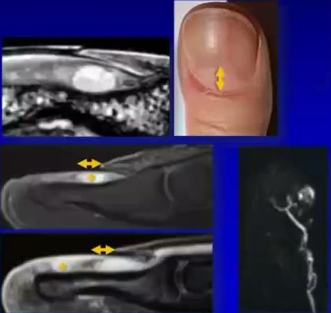
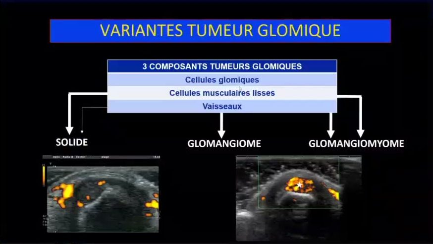
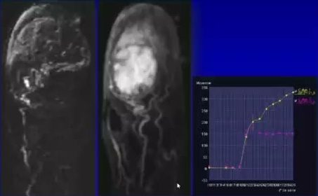

# Tumeurs de l'ongle, il n'y a pas que la glomique

> [!abstract] L'essentiel
> **Affirmer la (pseudo)tumeur, la situer par rapport à la matrice (report de la longueur de la lunule) et chercher l'envahissement osseux** ; puis caractériser avec la clinique.

> [!success] À retenir
> 1. **Sosies** de la glomique (bien limités, très hyper T2, rehaussement intense) : angioléiomyome, hémangiome capillaire lobulaire, malformation vasculaire (→ angio-IRM).
> 2. **Faux amis** : rehaussement hétérogène ou **progressif sans plateau (courbe de type 5)** = fibromyxome acral superficiel (jusqu'à **5 cm**) ; kyste mucoïde (pédicule IPD), kyste épidermoïde (coque).
> 3. Glomique **solide** (muscle lisse) : signal proche du derme et **Doppler pauvre** ; une IRM négative n'élimine pas le diagnostic.

## Images clés
 [▶ 8:45](https://www.youtube.com/watch?v=Z_x1DtADArY&t=525s)
 [▶ 5:01](https://www.youtube.com/watch?v=Z_x1DtADArY&t=301s)
 [▶ 6:44](https://www.youtube.com/watch?v=Z_x1DtADArY&t=404s)

## Points clés
- La demande d'imagerie unguéale la plus fréquente est la recherche de tumeur glomique, de la certitude clinique (simple caractérisation anatomique/bilan d'extension) jusqu'à la demande sans renseignement — d'où l'intérêt d'interroger soi-même le patient.
- **Sosies** de la tumeur glomique : lésions dermiques du lit, iso ou discrètement hyper T1, très hyper T2, bien limitées, vascularisées. Exemples : angioléiomyome (tumeur vasculaire rare à la main, issue de la média veineuse, sans cellule glomique), hémangiome capillaire lobulaire (granulome pyogénique) sous-matriciel, souvent après traumatisme (tablette interrompue).
- Les tumeurs glomiques volumineuses deviennent polymorphes : différentiel avec les malformations vasculaires (haut débit avec flow-voids, bas débit) → angio-IRM ; la malformation s'étend souvent plus en proximal.
- Trois composantes : cellules glomiques, cellules musculaires lisses, vaisseaux. Riches en vaisseaux (glomangiome, glomangiomyome) : très hyper T2, fort rehaussement, hypervascularisation Doppler ; **formes solides** (muscle lisse prédominant) : signal proche du derme, Doppler quasi absent.
- **Faux amis** : rehaussement hétérogène, moins intense, signal hétérogène :
  - fibromyxome acral superficiel : tumeur mésenchymateuse, 2 fois plus fréquente chez l'homme, douloureuse dans 40 % des cas, plus volumineuse (jusqu'à 5 cm), hétérogène en T2, encoche osseuse, **rehaussement dynamique continu** sans plateau ni décroissance (composante myxoïde), à l'inverse de la tumeur glomique ;
  - kyste mucoïde sous-matriciel : très intense et homogène en T2, pas de rehaussement central ou rehaussement périphérique, petit pédicule articulaire, arthrose IPD associée ;
  - kyste épidermoïde : hétérogène, hypointensité centrale, échos internes multiples, coque périphérique seule rehaussée.
- Message principal : rendre service au clinicien en **affirmant** une tumeur ou pseudo-tumeur sous-matricielle (zone la plus difficile d'accès clinique et chirurgical, la matrice étant fragile).
- Les limites de la matrice distale (vs lit « stérile ») sont mal visibles en imagerie : **mesurer la lunule** sur le patient et reporter cette longueur depuis le repli proximal pour déterminer si la lésion est sous-matricielle ou distale.

## Sémiologie et technique d'imagerie
- IRM avec injection, séquences dynamiques (courbes de rehaussement) ; échographie-Doppler.
- Rechercher l'extension osseuse (encoche, scalloping).

## Pièges et diagnostics différentiels
- Première IRM négative n'élimine pas une tumeur glomique (demandes de seconde IRM).
- Tumeur glomique solide peu vascularisée, proche du derme normal.

> [!WARNING] À ne pas manquer
> Un rehaussement continu sans plateau ni lavage doit faire douter de la tumeur glomique (lésion myxoïde).

> [!TIP] Pour le compte rendu
> Affirmer ou non la lésion, sa position par rapport à la matrice (à partir de la longueur de la lunule), sa taille, son extension osseuse et le caractère « compatible avec une tumeur glomique » ou le diagnostic alternatif évoqué.

## Liens
- Congrès : [[SIMS 2022 - Index]]
- Voir aussi : [[Radio anatomie de l'ongle]], [[Indication de l'imagerie en pathologie unguéale]], [[Prise en charge chirurgicale des lésions traumatiques et tumorales de l'ongle]]
