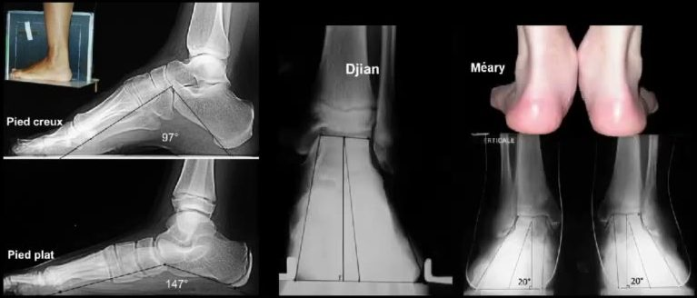
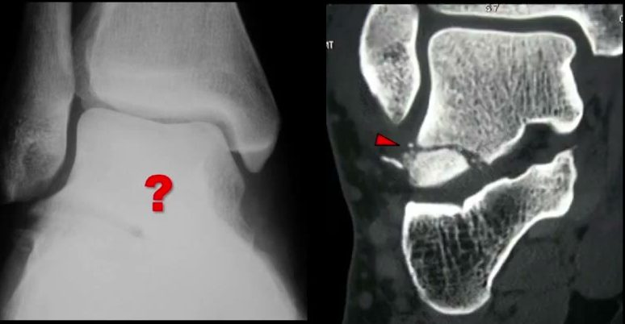
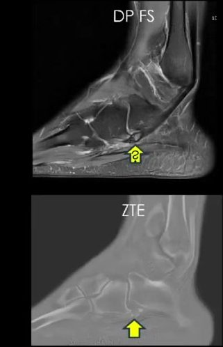

# 50 ans d'imagerie du pied

> [!abstract] L'essentiel
> **Le socle reste radiographies en charge + échographie, puis la technique la plus adaptée** : scanner pour l'os, IRM 3D pour les parties molles, cone beam en charge pour la 3D debout.

> [!success] À retenir
> 1. **Radiographies toujours en charge** (angles de Djian, Méary) ; cheville de face en équin = rayon tangent au dôme postérieur → **pincement antérieur méconnu**.
> 2. Arrière-pied, Chopart, Lisfranc : superpositions → **scanner** devant une radio « normale » mais une clinique franche (fracture occulte).
> 3. IRM : 3D DP FS et **séquences « os » (ZTE/PETRA)** pour se passer du scanner ; **cone beam en charge** (voxel 0,3 mm) : 3D debout, limité en contraste parties molles.

## Images clés
 [▶ 2:54](https://www.youtube.com/watch?v=PqyeDItBP_Q&t=174s)
 [▶ 7:24](https://www.youtube.com/watch?v=PqyeDItBP_Q&t=444s)
 [▶ 10:14](https://www.youtube.com/watch?v=PqyeDItBP_Q&t=614s)

## Points clés
- Pied humain : chef-d'œuvre biomécanique (3 millions d'années d'évolution) ; sols durs, chaussures fermées, talons et surpoids ont créé des « technopathies ».
- **Radiographie** : disponible, peu coûteuse, reproductible, comparable dans le temps, en charge (angles sagittaux et frontaux), possible dans la chaussure, dynamique (conflit antérieur chez un footballeur, conflit postérieur chez une danseuse). Limites : projection d'un volume (vision 3D et anatomie solides nécessaires), superpositions, squelette seul. Cheville de face réalisée en équin → rayon tangent au dôme postérieur alors que les pincements arthrosiques sont antérieurs → faux négatifs.
- **EOS** : le membre inférieur est un continuum (varus/flessum sus-jacent, flexion des genoux compensatrice à intégrer, ex. avant arthrodèse).
- **Scanner** : excellent pour le squelette (fractures, synostoses, malformations, tumeurs), sans superpositions (arrière-pied, Chopart, Lisfranc), mais en décharge et médiocre pour les parties molles ; l'arthroscanner reste le gold standard du cartilage. Hommage à Léonard de Vinci, « inventeur » de l'imagerie en coupe il y a 520 ans.
- **IRM** : premières publications sur le pied en 1987 (T2 d'environ 15 min, 2D peu résolue) ; années 90 : antennes dédiées, saturation de graisse, T1 FS gadolinium, arthro-IRM ; aujourd'hui 2D ultra-résolue et surtout 3D avec reconstructions multiplanaires, séquences « os » type ZTE (fragmentation de l'os peroneum dans un POPS sans scanner). Limites : exigeante techniquement, non dynamique, en décharge.
- **Échographie** : années 80-90 (description de toute l'anatomie), années 2000 (imagerie harmonique, sondes matricielles) ; aujourd'hui résolution inframillimétrique, dynamique, parfois en charge (tunnel tarsien), très clinique ; exigeante, apprentissage long, toujours couplée à la radiographie en charge.
- **Cone beam en charge** (apparu en 2013) : haute résolution, irradiation réduite, reconstructions radiographiques, MPR, 3D, mesures 2D/3D (bientôt automatisées par IA) ; limites : contraste des parties molles, flou cinétique debout, pas de cotation spécifique, coût, faible diffusion en France.
- **IA** : aide au diagnostic des fractures, mesures automatisées, deep learning en IRM (équilibre qualité/durée).
- **RI** : des injections sous contrôle radio/arthrographique aux gestes échoguidés (années 80), puis guidages couplés (scanner, échographie, capteur plan) : gestes nerveux, destructions tumorales (chaud, froid), embolisations.

## Sémiologie et technique d'imagerie
- Couple de base : radiographies en charge de bonne qualité + échographie, complété par la technique la plus adaptée.

## Pièges et diagnostics différentiels
- Pathologie de l'arrière-pied masquée par les superpositions radiographiques : recourir au scanner.

> [!WARNING] À ne pas manquer
> Une radiographie de cheville de face en équin peut méconnaître un pincement arthrosique antérieur.

> [!TIP] Pour le compte rendu
> Toujours confronter à la radiographie en charge et à la clinique ; évolutions souhaitées : imagerie plus fonctionnelle, dynamique (4D) et en charge.

## Liens
- Congrès : [[SIMS 2024 - Index]]
- Voir aussi : [[Interactions entre le pied et les articulations du membre inférieur - place des nouvelles modalités]], [[Radiologie interventionnelle pied et cheville]], [[IRM d'une métatarsalgie centrale]]
